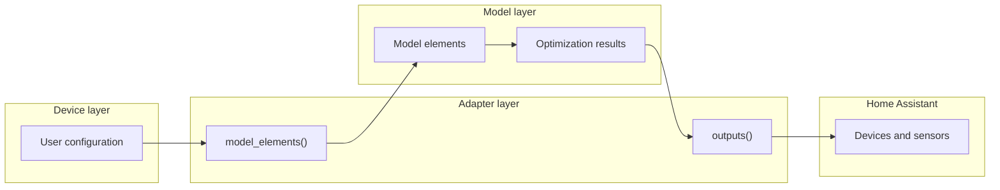

# Adapter layer

The adapter layer transforms device layer elements into model layer elements and maps optimization outputs back to user-facing device outputs.
This separation lets a single configured element create several model elements and devices.

## Purpose

HAEO separates user configuration from optimization modeling through distinct layers:

- **Device layer**: The element types a user configures, with Home Assistant sensor integration
- **Model layer**: Mathematical building blocks forming the linear programming problem
- **Adapter layer**: Transformation logic connecting these layers

This enables:

- **Composition**: One device layer element creates several model layer elements
- **Output mapping**: Model outputs map to one or more devices with user-facing sensor names

## Transformation flow

**Configuration to model** (`model_elements`): Transforms a loaded element config into `ModelElementConfig` dictionaries, discriminated by a model `element_type` from the `ELEMENTS` registry in `core/model/elements/__init__.py`.
An element with nothing to add to the network, such as one whose rules are compiled separately, returns an empty list.

**Model to devices** (`outputs`): Transforms the model outputs into each of the element's devices, keyed by device name and then output name.
Some adapters take the loaded `config` and the `periods` as keyword arguments to derive outputs, such as costs from prices.

## Adapter contract

Every adapter conforms to the `ElementAdapter` protocol in [`core/adapters/registry.py`](https://github.com/hass-energy/haeo/blob/main/custom_components/haeo/core/adapters/registry.py) and is registered in `ELEMENT_TYPES`, keyed by `ElementType`.
Besides the two methods, an adapter declares attributes that the rest of the integration reads instead of naming element types:

| Attribute      | Read by                                                                                      |
| -------------- | -------------------------------------------------------------------------------------------- |
| `advanced`     | The hub flow, which offers the type only in advanced mode                                    |
| `connectivity` | Connection selectors and topology validation, through `ConnectivityLevel`                    |
| `can_source`   | The policy flow, to decide whether the element can be a rule's source                        |
| `can_sink`     | The policy flow, to decide whether the element can be a rule's destination                   |
| `switchboard`  | Setup, which creates a switchboard element outside advanced mode when no such element exists |
| `device_names` | Device cleanup, which removes devices the element no longer creates                          |
| `buffer_roles` | The buffer flow, to decide what a buffer can count the element as                            |

Adding a behavior that differs between element types means adding an attribute here, not a list of types where the behavior is used.

An adapter whose elements choose in their own config whether they produce or consume power also implements `ConfiguredRolesAdapter`, whose `roles(config)` narrows `can_source` and `can_sink` for one configured element.

### Sub-element naming

When an adapter creates several model elements, they are named `{name}:{subname}`, such as `Grid:import` and `Grid:export`.
This prevents naming collisions and lets the coordinator trace a model element back to the configured element it belongs to.

## Related registries

Some element types carry schema-level behavior that others do not.
These are registered beside `ELEMENT_CONFIG_SCHEMAS` in [`core/schema/elements/__init__.py`](https://github.com/hass-energy/haeo/blob/main/custom_components/haeo/core/schema/elements/__init__.py):

- **`ELEMENT_SURFACED_PRICE_HINTS`**: Policy pricing fields an element type shows on its own form.
    The value is stored as a policy rule rather than in the element's config, and the element's flow lists each surfaced field in one of its sections.
- **`ELEMENT_REFERENCE_MAPPERS`**: For element types whose config lists other elements by name, how each replaces those names through a resolver, dropping the names it returns nothing for.
    `map_element_references` applies them after renaming the connection targets any element's config holds.
    The element subentry flow uses it to rename an element everywhere it is named when the element is renamed.
    The config entry's update listener uses it to drop the names of deleted elements, removing an element left with nothing to do.

`FieldSchemaInfo` in `elements/input_fields.py` carries a field's value type and whether it is optional, read from the schema for the config flow.

## Integration points

The adapter layer integrates at two points:

**Network construction**: `build_network` in [`core/adapters/network_builder.py`](https://github.com/hass-energy/haeo/blob/main/custom_components/haeo/core/adapters/network_builder.py) calls `collect_model_elements()`, which calls each adapter's `model_elements()` and sorts the results by their model element's `add_order`.
It then runs [policy compilation](policy-compilation.md) and adds the compiled elements to the network.
`build_element_updaters` then returns, for each configured element, an updater that calls `model_elements()` again with new values and writes them to the live model elements.

**Output processing**: [`coordinator/coordinator.py`](https://github.com/hass-energy/haeo/blob/main/custom_components/haeo/coordinator/coordinator.py) calls `outputs()` after each optimization to build the values of each element's sensors.

## Adding element types

See [Adding element types](architecture.md#adding-element-types) and the existing adapters in [`core/adapters/elements/`](https://github.com/hass-energy/haeo/tree/main/custom_components/haeo/core/adapters/elements).

## Next steps

- :material-chart-line:{ .lg .middle } **Modeling documentation**

    ---

    Understand the model layer mathematical formulation.

    [:material-arrow-right: Network optimization](../modeling/index.md)

- :material-file-document:{ .lg .middle } **Element configuration**

    ---

    User guide for device layer elements.

    [:material-arrow-right: Elements overview](../user-guide/elements/index.md)

- :material-database:{ .lg .middle } **Data loading**

    ---

    How sensor data flows into configuration.

    [:material-arrow-right: Data loading guide](data-loading.md)

