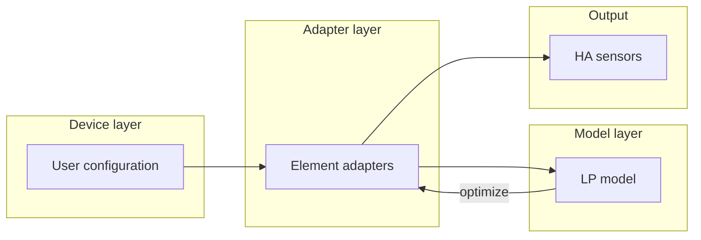
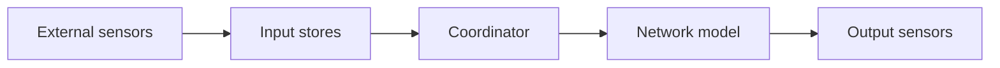

# Architecture

HAEO follows Home Assistant integration patterns with specialized optimization components.
This guide focuses on HAEO-specific architecture and where each part lives.
For Home Assistant fundamentals, see the [Home Assistant developer documentation](https://developers.home-assistant.io/).

## Layered architecture

HAEO separates user configuration from mathematical modeling through two layers:

**Device layer**: The element types a user configures, one per member of `ElementType`.
They read Home Assistant sensors and present user-facing outputs.

**Model layer**: Mathematical building blocks that form the linear programming problem.

The [adapter layer](adapter-layer.md) transforms between these layers, so a single device layer element can create several model elements and devices.

See [Modeling documentation](../modeling/index.md) for detailed layer descriptions.

## Setup sequence

`async_setup_entry` in [`__init__.py`](https://github.com/hass-energy/haeo/blob/main/custom_components/haeo/__init__.py) builds the runtime in this order:

1. The [HorizonManager](horizon-manager.md) is created and stored in `runtime_data`.
2. `build_input_stores` creates one input store per configured field into `runtime_data.input_stores`, and the calendar loader starts.
3. The coordinator is created from the same subentry snapshot.
4. The input platforms (Number, Switch) wrap the stores as entities, and setup waits for every store to settle.
5. `coordinator.async_initialize()` builds the network, then the first optimization runs.
6. The output platform (Sensor) adds the optimization status sensor and the output sensors.

## Packages

The integration lives under `custom_components/haeo/`.
The `core/` package holds everything with no Home Assistant dependency, which import-linter enforces.

### Core (`core/`)

- **`core/schema/`**: Element config schemas and data TypedDicts, field hints, form sections, and pure migration transforms.
    The registries `ELEMENT_CONFIG_SCHEMAS`, `ELEMENT_SURFACED_PRICE_HINTS`, and `ELEMENT_REFERENCE_PRUNERS` live in `core/schema/elements/__init__.py`.
- **`core/adapters/`**: One adapter per element type registered in `ELEMENT_TYPES` (`registry.py`), [policy compilation](policy-compilation.md), and `network_builder.py`, whose `build_network` turns loaded configs into a `Network` and returns an updater per element.
- **`core/data/`**: The `InputStore` behind each input, and the loaders, extractors, and utilities that turn entity states into time series.
    See the [Data loading guide](data-loading.md).
- **`core/model/`**: The LP model.
    `Network` aggregates element constraints and costs, `solver.py` wraps HiGHS, `linear.py` holds the array expressions, and `infeasibility.py` names conflicting constraints and relaxes them when allowed.
    See the [Energy models guide](energy-models.md).
- **`core/state.py`**, **`core/annotated_state.py`**, **`core/context.py`**: The state machine protocol the loaders read through, state machines that add calendar events and meter totals to entity states, and the `OptimizationContext` snapshot each optimization records for diagnostics.

### Integration

- **`config_flow.py`, `flows/`**: The hub, options, and element subentry flows.
    Element flows derive from `ElementSubentryFlow` (`flows/element_flow.py`) and declare their element type and form sections, which come from `flows/sections/`.
    See the [Config flow guide](config-flow.md).
- **`elements/`**: Input field metadata derived from the schemas, such as `get_input_fields` and `FieldSchemaInfo`, and helpers that read element subentries.
- **`horizon.py`**: The [HorizonManager](horizon-manager.md).
- **`input_stores.py`**, **`inputs/`**: Build the input stores from subentries, and the Home Assistant readers behind them: the state machine adapter, the calendar loader, and meter history.
    See the [Input entities guide](inputs.md).
- **`coordinator/`**: The [coordinator](coordinator.md), which applies changed inputs to the network, solves it in the executor, and builds outputs.
    `coordinator/network.py` checks network connectivity and manages the related repair issues.
- **`number.py`, `switch.py`, `sensor.py`, `entities/`**: The entity platforms and their entity classes, including the optimization status sensor (`entities/haeo_status.py`) and the horizon sensor.
- **`repairs.py`**: Creates and dismisses repair issues, such as unavailable inputs, a disconnected network, and failed, infeasible, or relaxed optimizations.
- **`services.py`**: The `haeo.optimize` and `haeo.save_diagnostics` actions.
- **`diagnostics/`**: Diagnostics export, including the inputs an optimization used so it can be replayed.
- **`migrations/`**: Config entry migrations, which apply the transforms in `core/schema/migrations/`.
- **`translations/`**: User-facing strings.
- **`www/`**: The built Lovelace cards the integration serves.
    The forecast card's source is in `frontend/haeo-forecast-card/` at the repository root.

## Optimization

The coordinator calls `Network.optimize()` in an executor thread.
The network minimizes cost and, among equally cheap plans, a time-preference secondary objective, using one blended solve with a calibrated weight.
Model parameters are `TrackedParam` descriptors, so changing an input invalidates only the constraints that read it, and the next solve warm starts from the previous basis.

When no plan satisfies every constraint, the network raises `InfeasibleError` naming the conflicting rows.
With the hub's `relax_infeasible` option on, it instead finds a plan with the fewest constraints relaxed and records them in `Network.relaxations`.
The coordinator turns both outcomes into repair issues; see [Error handling](coordinator.md#error-handling).

Every failed optimization shows on the optimization status sensor, which stays available while the output sensors do not.

## Extension points

### Adding element types

The [elements skill](https://github.com/hass-energy/haeo/blob/main/.agents/skills/elements/SKILL.md) lists every registry an element type must be added to.
In outline:

1. Define the schema in `core/schema/elements/{element_type}.py` and register it in `ELEMENT_CONFIG_SCHEMAS`.
2. Implement the adapter in `core/adapters/elements/{element_type}.py` and register it in `ELEMENT_TYPES`.
3. Implement the flow in `flows/elements/{element_type}.py`.
4. Add translations, tests colocated with the source, and user and modeling documentation.

### Custom field types

Fields are described by `FieldHint` in `core/schema/field_hints.py`, attached to the schema with `Annotated`:

- Add an `OutputType` when the field holds a new kind of quantity, with its unit and limits in `elements/field_hints.py`
- Add a `FieldHint` attribute when the field needs to load or present differently
- See [Field hints](config-flow.md#field-hints) for the available hints

## Related documentation

- :material-timer-outline:{ .lg .middle } **Horizon manager**

    ---

    Synchronized forecast time windows.

    [:material-arrow-right: Horizon manager guide](horizon-manager.md)

- :material-import:{ .lg .middle } **Input entities**

    ---

    Intermediate input entity layer.

    [:material-arrow-right: Input entities guide](inputs.md)

- :material-sync:{ .lg .middle } **Coordinator guide**

    ---

    Event-driven update patterns.

    [:material-arrow-right: Coordinator guide](coordinator.md)

- :material-network:{ .lg .middle } **Energy models**

    ---

    Network entities and constraints.

    [:material-arrow-right: Energy models](energy-models.md)

- :material-test-tube:{ .lg .middle } **Testing**

    ---

    Testing patterns and fixtures.

    [:material-arrow-right: Testing guide](testing.md)

