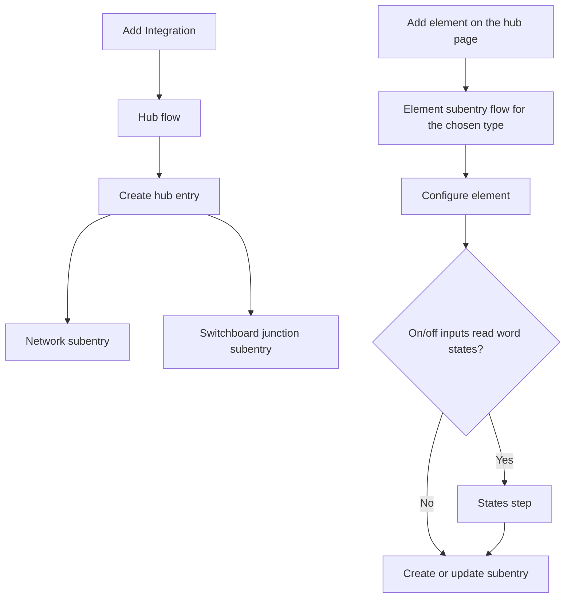

# Configuration flow development

Guide to HAEO's ConfigSubentry-based configuration flow implementation.

## Overview

HAEO uses Home Assistant's **ConfigSubentry architecture**, where each element is a subentry of a hub entry:

1. **Hub flow** ([`flows/hub.py`](https://github.com/hass-energy/haeo/blob/main/custom_components/haeo/flows/hub.py)): Creates the hub entry with its network and switchboard subentries
2. **Element flows** ([`flows/elements/`](https://github.com/hass-energy/haeo/tree/main/custom_components/haeo/flows/elements)): One `ConfigSubentryFlow` per element type, each creating and reconfiguring that type's subentries
3. **Options flow** ([`flows/options.py`](https://github.com/hass-energy/haeo/blob/main/custom_components/haeo/flows/options.py)): Edits the hub settings

This architecture follows Home Assistant's native [subentry pattern](https://developers.home-assistant.io/docs/config_entries_config_flow_handler/).
Elements appear as subentries under the hub in the UI, and their devices are linked to the hub through `config_subentry_id`.

For general information on config flows, see the [Home Assistant Config Flow documentation](https://developers.home-assistant.io/docs/config_entries_config_flow_handler/) and [Data Entry Flow](https://developers.home-assistant.io/docs/data_entry_flow_index/).

## Architecture



The hub offers one subentry type per element type registered in `ELEMENT_TYPES`.
`HubConfigFlow.async_get_supported_subentry_types()` hides the types whose adapter is marked `advanced` unless the hub has **Expose raw model elements** enabled.

## Hub flow

The hub flow creates the main integration entry that acts as the parent of element subentries and hosts the optimization coordinator.

### Hub entry structure

Hub entries are identified by `integration_type: "hub"` in their data.
Hub settings are stored in `data` under section keys, not in `options`.
This is the shape after the options flow has saved every setting; the hub flow itself stores only the name, horizon, debounce window, and advanced mode.

```python
{
    "integration_type": "hub",
    "common": {
        "name": "Home Energy System",
        "horizon": {"type": "preset", "value": "5_days"},
    },
    "advanced": {
        "debounce_seconds": 30,
        "advanced_mode": False,
        "relax_infeasible": False,
    },
    "record_forecasts": False,
}
```

The form uses sectioned schemas (`common`, `advanced`) built in [`flows/__init__.py`](https://github.com/hass-energy/haeo/blob/main/custom_components/haeo/flows/__init__.py).
The planning horizon field is a `ChooseSelector` between a preset and a forecast sensor, built in [`flows/horizon.py`](https://github.com/hass-energy/haeo/blob/main/custom_components/haeo/flows/horizon.py).
The stored `horizon` is either a preset value as shown above or an entity value such as `{"type": "entity", "value": ["sensor.planning_horizon"]}`.
The hub and options flows both validate a forecast sensor with `validate_horizon()` before saving it.

### Key implementation points

- Hub flow uses a standard config flow pattern with a single user step
- Prevents duplicate hub names by checking existing entries
- Creates the network subentry, which holds the optimization sensors, and the switchboard junction that other elements connect to
- Stores settings in `data` sections so the options flow can update them in place

## Element flows

Each element type has its own subentry flow class in `flows/elements/<element_type>.py`.
`get_element_flow_classes()` in [`flows/__init__.py`](https://github.com/hass-energy/haeo/blob/main/custom_components/haeo/flows/__init__.py) maps each `ElementType` to its flow class.

### Element entry structure

Element configuration is stored in the subentry's `data`.
The name and connection sit at the top level, and the inputs are grouped into the sections the element's schema declares.
Each input holds a schema value as described in [Schema vs data mode](#schema-vs-data-mode).

```python
{
    "element_type": "grid",
    "name": "Grid",
    "connection": {"type": "connection_target", "value": "Switchboard"},
    "pricing": {
        "price_source_target": {"type": "entity", "value": ["sensor.import_price"]},
        "price_target_source": {"type": "constant", "value": 0.05},
    },
    "power_limits": {
        "max_power_source_target": {"type": "constant", "value": 15.0},
        "max_power_target_source": {"type": "constant", "value": 5.0},
    },
}
```

The subentry's `title` matches `name`, and its `subentry_type` matches `element_type`.

### Base element flow classes

Every element flow subclasses `ElementSubentryFlow` in [`flows/element_flow.py`](https://github.com/hass-energy/haeo/blob/main/custom_components/haeo/flows/element_flow.py) and declares its `element_type` as a class attribute.
The base class provides name validation, the participants an element can connect to, endpoint validation, and the save path.
Before saving, it asks which states mean on and off for any on/off input that reads an entity reporting words rather than booleans.

Most element types configure a form of sectioned inputs.
Their flows subclass `SectionedElementSubentryFlow` in [`flows/sectioned_flow.py`](https://github.com/hass-energy/haeo/blob/main/custom_components/haeo/flows/sectioned_flow.py) and declare `element_type` and a `sections` tuple of `SectionDefinition`s as class attributes.
That class builds the form, defaults, validation, and stored config from those declarations.
Fields outside the sections come from overriding its hooks: `_top_level_entries` and `_top_level_defaults` add them to the form, `_section_entries` and `_section_defaults` adjust the sections, `_validate_fields` checks them, and `_config_fields` stores them.
It also shows the pricing fields an element type surfaces from policy rules (its `SurfacedPriceHint`s) in whichever of its sections lists them, and saves them as policy rules rather than in the element's config.

An element that connects to one other element subclasses `ConnectedElementSubentryFlow` in [`flows/connected_flow.py`](https://github.com/hass-energy/haeo/blob/main/custom_components/haeo/flows/connected_flow.py), which implements those hooks for the `connection` field, so its flow declares only `element_type` and `sections`.

Flows whose forms do not fit that pattern subclass `ElementSubentryFlow` directly, still declare `element_type` and `sections`, and implement their own steps.

### Connection endpoint filtering

Connection elements require selecting source and target endpoints from other configured elements.
The element flow filters available elements based on connectivity level and the **Expose raw model elements** hub setting.

Each adapter in `core/adapters/elements/` declares its level in its `connectivity` attribute.
The `ConnectivityLevel` enum has three values:

- **`ALWAYS`**: Always shown in connection selectors
- **`ADVANCED`**: Only shown when **Expose raw model elements** is enabled
- **`NEVER`**: Never shown in connection selectors

An element is an endpoint only if a connection to it goes through the same constraints as any other power flow.
Plain balance points are endpoints.
An element that applies its own prices, forecasts, limits, or efficiencies on its own connection is `NEVER`, because a connection made directly to it would bypass them.

Existing configurations that already connect to a `NEVER` element are reported through the `invalid_connection_endpoints` repair issue.
`find_invalid_connection_endpoints()` in `validation.py` reads endpoints from the model connections each adapter produces, so it checks every element type the same way.

## ChooseSelector config flow pattern

Element types use a sectioned configuration flow with Home Assistant's `ChooseSelector`.
This selector provides a dropdown letting users pick between different input methods for each field.

### Input options

Each configurable field uses a `ChooseSelector` with these options:

| Choice   | Description                              | Storage format                       |
| -------- | ---------------------------------------- | ------------------------------------ |
| Entity   | Value comes from Home Assistant sensors  | `{"type": "entity", "value": [...]}` |
| Constant | User enters a fixed value directly       | `{"type": "constant", "value": ...}` |
| None     | Field is not used (optional fields only) | `{"type": "none"}`                   |

Required fields offer "Entity" and "Constant" choices.
Optional fields also include "None" to skip the constraint entirely.

### Sectioned flow

Most elements configure all inputs in a single step:

1. User enters element name and connection target
2. For each input field, user selects "Entity", "Constant", or "None"
3. Based on selection, user either picks entities from a dropdown or enters a constant value inline
4. Submit creates the element with all configuration

### UI sections

Config flows group related fields using `data_entry_flow.section` so advanced settings can be collapsed by default.
Shared section builders live in [`flows/sections/`](https://github.com/hass-energy/haeo/tree/main/custom_components/haeo/flows/sections), and their TypedDicts and constants live in [`core/schema/sections/`](https://github.com/hass-energy/haeo/tree/main/custom_components/haeo/core/schema/sections).
Element-specific sections are declared as `SectionDefinition`s in the element's flow, with their keys defined in the element's schema module.
When using sections, translation strings for labels must live under
`step.<step_id>.sections.<section_key>.data.<field_name>` (and `data_description` if needed).
The name and connection fields are top-level form fields, so their labels live under `step.<step_id>.data`.

The Home Assistant frontend only shows errors keyed by `base` or by a top-level form field, not by a field inside a section.
`validate_sectioned_choose_fields()` therefore keys each error by its section, which shows it above that section.
An error keyed by a field inside a section would re-show the form with no visible message.

### Implementation pattern

The ChooseSelector utilities are in [`flows/field_schema.py`](https://github.com/hass-energy/haeo/blob/main/custom_components/haeo/flows/field_schema.py):

- `build_choose_schema_entry()`: Creates the ChooseSelector with entity/constant/none options
- `build_choose_selector()`: Builds the selector with proper choice ordering
- `get_preferred_choice()`: Determines which choice should be pre-selected based on defaults or current config
- `get_choose_default()`: Provides default values for the nested selector
- `convert_choose_data_to_config()`: Converts ChooseSelector output to final config format
- `preprocess_sectioned_choose_input()`: Normalizes sectioned ChooseSelector input
- `validate_sectioned_choose_fields()`: Validates sectioned choose fields before conversion
- `convert_sectioned_choose_data_to_config()`: Converts sectioned ChooseSelector data into sectioned config

The choice ordering in `ChooseSelector` determines the pre-selected option.
The `get_preferred_choice()` function examines field defaults and current configuration to order choices appropriately.

### Entity creation

HAEO creates an input entity (number or switch) for every field configured with "Entity" or "Constant".
A constant field's entity is editable, so its value can be adjusted at runtime without reconfiguring the element.
An entity field's entity is driven by its source sensors and shows the value HAEO loaded from them.
Fields configured with "None" get no input entity.

## Field schema system

HAEO uses a typed schema system to define element configuration fields.
The schema says what each field stores, how the config flow presents it, and how its value loads at runtime.

### Element type registry

All element types are registered in `ELEMENT_TYPES` in [`core/adapters/registry.py`](https://github.com/hass-energy/haeo/blob/main/custom_components/haeo/core/adapters/registry.py), mapping each `ElementType` to its adapter.
Each adapter implements the `ElementAdapter` protocol:

- **Attributes**: `element_type`, `advanced`, `connectivity`, `can_source`, `can_sink`, `switchboard`, `device_names`, and `buffer_roles`
- **`model_elements(config)`**: Turns a loaded config into model element parameters
- **`outputs(name, model_outputs, ...)`**: Maps model outputs to the element's device outputs

[`elements/__init__.py`](https://github.com/hass-energy/haeo/blob/main/custom_components/haeo/elements/__init__.py) re-exports the registry and adds the Home Assistant-side lookups built from the schemas, such as `get_input_fields()` and `get_input_field_schema_info()`, which returns a `FieldSchemaInfo` for each input field.

### Schema vs data mode

Each element type has two TypedDict definitions in `core/schema/elements/<element_type>.py`:

**Schema mode** (`*ConfigSchema`): What the config flow stores in the subentry

- Each input field holds a schema value: `{"type": "entity", "value": [entity IDs]}`, `{"type": "constant", "value": number or bool}`, or `{"type": "none"}`
- Field hints attached with `Annotated` describe how each field loads

**Data mode** (`*ConfigData`): What the adapters and optimizer use

- Each input field holds its loaded value: a float, a bool, or a NumPy array over the horizon
- A field configured as "None" takes its field's default, such as 100% efficiency, or is left out when it has none

`GridConfigSchema` and `GridConfigData` in [`core/schema/elements/grid.py`](https://github.com/hass-energy/haeo/blob/main/custom_components/haeo/core/schema/elements/grid.py) are a small example of the pair.
`is_element_config_schema()` in [`core/schema/elements/conformance.py`](https://github.com/hass-energy/haeo/blob/main/custom_components/haeo/core/schema/elements/conformance.py) checks that stored data conforms to its element type's schema.

### Field hints

Field hints in [`core/schema/field_hints.py`](https://github.com/hass-energy/haeo/blob/main/custom_components/haeo/core/schema/field_hints.py) attach to schema fields through `Annotated` metadata:

- **`FieldHint`**: One input field.
    `output_type` sets its unit, device class, and default limits.
    `time_series` and `boundaries` choose between a scalar, a value per period, and a value per boundary.
    `default_mode` and `default_value` choose what the config flow pre-selects.
    `min_value`, `max_value`, `step`, `force_required`, `calendar`, and `meter` refine it further.
    `outputs` makes the field feed several inputs instead of being one, each loaded under its own name with its own hint and entity, such as one calendar feeding both a window and a due amount.
- **`SectionHints`**: The field hints for the fields inside a section
- **`ListFieldHints`**: The field hints for each item of a list field, such as policy rules
- **`SurfacedPriceHint`**: A pricing field shown on an element's form but stored as a policy rule

`elements/field_hints.py` turns these hints into the `InputFieldInfo` that the config flow and the input entities use.
A new kind of field is usually a new `OutputType` or a new hint attribute rather than a new class.

### Data loading flow

The schema system integrates with data loading:

1. The user picks "Entity", "Constant", or "None" for each field, and the config flow stores the schema value (Schema mode)
2. `validate_sectioned_choose_fields()` checks the input before it is stored
3. At setup, each entity or constant field gets an input store, which resolves its value with `resolve_field` as its field hint directs
4. The coordinator assembles each element's Data mode config from the stores' resolved values with `load_element_config_from_values`
5. Adapters receive the Data mode config and create model elements

For details on loading, see [Data loading](data-loading.md).

## Options flow

The options flow edits the hub settings after initial setup: the planning horizon, the debounce window, **Expose raw model elements**, relaxing infeasible plans, and forecast recording.
Elements are managed as subentries, not through the options flow.

The options flow implementation is in [`flows/options.py`](https://github.com/hass-energy/haeo/blob/main/custom_components/haeo/flows/options.py).
It writes the settings back into the hub entry's `data` sections, and the entry's update listener reloads the integration to apply them.

## Element management

Users add, reconfigure, and delete elements as subentries from the hub's integration page.
Each element type the hub supports appears as an add option there, and each subentry's menu offers reconfigure and delete.
Reconfiguring an element runs its flow's `reconfigure` step, which shows the same form as creation.
See the [user configuration guide](../user-guide/configuration.md) for end-user instructions.

## Testing config flow

Config flow testing uses Home Assistant's [testing fixtures](https://developers.home-assistant.io/docs/development_testing/#test-fixtures) and follows standard patterns.

Hub and options flow tests are in [`flows/tests/`](https://github.com/hass-energy/haeo/tree/main/custom_components/haeo/flows/tests), and each element type's flow tests are in [`flows/elements/tests/`](https://github.com/hass-energy/haeo/tree/main/custom_components/haeo/flows/elements/tests).
Shared element flow tests in `flows/tests/test_element_flows.py` run against every element type using the configurations in `flows/tests/test_data/<element_type>.py`.
See the [testing guide](testing.md) for details.

## Related documentation

<div class="grid cards" markdown>

- :material-sitemap:{ .lg .middle } **Architecture**

    ---

    Overall system design.

    [:material-arrow-right: Architecture guide](architecture.md)

- :material-database:{ .lg .middle } **Data loading**

    ---

    Field types and data validation.

    [:material-arrow-right: Data loading guide](data-loading.md)

- :material-network:{ .lg .middle } **Energy models**

    ---

    Element type implementations.

    [:material-arrow-right: Energy models](energy-models.md)

- :material-test-tube:{ .lg .middle } **Testing**

    ---

    Testing patterns for config flows.

    [:material-arrow-right: Testing guide](testing.md)

- :material-file-document:{ .lg .middle } **User configuration guide**

    ---

    End-user configuration instructions.

    [:material-arrow-right: Configuration guide](../user-guide/configuration.md)

- :material-home-assistant:{ .lg .middle } **Home Assistant config flow**

    ---

    Upstream pattern documentation.

    [:material-arrow-right: HA Config Flow](https://developers.home-assistant.io/docs/config_entries_config_flow_handler/)

- :material-home-assistant:{ .lg .middle } **Data entry flow**

    ---

    Flow framework reference.

    [:material-arrow-right: Data Entry Flow](https://developers.home-assistant.io/docs/data_entry_flow_index/)

</div>
