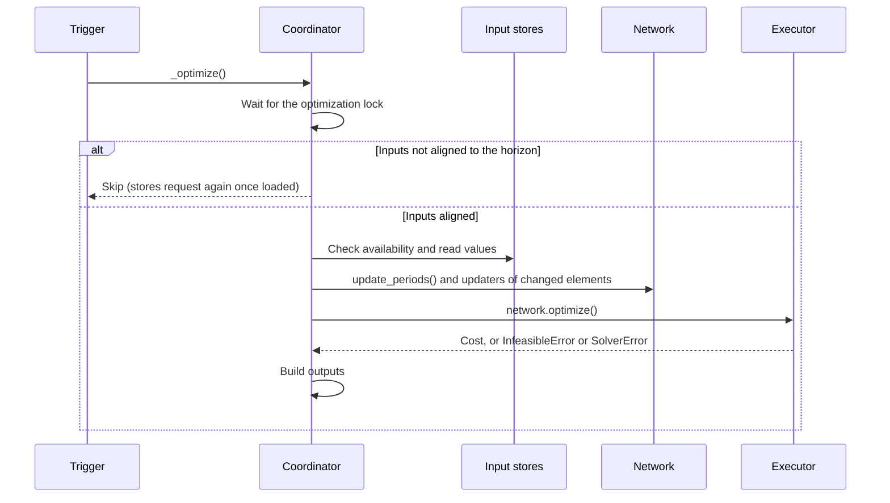
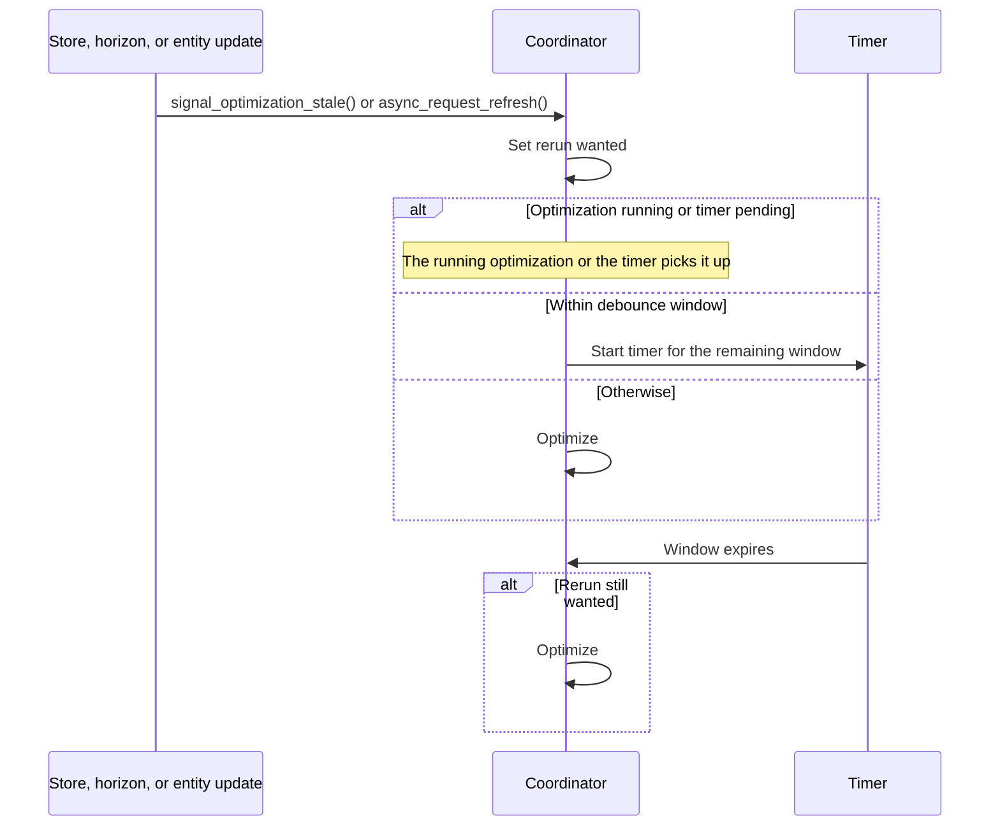

# Data update coordinator

The coordinator runs optimizations when inputs change and distributes the results to sensors.

## Purpose

HAEO's coordinator implements Home Assistant's [DataUpdateCoordinator pattern](https://developers.home-assistant.io/docs/integration_fetching_data/#coordinated-single-api-poll-for-data-for-all-entities).
The implementation is in [`coordinator/coordinator.py`](https://github.com/hass-energy/haeo/blob/main/custom_components/haeo/coordinator/coordinator.py).
[`coordinator/network.py`](https://github.com/hass-energy/haeo/blob/main/custom_components/haeo/coordinator/network.py) checks network connectivity and keeps its repair issues current.

The coordinator:

- Reads resolved values from the [input stores](inputs.md) in `runtime_data.input_stores`
- Applies the inputs that changed to the network built by `build_network`
- Runs the LP solver in an executor thread
- Builds the outputs that sensors read
- Reports failed optimizations through the status sensor and repair issues

Each hub config entry has one coordinator.
It is created during setup from the same snapshot of element subentries that built the input stores, so the elements it optimizes always match the stores it reads.
Adding, changing, or removing an element reloads the config entry, which builds a new coordinator.
An input entity writing a new value does not reload; it signals the coordinator instead.

The coordinator has no update interval.
Optimizations run when an input store reports a new value, when the [HorizonManager](horizon-manager.md) advances, or when one is requested.

## Initialization

`async_initialize()` runs once every input store has settled:

1. Assembles each element's config from the stores' values
2. Calls `build_network` in [`core/adapters/network_builder.py`](https://github.com/hass-energy/haeo/blob/main/custom_components/haeo/core/adapters/network_builder.py) to build the network, and `build_element_updaters` to build an updater per element for it
3. Serializes the topology for the frontend card and checks network connectivity
4. Subscribes to each input store, the auto-optimize switch, and the HorizonManager

Setup then runs the first optimization before adding the output sensors.

## Update cycle

### Warm start

Each store listener marks its element stale.
Before a solve, the coordinator copies the horizon's period durations onto the network and calls the updater of every stale element.
An updater calls the adapter's `model_elements()` with the new values and writes them to the `TrackedParam` descriptors on the live model elements, so only the constraints that read them are rebuilt.

All network changes happen on the event loop before the solve is handed to the executor, so the network is never mutated while it is being solved.

### Outputs

`_build_outputs()` stores the results in `coordinator.data.outputs`, keyed by element name, then device name, then output name.
Each adapter's `outputs()` maps the model outputs to its devices.
The network's own outputs, the optimization cost and duration, are keyed by the network subentry's title, which its sensors look them up by.
An `OutputData` marked `diagnostic` becomes a sensor in the diagnostic entity category.

## Scheduling

### Single-flight refresh

Every optimization goes through `_optimize()`, which holds a lock while it runs, so optimizations never overlap.
A request sets a single "rerun wanted" flag before waiting for the lock.
Each optimization reads every input as it is when it starts and clears the flag, so requests made while one runs share a single follow-up, and a request already met by an optimization that started after it does nothing.
An optimization is skipped while any available forecast input is still loading for a new horizon, since its `horizon_start` does not yet match the horizon's.
Those stores request another optimization once they load.

`async_refresh()` optimizes as soon as the lock allows, which setup uses for the first optimization.
The `haeo.optimize` action calls `async_run_optimization()`, which also bypasses the debounce window and the auto-optimize switch.
It checks alignment under the lock and raises the `inputs_not_aligned` error when inputs are loading for a new horizon, rather than skipping silently.

### Debouncing

Automatic requests wait out the debounce window:

`signal_optimization_stale()` does nothing while the auto-optimize switch is off; `async_request_refresh()`, which an entity update calls, requests one either way.
The debounce window, the hub's debounce seconds, starts when an optimization starts and again when it succeeds, which batches rapid input changes into one optimization.
An input that changes while an optimization runs requests a follow-up through the same window.

Turning the auto-optimize switch off cancels an optimization waiting out the debounce window and pauses the HorizonManager.
Turning it back on resumes the HorizonManager, whose notification requests an optimization that catches up on changes made while it was off.

## Error handling

Failures raise [UpdateFailed](https://developers.home-assistant.io/docs/integration_fetching_data/), which sets `last_update_success` to false and makes the output sensors unavailable.

### Optimization status

The optimization status sensor is added at setup and stays available.
It reads `coordinator.optimization_status`:

- `failed` when the latest optimization failed
- `success` when it succeeded
- `pending` before any optimization has produced data

Its `error` attribute shows `coordinator.optimization_error`.
Home Assistant notifies listeners only when an update switches between failing and succeeding, so `_async_refresh_finished` also notifies them after each repeated failure to keep that attribute current.

Once updates have kept failing for `FAILURE_SECONDS_BEFORE_REPAIR_ISSUE`, `_async_refresh_finished` raises the general `optimization_failure` repair issue with the error message, once per failing stretch, and the next success dismisses it.
A failure that raises a repair issue of its own fails the update with `ReportedUpdateFailed` instead, and the general issue is not raised for it.

### Inputs

Setup waits for every input store to settle.
If one rejects its source's value, or the stores do not settle in time, setup raises `ConfigEntryNotReady` naming the input.

Before each solve, `_check_inputs()` raises a repair issue per input without a reading, naming its sources, and dismisses issues for inputs that have recovered.
It then fails the update with the `input_unavailable` translation, or with the error of a store that rejected its source's value.
It also keeps the mixed price currencies issue current.

### Solver

A solve that stops for a reason other than infeasibility, such as an unbounded model, raises `SolverError` carrying the HiGHS status.
The coordinator fails the update with the `optimization_solver_failed` translation.

### Infeasible and relaxed plans

An infeasible model raises `InfeasibleError` carrying the conflicting constraint rows.
The coordinator raises the `optimization_infeasible` repair issue naming the configured elements those rows belong to and the minutes from the start of the plan to the first of them, and fails the update with the same message.
The wording lives in the translations; the coordinator passes only element names, numbers, and the plan's start time as placeholders.

When the hub's `relax_infeasible` option is on, the network relaxes the model instead and records `Network.relaxations`.
The coordinator raises the `optimization_relaxed` warning issue after the update succeeds, naming the conflicting elements, the elements where constraints were relaxed, and how many periods.

An impossible or relaxed plan's cause can come and go between optimizations, so the coordinator never dismisses either issue.
Both are persistent and fixable, and the user resolves them through the confirm flow `repairs.async_create_fix_flow` returns.
While either is open, later failures leave it as it is.

When either issue is raised, the coordinator saves diagnostics built from the failing optimization's context with `diagnostics_from_context`, plus a `failure` section listing the conflicting and relaxed rows, to `haeo/diagnostics/infeasible_*.json` or `relaxed_*.json`.
The path goes in the issue's data, and the file is deleted when the issue is resolved or the config entry is removed, so there is at most one file per open issue.
Issues that change only when the configuration does, such as a disconnected network, clear themselves once fixed and are not fixable.

## Testing

Coordinator tests are in `coordinator/tests/`, split by concern: scheduling, outputs, failures, connectivity, and the optimization context.
They use Home Assistant's [test fixtures](https://developers.home-assistant.io/docs/development_testing/#test-fixtures).

## Related documentation

- :material-timer-outline:{ .lg .middle } **Horizon manager**

    ---

    Synchronized forecast time windows.

    [:material-arrow-right: Horizon manager guide](horizon-manager.md)

- :material-import:{ .lg .middle } **Input entities**

    ---

    How input entities load and expose data.

    [:material-arrow-right: Input entities guide](inputs.md)

- :material-sitemap:{ .lg .middle } **Architecture**

    ---

    System overview and component relationships.

    [:material-arrow-right: Architecture guide](architecture.md)

- :material-database:{ .lg .middle } **Data loading**

    ---

    How data is extracted and aligned.

    [:material-arrow-right: Data loading guide](data-loading.md)

- :material-network:{ .lg .middle } **Energy models**

    ---

    Network entities and constraints.

    [:material-arrow-right: Energy models](energy-models.md)

- :material-home-assistant:{ .lg .middle } **Home Assistant DataUpdateCoordinator**

    ---

    Upstream pattern documentation.

    [:material-arrow-right: HA documentation](https://developers.home-assistant.io/docs/integration_fetching_data/#coordinated-single-api-poll-for-data-for-all-entities)

