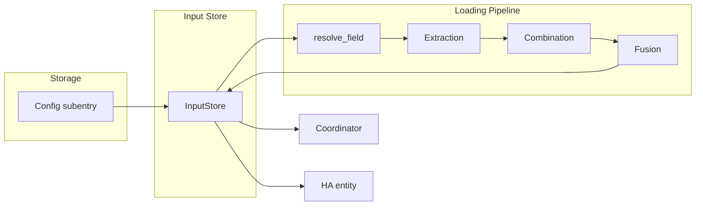

# Data Loading System

Technical guide to HAEO's unified time series loading architecture.

## Overview

The data loading system transforms Home Assistant sensor data into time series aligned with optimization horizons.
[Input stores](inputs.md) hold each field's resolved value and call this system to load forecast data; the coordinator
reads those store values directly, and [input entities](inputs.md) merely display and edit the stores.

The system addresses three core challenges:

1. **Heterogeneous data sources**: Sensors provide different formats (simple values vs forecasts from various integrations)
2. **Temporal alignment**: Forecast timestamps rarely match optimization periods
3. **Partial coverage**: Forecasts often don't span the entire optimization horizon

The system uses a three-stage pipeline: extraction → combination → fusion.

See Home Assistant documentation for background on entities and sensors:

- [Entity state documentation](https://developers.home-assistant.io/docs/core/entity/)
- [Sensor platform guide](https://developers.home-assistant.io/docs/core/entity/sensor/)

## Architecture

The data loading pipeline consists of four stages:

1. **Orchestration** ([`resolve_field`](https://github.com/hass-energy/haeo/blob/main/custom_components/haeo/core/data/loader/config_loader.py)) - Coordinates the entire loading process
2. **Extraction** ([`sensor_loader.py`](https://github.com/hass-energy/haeo/blob/main/custom_components/haeo/core/data/loader/sensor_loader.py)) - Reads Home Assistant entities and detects formats
3. **Combination** ([`forecast_combiner.py`](https://github.com/hass-energy/haeo/blob/main/custom_components/haeo/core/data/util/forecast_combiner.py)) - Merges multiple sensors into unified data
4. **Fusion** ([`forecast_fuser.py`](https://github.com/hass-energy/haeo/blob/main/custom_components/haeo/core/data/util/forecast_fuser.py)) - Aligns data to optimization horizon using interpolation

An `InputStore` resolves its field through the shared field resolver (`resolve_field`), which uses this pipeline for
time series data. Driven stores resolve from source entities via the state machine; editable stores resolve a stored
constant. The coordinator assembles each element's config from the stores' already-resolved values
(`load_element_config_from_values`) and subscribes to store change listeners — it never re-reads the state machine.



Each stage has a single responsibility and clear interfaces, making the system testable and extensible.
Fields with `time_series` set to `False`, such as initial SOC, take the summed present value and skip fusion, because there is no horizon to align to.

### Design Decisions

**Why separate extraction and fusion?**
Extraction handles heterogeneous input formats, while fusion handles temporal alignment.
This separation allows adding new forecast formats without changing alignment logic.

**Why trapezoidal integration for fusion?**
Linear programming optimization works with energy (power × time), not instantaneous power.
Trapezoidal integration accurately computes interval averages from point samples.

**Why additive sensor combination?**
Physical intuition: multiple solar arrays sum their power output, multiple price components sum to total cost.
This matches real-world energy network behavior.

## Field resolution

[`resolve_field`](https://github.com/hass-energy/haeo/blob/main/custom_components/haeo/core/data/loader/config_loader.py) resolves one configured field from its schema value and field hint.

### One path for every caller

Loading in Home Assistant and offline (the diag CLI and scenario benchmarks) shares every step, so they cannot disagree:

1. `element_inputs` lists an element's inputs from its schema's field hints: each input's path, the config path it reads, and its hint.
    `build_input_stores` creates one input store per configured input from this list, and offline loading walks the same list.
2. Each input resolves through `resolve_field`, with the same hint and the same negation in both cases.
3. `load_element_config_from_values` assembles the element's loaded config from the resolved values, filling defaults such as 100% efficiency for inputs that are not configured.

An input that has no data stops the optimization in Home Assistant.
Offline, `load_element_config` raises `InputsUnavailableError` naming those inputs, rather than filling in a default.

### Meters

A field whose hint sets `meter` reads meters: running totals, such as an energy sensor that only counts up.
Its value is how much its meters rose since the calendar window open at the horizon start began, so its input entity shows that rise.
Many meters reset (an "energy today" sensor returns to zero at midnight), so a reading alone cannot say how much a meter rose since a window started.

The meter hint names the calendar field, in the same section, whose window sets the zero point.
`input_value` adds that field's calendars to the meter input's entities, so the input reads both and the calendar loader loads it with the events injected.
Overlapping events chain into one window, so the rise counts from the earliest start among the events open at the horizon start.
With no window open the rise is zero.

The calendar loader keeps each meter's running totals with the [meter history](https://github.com/hass-energy/haeo/blob/main/custom_components/haeo/meter_history.py).
It reads the meter's sum from the recorder's 5-minute statistics over the past week, which carries on through resets as the Energy dashboard reads it.
It extends the sum with the meter's state changes as they arrive, keeping totals five minutes apart.
Into the meter's state, as the `haeo_meter_totals` attribute, it injects only the two totals a rise reads: the one at or before the open window's start and the latest.
A meter with no window open carries only its latest total.
It detects resets as the recorder does: a `total_increasing` reading below 90% of the last one, or a `total` meter whose `last_reset` changes, rose from zero.
Statistics only exist for sensors with a `total` or `total_increasing` state class, so meter fields only offer those sensors.
When the totals start after the window began, the rise counts from the earliest total, the most the meter is known to have risen.

The input store captures the calendars with their events and the meters with their totals, so diagnostics replay the same rise.
Historical diagnostics read each meter's totals as of the run from the recorder and inject the same two, for the window open at the run.

### On and off states

An on/off input reads binary sensors as `on` and `off`.
When one of its entities reports words instead, the element flow's `states` step asks which states mean on and which mean off, and stores them in the entity value as `on_states` and `off_states`.
`resolve_field` then reads those entities through `OnOffStateMachine`, which rewrites each state to `on` or `off` before the sensor loader parses it.
With only one list, every other state is the opposite; with both, a state in neither reads as `unknown`, and states already reading as on or off keep their reading unless listed.
Input stores capture the states as reported, so diagnostics replay the same reading from the stored lists.

### Responsibilities

- Load every referenced sensor, and treat the field as unavailable if any sensor is missing or has no data
- Coordinate extraction, combination, and fusion stages
- Convert results to HAEO base units (see [Units](units.md) for details)
- Handle single sensors and sensor lists uniformly

**Intervals vs Fence Posts**:
Optimization horizons are defined by n+1 timestamps (fence posts) creating n periods (intervals).
Different physical quantities require different loading approaches, chosen by the field hint's `boundaries` flag:

- **Interval values** (n values): Power, efficiency, costs - values that represent averages over time periods
- **Fence post values** (n+1 values): Capacity, SOC limits - values that represent states at specific points in time

Constant values broadcast to the same lengths.

Values use HAEO base units: kilowatts (kW) for power, kilowatt-hours (kWh) for energy, \$/kWh for prices.
See [Units documentation](units.md) for conversion details.

## Sensor Extraction

The [`sensor_loader.py`](https://github.com/hass-energy/haeo/blob/main/custom_components/haeo/core/data/loader/sensor_loader.py) module extracts data from Home Assistant entities.

### Payload Types

A sensor provides either:

- **Present value** (float): Current reading at query time
- **Forecast series** (list of timestamp/value tuples): Future predictions

This distinction drives all downstream processing: present values repeat across horizons, forecast series interpolate and cycle.

### Format Detection

The system uses duck typing to identify forecast formats.
Each integration has distinct attribute structures, allowing automatic detection without configuration.

The detection logic tries all known parsers (see [Extractors](#extractors)) and returns the first match.
If no parser matches, the system falls back to extracting the numeric state value.

### Why Automatic Detection?

Users shouldn't need to specify integration types in configuration.
Automatic detection reduces configuration complexity and prevents errors from misconfiguration.
Adding new forecast formats requires only a new parser module, not changes to user configuration.

## Extractors

The extractor system ([`extractors/`](https://github.com/hass-energy/haeo/tree/main/custom_components/haeo/core/data/loader/extractors)) handles integration-specific forecast formats.

### Supported Integrations

| Integration               | Use Case                     | Parser Module                                                                                                                                                   |
| ------------------------- | ---------------------------- | --------------------------------------------------------------------------------------------------------------------------------------------------------------- |
| Amber Electric            | Electricity pricing          | [`amberelectric.py`](https://github.com/hass-energy/haeo/blob/main/custom_components/haeo/core/data/loader/extractors/amberelectric.py)                         |
| AEMO NEM                  | Wholesale pricing            | [`aemo_nem.py`](https://github.com/hass-energy/haeo/blob/main/custom_components/haeo/core/data/loader/extractors/aemo_nem.py)                                   |
| EMHASS                    | Energy management forecasts  | [`emhass.py`](https://github.com/hass-energy/haeo/blob/main/custom_components/haeo/core/data/loader/extractors/emhass.py)                                       |
| Flow Power                | Electricity pricing          | [`flow_power.py`](https://github.com/hass-energy/haeo/blob/main/custom_components/haeo/core/data/loader/extractors/flow_power.py)                               |
| HAEO                      | Chaining HAEO sensor outputs | [`haeo.py`](https://github.com/hass-energy/haeo/blob/main/custom_components/haeo/core/data/loader/extractors/haeo.py)                                           |
| Nordpool                  | Electricity pricing          | [`nordpool.py`](https://github.com/hass-energy/haeo/blob/main/custom_components/haeo/core/data/loader/extractors/nordpool.py)                                   |
| Solcast Solar             | Solar forecasting            | [`solcast_solar.py`](https://github.com/hass-energy/haeo/blob/main/custom_components/haeo/core/data/loader/extractors/solcast_solar.py)                         |
| Volcast                   | Solar forecasting            | [`volcast.py`](https://github.com/hass-energy/haeo/blob/main/custom_components/haeo/core/data/loader/extractors/volcast.py)                                     |
| Open-Meteo Solar Forecast | Solar forecasting            | [`open_meteo_solar_forecast.py`](https://github.com/hass-energy/haeo/blob/main/custom_components/haeo/core/data/loader/extractors/open_meteo_solar_forecast.py) |
| Calendar events           | Calendars as forecasts       | [`calendar_events.py`](https://github.com/hass-energy/haeo/blob/main/custom_components/haeo/core/data/loader/extractors/calendar_events.py)                     |

### Period values and point values

The fuser interpolates linearly between points, so an extractor must place each value at the time it describes.

A value that is constant over a period, such as a tariff price or an optimizer's schedule, becomes a step function.
`step_points()` emits two points per period, `(start, value)` and `(end, value)`.
Adjacent periods share a boundary timestamp, and `extract()` separates it with `separate_duplicate_timestamps()` so the fuser steps there instead of ramping.
A source that gives only start times ends each period where the next one starts (`hold_until_next()`).

A quantity that varies continuously, such as solar or load power, stays as points and is interpolated.
An instantaneous value sits at its instant.
A mean over a period sits at the middle of the period, where a smoothly varying quantity equals its mean, so interpolating between midpoints recovers the period means.
`period_means()` emits those midpoints and holds the first and last means out to the forecast's start and end, so the fuser's cycling never fills the edges.

| Source                     | Reading                                                                                                                                                                          |
| -------------------------- | -------------------------------------------------------------------------------------------------------------------------------------------------------------------------------- |
| Amber Electric, Amber2MQTT | Prices held from `start_time` to `end_time`                                                                                                                                      |
| AEMO NEM                   | Prices held from `start_time` to `end_time`, or the next start, or 30 minutes                                                                                                    |
| Nordpool                   | Prices held from `start` to `end`                                                                                                                                                |
| Flow Power                 | Prices held until the next period starts                                                                                                                                         |
| Solcast                    | Mean power over the 30 minutes from `period_start`, at the period's middle                                                                                                       |
| Volcast                    | Mean power over the 5 minutes from `period_start`, at the period's middle, with zero across the periods Volcast leaves out and just before and after the forecast                |
| Open-Meteo Solar Forecast  | Instantaneous `watts` at 15 minutes after its timestamp, which is when the irradiance it is computed from applies                                                                |
| EMHASS                     | Schedules, prices and the `forecasts` attribute held over their step; ML load forecasts at the middle of their step; state of charge at the step's end; temperature at its start |
| HAEO                       | Linear points unless `interpolation_mode` says otherwise                                                                                                                         |

HAEO's own sensors and numbers publish interval forecasts (power, prices, and other per-period values) with one point at each period start and `interpolation_mode: previous`.
In previous mode each value holds until the next point and the last for as long as the step before it, so an input reading a HAEO output gets each period's value back unchanged.
Boundary forecasts (stored energy and other states) publish a point at every boundary and no interpolation mode.

### Calendar Events

A calendar's state only shows its current or next event, so the calendar extractor cannot read a calendar directly.
The calendar input loader fetches each calendar's events over the horizon and injects them into the calendar's state as the `haeo_events` attribute, which the extractor reads.
Input stores capture their source states through the same injecting state machine, so diagnostics hold the events and replay loads them without a calendar to fetch from.
A calendar without injected events reads as unavailable rather than as its plain state.

Each event's value is a number typed with its unit.
`extract()` takes the input's output type, and the calendar extractor converts each event's value to the input's unit with `to_field_unit()`.
An event whose value the input cannot use, such as a bare number, is ignored, and the calendar input loader raises a repair issue listing those events, so one mistyped event never makes the input unavailable.
The extracted series is a step function padded with zeros well before and after the events, so it covers the horizon: a calendar is zero outside its events rather than repeating, and it fuses on its own beside other forecasts.

### Parser Design

Each parser is a standalone module with two responsibilities:

1. **Detection**: Identify if a sensor state matches the integration's format
2. **Extraction**: Parse forecast data into (Unix timestamp, value) tuples

Parsers declare expected units and device classes for automatic unit conversion.

### Adding New Formats

To support a new forecast integration:

1. Create a parser module in `extractors/`
2. Implement `detect()` and `extract()` static methods
3. Declare `DOMAIN`, `UNIT`, and `DEVICE_CLASS` class attributes
4. Add tests to `core/data/loader/extractors/tests/`

The system automatically discovers and uses new parsers without configuration changes.
See existing parsers for implementation patterns.

## Combining Payloads

The [`forecast_combiner.py`](https://github.com/hass-energy/haeo/blob/main/custom_components/haeo/core/data/util/forecast_combiner.py) module merges multiple sensor payloads.

### Combination Strategy

Multiple sensors combine additively:

- **Present values** sum together
- **Forecast series** interpolate to shared timestamps, then sum

This matches physical reality: two solar arrays produce combined power, multiple price components sum to total cost.

`load_sensors()` returns None when any sensor is missing or has no data, so the field is unavailable rather than summing the sensors that remain.

### Timestamp Alignment

`fuse_sensor_payloads()` splits forecasts by whether they cover the whole horizon.
Forecasts covering only part of it merge first:

1. Creates a union of all timestamps from the partial forecasts
2. Interpolates each forecast's values to this common timestamp set, zero outside its own range
3. Sums interpolated values at each timestamp

The merged forecast then fuses to the horizon, repeating if it ends early, so forecasts for consecutive windows (today and tomorrow) join before they repeat.
Each forecast covering the whole horizon fuses on its own and adds to the result.
Merging one into the partial forecasts would make the merged forecast cover the horizon too, stopping the partial ones from repeating.
A forecast with no points, such as a calendar without events, adds nothing.

### Mixed Payloads

`split_sensor_payloads()` returns the summed present value and each forecast series separately.
A present value is the reading for now, so `fuse_sensor_payloads()` uses it for the first interval (or the first boundary) and the forecasts for the rest.
Without a forecast, the present value repeats across the horizon.

## Fusion to Horizon

The [`forecast_fuser.py`](https://github.com/hass-energy/haeo/blob/main/custom_components/haeo/core/data/util/forecast_fuser.py) module aligns combined forecasts to optimization horizons.

### Fusion Functions

The fuser provides two functions for different data types:

- `fuse_to_intervals()` - Produces n interval averages using trapezoidal integration
- `fuse_to_boundaries()` - Produces n+1 point-in-time values via interpolation

### Interval Fusion Strategy

The `fuse_to_intervals()` function produces values for each optimization period:

- Uses trapezoidal integration to compute accurate period averages
- Accounts for value changes within periods

This matches optimization requirements: linear programming operates on energy quantities (power × time), not instantaneous values.

### Fence Post Fusion Strategy

The `fuse_to_boundaries()` function produces values at each timestamp boundary:

- Uses linear interpolation to get values at exact fence post times
- Preserves point-in-time nature of quantities like capacity and SOC limits

This is appropriate for energy storage values that represent states at specific moments, not averages over periods.

### Interval Averaging

The system uses trapezoidal integration to compute accurate interval averages from point forecasts.
This accounts for value changes within optimization periods, producing more accurate results than simple point sampling or nearest-neighbor approaches.

**Why trapezoidal integration?**
Energy (kWh) = Power (kW) × Time (h).
Optimization operates on energy quantities, so we need accurate power-over-time averaging.
Trapezoidal integration provides the best balance of accuracy and simplicity for linear interpolation.

### Forecast Cycling

When forecasts don't cover the full horizon, the system cycles them using natural period alignment.
See [Forecast Cycling](#forecast-cycling) for details.

The cycling happens before fusion, ensuring the fusion always has data covering beyond the last horizon timestamp.

## Forecast Cycling

The [`forecast_cycle.py`](https://github.com/hass-energy/haeo/blob/main/custom_components/haeo/core/data/util/forecast_cycle.py) module handles partial forecast coverage.

### Natural Period Alignment

Forecasts cycle at their natural period (24 hours for daily patterns, 7 days for weekly patterns, etc.).
The system identifies this period automatically by detecting when forecast timestamps align with 24-hour boundaries.

**Why natural periods?**
Different forecast types have different inherent cycles:

- Electricity prices often have daily patterns (time-of-use pricing)
- Some forecasts span multiple days (7-day solar forecasts)
- Cycling should preserve the forecast's intended pattern

### Time-of-Day Preservation

When cycling, the system maintains time-of-day alignment.
A 6-hour forecast from 2pm-8pm repeats at the same times each day, not offset by arbitrary amounts.

This ensures realistic patterns: expensive electricity in the evening stays expensive in the evening on subsequent days.

### Design Rationale

Cycling is necessary because users configure long optimization horizons (48-168 hours) but integrations provide shorter forecasts.
Simply repeating the last value would lose time-of-day patterns.
Wrapping to zero would produce unrealistic gaps.
Natural period cycling preserves patterns while extending coverage.

## Error Handling

The data loading system uses `ValueError` for all data problems.
Coordinators catch these and convert them to appropriate Home Assistant exceptions based on context.

### Error Strategy

- **Transient errors** (sensor offline, API timeout) → `UpdateFailed` (coordinator retries)
- **Permanent errors** (invalid sensor ID, wrong device class) → `ConfigEntryError` (user must fix configuration)

This separation ensures temporary issues don't require user intervention while permanent problems surface immediately.

### Error Messages

All error messages include specific sensor entity IDs and actionable guidance.
Users should be able to identify the problem sensor and understand how to fix it without reading code or logs.

## Testing

Tests are colocated with source code:

- [`core/data/loader/tests/`](https://github.com/hass-energy/haeo/tree/main/custom_components/haeo/core/data/loader/tests) - Extraction and loading tests
- [`core/data/util/tests/`](https://github.com/hass-energy/haeo/tree/main/custom_components/haeo/core/data/util/tests) - Combination and fusion tests
- [`core/data/loader/extractors/tests/`](https://github.com/hass-energy/haeo/tree/main/custom_components/haeo/core/data/loader/extractors/tests) - Format-specific parser tests

### Test Strategy

**Unit tests** cover individual functions (extraction, combination, fusion, cycling) in isolation.
**Integration tests** verify the complete pipeline from sensor IDs to horizon-aligned values.

Each test uses realistic fixtures based on actual integration data formats.
This ensures parsers handle real-world edge cases (missing fields, unexpected value ranges, timezone handling).

### Running Tests

```bash
# All data loading tests
uv run pytest custom_components/haeo/core/data/ -v

# Specific component
uv run pytest custom_components/haeo/core/data/loader/tests/test_config_loader.py -v

# With coverage report
uv run pytest custom_components/haeo/core/data/ --cov=custom_components.haeo.core.data
```

## Related Documentation

<div class="grid cards" markdown>

- :material-import:{ .lg .middle } **Input Entities**

    ---

    How input stores and entities use the loading system.

    [:material-arrow-right: Input entities guide](inputs.md)

- :material-file-document:{ .lg .middle } **Forecasts and Sensors guide**

    ---

    User-facing documentation for sensor behavior.

    [:material-arrow-right: Forecasts and Sensors](../user-guide/forecasts-and-sensors.md)

- :material-ruler:{ .lg .middle } **Units**

    ---

    Unit conversion system and base units.

    [:material-arrow-right: Units guide](units.md)

- :material-sync:{ .lg .middle } **Coordinator**

    ---

    How the coordinator reads loaded data from stores.

    [:material-arrow-right: Coordinator guide](coordinator.md)

</div>
