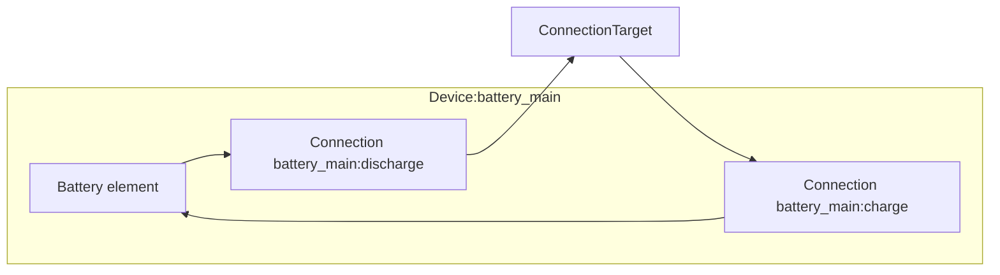

# Battery Modeling

The Battery device composes a single [Battery model](../model-layer/elements/battery.md) element and two [Connections](../model-layer/connections/connection.md), one for discharging and one for charging.
The min and max charge are limits on the battery element itself.

## Model Elements Created

The adapter creates three model elements:

| Model Element                                          | Name               | Parameters From Configuration                               |
| ------------------------------------------------------ | ------------------ | ----------------------------------------------------------- |
| [Battery](../model-layer/elements/battery.md)          | `{name}`           | Capacity, initial charge, min and max charge, salvage value |
| [Connection](../model-layer/connections/connection.md) | `{name}:discharge` | Efficiency, power limits                                    |
| [Connection](../model-layer/connections/connection.md) | `{name}:charge`    | Power limits, efficiency                                    |

## Architecture Details

### Charge limits

The battery model stores energy from empty to its full capacity $C(t)$, and the adapter converts the percentage limits to energy:

$$
E_{\min}(t) = \text{min\%}(t) \cdot C(t), \qquad E_{\max}(t) = \text{max\%}(t) \cdot C(t)
$$

The model keeps stored energy between them with a steep holding cost rather than a hard bound, so a battery reported outside its limits still gives a plan.
The initial charge is the current SOC multiplied by the capacity, clamped to the capacity.
Stored energy and SOC are reported as absolute values.

[Buffers](buffer.md) measure the energy a battery can deliver above a level, never below its min charge, and the space it can absorb below a level, never above its max charge.
Pair a wider min and max charge with buffers at narrower levels to let the battery use an outer range when the price justifies its holding cost.

### Metered terminal convention

Battery management systems, hybrid inverter battery ports, and battery meters all measure power at the battery terminals.
Manufacturers rate charge and discharge power at the same point.
In the model the terminals are the bus end of the battery's connections, and efficiency is the loss between the terminals and the stored energy.

Each connection therefore places its efficiency segment next to the battery and its power-limit segment at the bus end:

| Connection         | Segment order           | Power limit applies to     |
| ------------------ | ----------------------- | -------------------------- |
| `{name}:discharge` | efficiency, power limit | Power delivered to the bus |
| `{name}:charge`    | power limit, efficiency | Power drawn from the bus   |

With discharge efficiency $\eta_d$, charge efficiency $\eta_c$, and terminal powers $P_d$ and $P_c$:

$$
P_d(t) \le P_d^{\max}(t), \qquad P_c(t) \le P_c^{\max}(t)
$$

$$
E(t+1) = E(t) + \left(\eta_c P_c(t) - \frac{P_d(t)}{\eta_d}\right) \Delta t
$$

The charge, discharge, and active power sensors all report terminal power, so they match what a meter on the battery would read.

### Salvage value

The battery element can include a terminal salvage value.
This assigns a per-kWh value to the final stored energy at the horizon end.
It discourages draining the battery to zero when energy is still valuable beyond the forecast window.

## Devices Created

Battery creates a single Home Assistant device:

| Device  | Name     | Created When | Purpose                           |
| ------- | -------- | ------------ | --------------------------------- |
| Battery | `{name}` | Always       | Power, energy, SOC, shadow prices |

## Parameter mapping

| User Configuration          | Model Element(s)    | Model Parameter            | Notes                          |
| --------------------------- | ------------------- | -------------------------- | ------------------------------ |
| `capacity`                  | Battery             | `capacity`                 | kWh, boundaries                |
| `initial_charge_percentage` | Battery             | `initial_charge`           | kWh                            |
| `min_charge_percentage`     | Battery             | `min_charge`               | kWh, held with priced slack    |
| `max_charge_percentage`     | Battery             | `max_charge`               | kWh, held with priced slack    |
| `salvage_value`             | Battery             | `salvage_value`            | Terminal value for stored kWh  |
| `charge_limit_cost`         | Battery             | `charge_limit_cost`        | \$/kWh/h outside min/max       |
| `efficiency_source_target`  | Efficiency segment  | `efficiency_source_target` | Battery to network (discharge) |
| `efficiency_target_source`  | Efficiency segment  | `efficiency_target_source` | Network to battery (charge)    |
| `max_power_target_source`   | Power-limit segment | `max_power_target_source`  | Network to battery             |
| `max_power_source_target`   | Power-limit segment | `max_power_source_target`  | Battery to network             |

## Output Mapping

Power sensors come from the bus end of the connections, and the remaining sensors from the battery element:

| Model Output                              | Sensor Name                         | Description                  |
| ----------------------------------------- | ----------------------------------- | ---------------------------- |
| `{name}:charge` `CONNECTION_POWER`        | `power_charge`                      | Charge power at terminals    |
| `{name}:discharge` `CONNECTION_POWER_OUT` | `power_discharge`                   | Discharge power at terminals |
| Calculated as discharge minus charge      | `power_active`                      | Net power at terminals       |
| `BATTERY_ENERGY_STORED`                   | `energy_stored`                     | Total energy stored          |
| Calculated SOC                            | `state_of_charge`                   | State of charge              |
| `BATTERY_POWER_BALANCE`                   | `power_balance_shadow_energy_price` | Power balance shadow price   |
| `BATTERY_ENERGY_IN_FLOW`                  | `energy_in_flow`                    | Energy-in shadow price       |
| `BATTERY_ENERGY_OUT_FLOW`                 | `energy_out_flow`                   | Energy-out shadow price      |
| `BATTERY_SOC_MAX`                         | `soc_max`                           | Max SOC shadow price         |
| `BATTERY_SOC_MIN`                         | `soc_min`                           | Min SOC shadow price         |

See [Battery Configuration](../../user-guide/elements/battery.md#sensors-created) for complete sensor documentation.

## Next steps

- :material-file-document:{ .lg .middle } **Battery configuration**

    ---

    Configure batteries in your Home Assistant setup.

    [:material-arrow-right: Battery configuration](../../user-guide/elements/battery.md)

- :material-battery-charging:{ .lg .middle } **Battery model**

    ---

    Mathematical formulation for battery storage.

    [:material-arrow-right: Battery model](../model-layer/elements/battery.md)

- :material-connection:{ .lg .middle } **Connection model**

    ---

    How power limits, efficiency, and pricing are applied.

    [:material-arrow-right: Connection formulation](../model-layer/connections/connection.md)

