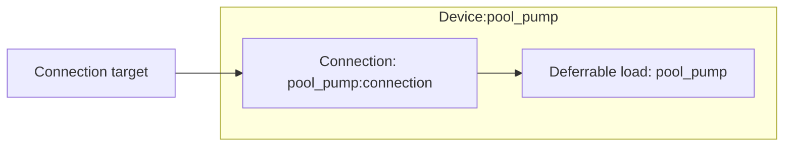

# Deferrable load modeling

The deferrable load device composes one deferrable load model element and one [Connection](../model-layer/connections/connection.md).

## Model elements created

The adapter creates two model elements:

| Model Element                                          | Name                | Purpose                                              |
| ------------------------------------------------------ | ------------------- | ---------------------------------------------------- |
| Deferrable load                                        | `{name}`            | Per-window energy requirements with priced shortfall |
| [Connection](../model-layer/connections/connection.md) | `{name}:connection` | Network → load, limited by the configured max power  |

## Architecture details

### Window scheduling

Calendar events define run windows, and the energy typed with its unit in each event's text is that event's requirement.
Every event is a window; one without a usable energy needs nothing.

The window calendar feeds four inputs:

- **Run window** and **window start**: overlapping events share one window, merged transitively, while events that only touch stay separate windows.
- **Energy opening** and **energy due**: each event's requirement at its own start and its own end.
    An event open at the horizon start opens at the first boundary, and an event running past the horizon end is clamped to the final boundary, where its requirement falls due.

Window edges snap outward to the containing period boundaries, as for every calendar field.
The adapter passes these inputs to the [deferrable load model](../model-layer/elements/deferrable_load.md) unchanged, which keeps each event's energy within its own time.
Power can only flow while a window is open, and the connection caps it at the configured max power.

### Energy already delivered

Each optimization starts a fresh horizon, so a window that is already open at the horizon start would otherwise demand its full energy again.
When a delivered energy sensor is configured, its reading $E_0$ seeds the open window's accumulator.
The window covering the first period counts as open, including one that starts inside that period.

- **Under target**: the remaining requirement, less $E_0$, stays due at the window end.
- **Over target**: the overshoot already happened, so it is overage at a fixed cost that changes no decision, and the window takes no new energy unless energy pays to be used.
- **Slightly negative reading**: treated as zero.

The reading never counts toward a later window, and with no window open it is ignored.

### Settlement

Each event is settled at its own end, where any shortfall is priced at the shortfall price.
Delivery beyond what the started events need is overage, priced at the overage price at the window's end and never forbidden.
Delivering early within an event is never penalized.

## Devices created

The deferrable load element creates a single Home Assistant device:

| Device          | Name     | Created when | Purpose                                     |
| --------------- | -------- | ------------ | ------------------------------------------- |
| Deferrable Load | `{name}` | Always       | Power, delivered energy, shortfall, overage |

## Parameter mapping

| User configuration | Model element(s)               | Model parameter                              | Notes                              |
| ------------------ | ------------------------------ | -------------------------------------------- | ---------------------------------- |
| `window_calendar`  | Deferrable load `{name}`       | `in_window`, `window_start`, `opened`, `due` | Clamped to the horizon end         |
| `energy_meter`     | Deferrable load `{name}`       | `initial_energy`                             | Rise since the open window started |
| `deficit_price`    | Deferrable load `{name}`       | `deficit_price`                              | Defaults to \$10/kWh               |
| `overage_price`    | Deferrable load `{name}`       | `overage_price`                              | Defaults to \$0/kWh                |
| `max_power`        | Connection `{name}:connection` | Power limit segment                          | Optional                           |

## Output mapping

The sensors this element creates, with their entity IDs, are listed under [Sensors created](../../user-guide/elements/deferrable_load.md#sensors-created) on the Deferrable load page.

## Next steps

- :material-file-document:{ .lg .middle } **Deferrable load configuration**

    ---

    Configure deferrable loads in your Home Assistant setup.

    [:material-arrow-right: Deferrable load configuration](../../user-guide/elements/deferrable_load.md)

- :material-car-electric:{ .lg .middle } **EV modeling**

    ---

    The EV's trip sink uses the same deferrable load element.

    [:material-arrow-right: EV modeling](ev.md)

- :material-connection:{ .lg .middle } **Connection model**

    ---

    How power limits, efficiency, and pricing are applied.

    [:material-arrow-right: Connection formulation](../model-layer/connections/connection.md)

