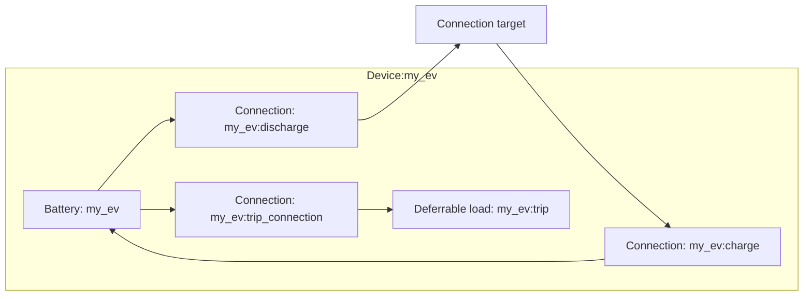

# EV modeling

The EV device composes a [Battery](../model-layer/elements/battery.md), a deferrable load, and three [Connection](../model-layer/connections/connection.md) elements.
The battery represents the physical EV pack, while the deferrable trip load captures per-trip energy requirements from calendar data.

## Model elements created

The adapter creates five model elements:

| Model Element                                          | Name                     | Purpose                                             |
| ------------------------------------------------------ | ------------------------ | --------------------------------------------------- |
| [Battery](../model-layer/elements/battery.md)          | `{name}`                 | Physical EV battery with SOC tracking               |
| [Connection](../model-layer/connections/connection.md) | `{name}:charge`          | Home charging (network → EV), active when connected |
| [Connection](../model-layer/connections/connection.md) | `{name}:discharge`       | V2G discharge (EV → network), active when connected |
| Deferrable load                                        | `{name}:trip`            | Trip energy requirement with a priced shortfall     |
| [Connection](../model-layer/connections/connection.md) | `{name}:trip_connection` | EV battery → trip load, active when away            |

## Architecture details

### Connected and disconnected states

The EV alternates between two states:

- **Connected** (plugged in at home): The home charge/discharge connections are active, trip connections are zeroed
- **Away** (on a trip): The home connections are zeroed and the trip connection is active

The trip calendar is authoritative for the future: the away mask is derived from calendar event windows aligned to the horizon.
The live plugged-in binary sensor overrides the current interval, so early returns and unplanned absences are reflected immediately.
A car plugged in during an open trip has not left yet: only the current interval is home, and the trip still happens in the rest of its window unless the car already came back (see [trip progress](#trip-progress)).
The plugged-in field is required and accepts only a sensor.
The masks multiply the connection power limits.

### Metered charger convention

Charge and discharge power are measured at the charger, the bus end of the EV's connections, following the [battery's metered terminal convention](battery.md#metered-terminal-convention).
`{name}:charge` applies its power limit before its efficiency, and `{name}:discharge` applies its efficiency before its power limit, so both limits and the charge, discharge, and active power sensors refer to power at the charger.

### Trip energy modeling

Calendar events define trip windows.
For each trip, the required energy is:

$$
E_{\text{trip}} = d \cdot r
$$

where $d$ is the trip distance and $r$ is the energy-per-distance rate.
The distance is read from the first of the event's location, summary, or description fields that holds only a distance with its unit, such as `50 km`, and converted to kilometres.

The trip calendar feeds four inputs, resolved the same way as for the [deferrable load device](deferrable_load.md#window-scheduling): the periods away, where trips start, and the distances of the events starting and ending at each boundary.
Overlapping events share one window, touching trips stay separate, and an event running past the horizon end is due at the final boundary.
Every away period is a trip window of the [deferrable trip load](../model-layer/elements/deferrable_load.md); an event without a distance marks the car away but asks for no energy.

The trip load counts the energy each window receives from zero at its start, and each event's energy $E_{\text{trip}}$ is due by its own end:

- **Shortfall** below the requirement is priced at the public charging price $p_{\text{public}}$ at that boundary.
- **Overage**, energy beyond what the trips that have started need, is priced at \$10/kWh.
    A trip's energy is not the plan's to choose, so this keeps the plan from ever sending more energy into a trip than it needs, even when energy is paid to be used, without making the optimization infeasible.

$$
\text{cost} = \sum_{\text{trips}} p_{\text{public}}(e) \cdot \max\left(0,\ E_{\text{trip}} - E_{\text{delivered}}(e)\right)
$$

where $e$ is the trip's end boundary.
This models topping up publicly during the trip: the optimizer covers trip energy from the EV pack whenever home charging is cheaper than the public price, and a trip can never make the optimization infeasible.
A missed trip stays priced at its own end, and the next trip starts from zero.

The pack's initial charge clamps to $[0, C]$ so a glitched state-of-charge sensor cannot overfill the model.

An optional min charge holds the pack above a fraction of its capacity, as the [battery](battery.md) does.
Energy below it costs \$100/kWh per hour, far above the public charging price, so neither V2G nor a trip ever plans to drain past it: a trip that would need more leaves a priced shortfall.
A car that comes home below it stays feasible.

### Trip progress

The odometer is a [meter input](../../developer-guide/data-loading.md#meters) measured from the trip calendar.
It loads as $\Delta o$, the distance driven since the trip window open at the horizon start began, read from the odometer's recorded statistics, and zero when no trip window is open.
The car does not drive while waiting at home, so this is the distance driven on the trip.

Together with the plugged-in sensor it places the car on the open trip:

| Plugged in | $\Delta o$ | The car          | Model                                                                        |
| ---------- | ---------- | ---------------- | ---------------------------------------------------------------------------- |
| Yes        | 0          | has not left yet | The current interval is home; the trip keeps its requirement, due at its end |
| Yes        | > 0        | is back          | The open trip is dropped; the car is home until the trip's scheduled end     |
| No         | any        | is on the trip   | The trip load's initial energy is $E_{\text{initial}} = \Delta o \cdot r$    |

The credited energy already left the pack, which the live state of charge reflects, so the model never draws it again.
The credit is capped at the open trip's own energy.
Below it, the remainder stays due at the trip's end; at or above it, the trip is complete, and distance driven beyond it is neither credited nor priced.
Unplugging again after coming back resumes the trip, with the distance still counted from the trip's start.
Without an odometer $\Delta o$ is zero, so a car plugged in during a trip has not left yet.
Later trips are unaffected.

### Keeping a margin

The EV keeps no reserve of its own.
A [buffer](buffer.md) holds one: an EV taking part in a buffer counts its trip load as a load and its pack as storage, so a buffer over the EV alone with a level keeps a margin in the pack above its trips, and a buffer over the house, the EV, and the home battery keeps a whole-system reserve.

### Public charging

Public charging is modeled as the price on the trip load's shortfall rather than as an explicit grid element.
The optimizer chooses between:

- Pre-charging the EV at home prices before the trip
- Leaving a shortfall to be topped up publicly during the trip at the configured price

The optimizer selects the cheaper option based on current and forecast prices.
Without a configured price the default \$10/kWh applies, which strongly discourages a shortfall without forbidding it.
The shortfall still keeps trips from making the optimization infeasible, and if effective home charging costs more than \$10/kWh the optimizer can deliberately leave one.
The expected public top-up is exposed as the trip energy shortfall output.

## Devices created

The EV element creates a single Home Assistant device:

| Device | Name     | Created when | Purpose                                 |
| ------ | -------- | ------------ | --------------------------------------- |
| EV     | `{name}` | Always       | Power, energy, SOC, trip, shadow prices |

## Parameter mapping

| User configuration         | Model element(s)              | Model parameter                   | Notes                                         |
| -------------------------- | ----------------------------- | --------------------------------- | --------------------------------------------- |
| `capacity`                 | Battery `{name}`              | `capacity`                        | kWh, time-series boundary array               |
| `current_soc`              | Battery `{name}`              | `initial_charge`                  | SOC ratio × capacity                          |
| `min_charge_percentage`    | Battery `{name}`              | `min_charge`, `charge_limit_cost` | Ratio × capacity, \$100/kWh per hour below it |
| `trip_calendar`            | Deferrable load `{name}:trip` | Window masks, `opened`, `due`     | Distances × energy per distance               |
| `max_charge_rate`          | Connection `{name}:charge`    | Power limit segment               | Masked by connected flag                      |
| `max_discharge_rate`       | Connection `{name}:discharge` | Power limit segment               | Masked by connected flag                      |
| `connected`                | Connections                   | Home and away masks               | Pins the current interval                     |
| `energy_per_distance`      | Trip energy calculation       | Multiplied by distance            | Wh/km and kWh/100km converted to kWh/km       |
| `odometer`                 | Deferrable load `{name}:trip` | `initial_energy`                  | Distance since the trip began × rate          |
| `public_charging_price`    | Deferrable load `{name}:trip` | `deficit_price`                   | Defaults to \$10/kWh                          |
| `efficiency_source_target` | Connection `{name}:discharge` | Efficiency segment                | Discharge direction                           |
| `efficiency_target_source` | Connection `{name}:charge`    | Efficiency segment                | Charge direction                              |

## Output mapping

The adapter maps model outputs to EV-specific sensor names:

| Model output               | Sensor name                    | Description                                             |
| -------------------------- | ------------------------------ | ------------------------------------------------------- |
| `{name}:charge` power      | `ev_power_charge`              | Home charge power                                       |
| `{name}:discharge` power   | `ev_power_discharge`           | V2G discharge power                                     |
| Calculated                 | `ev_power_active`              | Net power (discharge − charge)                          |
| `BATTERY_ENERGY_STORED`    | `ev_energy_stored`             | Energy in EV battery                                    |
| Calculated                 | `ev_state_of_charge`           | SOC ratio                                               |
| Trip load energy delivered | `ev_trip_energy_delivered`     | Energy used by the current trip                         |
| Trip load energy shortfall | `ev_trip_energy_shortfall`     | Expected public top-up energy for each trip, at its end |
| Power limit shadow         | `ev_power_max_charge_price`    | Charge limit shadow price                               |
| Power limit shadow         | `ev_power_max_discharge_price` | Discharge limit shadow price                            |

See [EV Configuration](../../user-guide/elements/ev.md#sensors-created) for complete sensor documentation.

## Next steps

- :material-file-document:{ .lg .middle } **EV configuration**

    ---

    Configure EVs in your Home Assistant setup.

    [:material-arrow-right: EV configuration](../../user-guide/elements/ev.md)

- :material-battery-charging:{ .lg .middle } **Battery model**

    ---

    Mathematical formulation for battery storage.

    [:material-arrow-right: Battery model](../model-layer/elements/battery.md)

- :material-connection:{ .lg .middle } **Connection model**

    ---

    How power limits, efficiency, and pricing are applied.

    [:material-arrow-right: Connection formulation](../model-layer/connections/connection.md)

