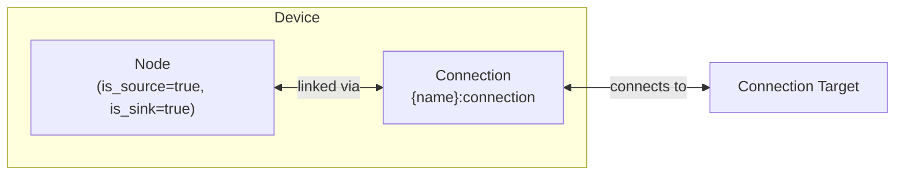

# Grid modeling

The Grid device composes a [Node](../model-layer/elements/node.md) (bidirectional power source/sink) with an implicit [Connection](../model-layer/connections/connection.md) to model utility grid connections with time-varying import and export pricing.

## Model elements created

| Model Element                                          | Name                | Parameters From Configuration          |
| ------------------------------------------------------ | ------------------- | -------------------------------------- |
| [Node](../model-layer/elements/node.md)                | `{name}`            | is_source=true, is_sink=true           |
| [Connection](../model-layer/connections/connection.md) | `{name}:connection` | power-limit and pricing segment values |

## Devices created

Grid creates 1 device in Home Assistant:

| Device  | Name     | Created When | Purpose                                   |
| ------- | -------- | ------------ | ----------------------------------------- |
| Primary | `{name}` | Always       | Bidirectional grid connection and pricing |

## Parameter mapping

The adapter transforms user configuration into connection segments:

| User Configuration        | Segment           | Segment Field             | Notes                                   |
| ------------------------- | ----------------- | ------------------------- | --------------------------------------- |
| `price_source_target`     | PricingSegment    | `price_source_target`     | Cost per kWh imported                   |
| `price_target_source`     | PricingSegment    | `price_target_source`     | Stored as negative to represent revenue |
| `max_power_source_target` | PowerLimitSegment | `max_power_source_target` | Maximum import power (optional)         |
| `max_power_target_source` | PowerLimitSegment | `max_power_target_source` | Maximum export power (optional)         |
| `connection`              | Connection        | `target`                  | Node to connect to                      |
| —                         | Node              | `is_source=true`          | Grid can supply power                   |
| —                         | Node              | `is_sink=true`            | Grid can absorb power                   |

## Sensors created

The sensors this element creates, with their entity IDs, are listed under [Sensors created](../../user-guide/elements/grid.md#sensors-created) on the Grid page.

## Configuration examples

### Time-of-use pricing

| Field            | Value                           |
| ---------------- | ------------------------------- |
| **Name**         | Main Grid                       |
| **Import Price** | sensor.electricity_import_price |
| **Export Price** | sensor.electricity_export_price |
| **Connection**   | Home Bus                        |

### With capacity limits

| Field            | Value                           |
| ---------------- | ------------------------------- |
| **Name**         | Limited Grid                    |
| **Import Price** | sensor.electricity_import_price |
| **Export Price** | sensor.electricity_export_price |
| **Import Limit** | 10.0                            |
| **Export Limit** | 5.0                             |
| **Connection**   | Home Bus                        |

## Typical use cases

**Time-of-Use Optimization**:
Grid with time-varying prices enables battery arbitrage—charge during low prices, discharge during high prices.

**Feed-in Tariff Systems**:
Configure export pricing to model solar export revenue and optimize when to export vs. store in battery.

**Demand-Limited Connections**:
Use import/export limits to model connection capacity constraints and prevent exceeding utility limits.

## Physical interpretation

Grid represents the utility connection that can supply power (import) when local generation is insufficient, or absorb excess power (export) from solar or battery discharge.

### Configuration guidelines

- **Import/Export Pricing**: Use [sensor](../../user-guide/forecasts-and-sensors.md) or [forecast](../../user-guide/forecasts-and-sensors.md) for time-varying prices. Ensure export prices are always less than import prices to prevent unrealistic arbitrage.
- **Power Limits**: Configure limits to model connection capacity constraints. If omitted, grid has unlimited capacity.
- **Pricing Strategy**: Flat pricing provides limited optimization value (battery only useful for solar storage). Time-varying pricing enables full optimization benefits.
- **Zero Prices**: Avoid setting both import and export prices to zero simultaneously—optimizer has no economic preference and may produce unexpected results.

## Next steps

- :material-file-document:{ .lg .middle } **Grid configuration**

    ---

    Configure grids in your Home Assistant setup.

    [:material-arrow-right: Grid configuration](../../user-guide/elements/grid.md)

- :material-power-plug:{ .lg .middle } **Node model**

    ---

    Underlying model element for Grid.

    [:material-arrow-right: Node formulation](../model-layer/elements/node.md)

- :material-connection:{ .lg .middle } **Connection model**

    ---

    How power limits and pricing are applied.

    [:material-arrow-right: Connection formulation](../model-layer/connections/connection.md)

