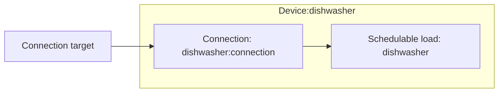

# Schedulable load modeling

The schedulable load device composes one schedulable load model element and one [Connection](../model-layer/connections/connection.md).

## Model elements created

The adapter creates two model elements:

| Model Element                                          | Name                | Purpose                                         |
| ------------------------------------------------------ | ------------------- | ----------------------------------------------- |
| Schedulable load                                       | `{name}`            | One run of the profile per window, priced miss  |
| [Connection](../model-layer/connections/connection.md) | `{name}:connection` | Network → load, with no limits of its own       |

The connection needs no power limit: the profile fixes the power the load draws.

## Architecture details

### Profile

The power and run duration form a one-step profile: the configured power for the configured duration.
The [schedulable load model](../model-layer/elements/schedulable_load.md) accepts any number of steps, so a load with a measured multi-phase profile reuses the same model element with a longer profile.
Negative readings are treated as zero.

### Window scheduling

Calendar events define the windows a run must fit inside.
Every event opens a window, whatever its text says.
The adapter builds windows the same way as for the [deferrable load](deferrable_load.md#window-scheduling):

- **Overlapping events merge** into one window that receives one run.
- **Touching events stay separate**, each receiving its own run.
- **Windows running past the horizon end** are clamped to the final boundary, so a run must fit before the horizon end.

### Runs already started

Each optimization starts a fresh horizon, so the device must tell the model what the load is already doing.
When a running sensor is configured, the integration looks up when the sensor last stopped reading off, using the same recorder lookup as the [EV's plugged-in sensor](ev.md#early-return).
That time is when the latest run started.

- **Running now**: the run is committed.
    The model consumes the rest of the profile from the horizon start, counting from the run's start, and allows no new start until it finishes.
    Without history the run is taken to have just started, which plans the whole profile.
- **Run started inside the open window**: that window needs no further run, whether the run is still going or has finished.
- **Run started before the open window opened**: the run does not count toward the open window, which still needs its own run once the committed run finishes.

The open window's start comes from its calendar event, even when it began before the horizon.
HAEO keeps no state of its own, so the decision replays the same way from diagnostics.

### Start decision

The advanced section's start decision sets the model's `integer_mode`.
The default makes the decision to start in the current period all or nothing, which is the only decision acted on before the next optimization.
See [integer starts](../model-layer/elements/schedulable_load.md#integer-starts) for the trade-offs.

## Devices created

The schedulable load element creates a single Home Assistant device:

| Device           | Name     | Created when | Purpose                            |
| ---------------- | -------- | ------------ | ---------------------------------- |
| Schedulable Load | `{name}` | Always       | Power, start schedule, missed runs |

## Parameter mapping

| User configuration | Model element(s)          | Model parameter                     | Notes                                       |
| ------------------ | ------------------------- | ----------------------------------- | ------------------------------------------- |
| `window_calendar`  | Schedulable load `{name}` | `in_window`, `window_start`         | Overlaps merged, clamped to the horizon end |
| `running`          | Schedulable load `{name}` | `elapsed`, `window_started`         | From the sensor's last off time             |
| `power`            | Schedulable load `{name}` | `profile_power`                     | One step, clamped ≥ 0                       |
| `duration`         | Schedulable load `{name}` | `profile_duration`                  | One step in hours, clamped ≥ 0              |
| `deficit_price`    | Schedulable load `{name}` | `deficit_price`                     | Defaults to \$10/kWh, clamped ≥ 0           |
| `integer_mode`     | Schedulable load `{name}` | `integer_mode`                      | Defaults to `first`                         |

## Output mapping

The adapter maps model outputs to schedulable-load-specific sensor names:

| Model output                     | Sensor name     | Description                                     |
| -------------------------------- | --------------- | ----------------------------------------------- |
| Connection power                 | `power`         | Power drawn by the load                         |
| `SCHEDULABLE_LOAD_START`         | `start`         | 1 at each boundary where a run is planned       |
| `SCHEDULABLE_LOAD_ENERGY_MISSED` | `energy_missed` | Profile energy of runs missed, at window ends   |

See [Schedulable Load Configuration](../../user-guide/elements/schedulable_load.md#sensors-created) for complete sensor documentation.

## Next steps

- :material-file-document:{ .lg .middle } **Schedulable load configuration**

    ---

    Configure schedulable loads in your Home Assistant setup.

    [:material-arrow-right: Schedulable load configuration](../../user-guide/elements/schedulable_load.md)

- :material-calculator:{ .lg .middle } **Schedulable load model**

    ---

    Profile columns, run counting, and integer starts.

    [:material-arrow-right: Schedulable load formulation](../model-layer/elements/schedulable_load.md)

- :material-connection:{ .lg .middle } **Connection model**

    ---

    How power limits, efficiency, and pricing are applied.

    [:material-arrow-right: Connection formulation](../model-layer/connections/connection.md)

