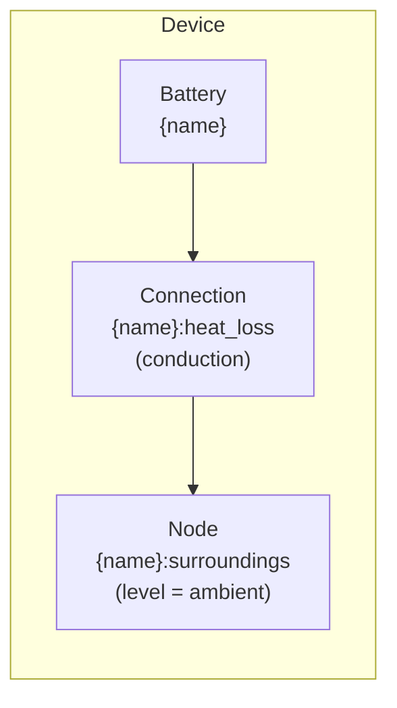

# Thermal mass modeling

The Thermal mass device models something that stores heat, such as a hot water tank or a room.
It composes a [Battery](../model-layer/elements/battery.md) whose level is its temperature,
a [Node](../model-layer/elements/node.md) at the ambient temperature,
and a [Connection](../model-layer/connections/connection.md) with a [conduction segment](../model-layer/segments/level.md) that carries the heat lost to the surroundings.

## Model elements created

| Model Element                                          | Name                  | Parameters From Configuration                        |
| ------------------------------------------------------ | --------------------- | ---------------------------------------------------- |
| [Battery](../model-layer/elements/battery.md)          | `{name}`              | Heat capacity, temperatures, comfort band and cost   |
| [Node](../model-layer/elements/node.md)                | `{name}:surroundings` | Ambient temperature as its level; source and sink    |
| [Connection](../model-layer/connections/connection.md) | `{name}:heat_loss`    | Heat loss as the conductance of a conduction segment |

Heating and cooling reach the mass through [Connection](connection.md) elements whose target is the mass.

## Devices created

Thermal mass creates 1 device in Home Assistant:

| Device  | Name     | Created When | Purpose                           |
| ------- | -------- | ------------ | --------------------------------- |
| Primary | `{name}` | Always       | Planned temperature and heat lost |

## Parameter mapping

The store is an unbounded battery that measures heat from the mass's current temperature $T_0$.
With heat capacity $C$ (kWh/°C), stored energy and temperature relate by $E = C \cdot (T - T_0)$,
so the store starts empty and goes negative as the mass cools.
It has no capacity: the comfort band, priced, is the only limit on its temperature,
since the surroundings can push it anywhere whatever the plan does.

| User Configuration    | Model Element | Model Parameter     | Notes                                     |
| --------------------- | ------------- | ------------------- | ----------------------------------------- |
| `heat_capacity`       | Battery       | `energy_per_level`  | $C$                                       |
| `temperature`         | Battery       | `level_offset`      | $T_0$; `initial_charge` is 0              |
| -                     | Battery       | `capacity`          | None, an unbounded store                  |
| `min_temperature`     | Battery       | `min_charge`        | $C \cdot (T_{\text{low}} - T_0)$, priced  |
| `max_temperature`     | Battery       | `max_charge`        | $C \cdot (T_{\text{high}} - T_0)$, priced |
| `comfort_cost`        | Battery       | `charge_limit_cost` | \$/kWh/h of heat outside the band         |
| `ambient_temperature` | Node          | `level`             | Forecast per period                       |
| `heat_loss`           | Connection    | `conductance`       | kW/°C                                     |

## Sensors created

The sensors this element creates are listed under [Sensors created](../../user-guide/elements/thermal_mass.md#sensors-created) on the Thermal mass page.

## Physical interpretation

The mass is treated as one fully mixed temperature.
For a stratified hot water cylinder this slightly undercounts the hot water available, since the top of the tank is hotter than its mean.
Heat flows to the surroundings at the end-of-period temperature, which stays stable for every period length, as [Level segments](../model-layer/segments/level.md#stability-over-long-periods) explains.

## Next steps

- :material-file-document:{ .lg .middle } **Thermal mass configuration**

    ---

    Configure a hot water tank or a room.

    [:material-arrow-right: Thermal mass configuration](../../user-guide/elements/thermal_mass.md)

- :material-arrow-expand-horizontal:{ .lg .middle } **Level segments**

    ---

    How conduction and level limits set flows from temperature differences.

    [:material-arrow-right: Level segments](../model-layer/segments/level.md)

- :material-battery:{ .lg .middle } **Battery model**

    ---

    The store underneath a thermal mass.

    [:material-arrow-right: Battery formulation](../model-layer/elements/battery.md)

