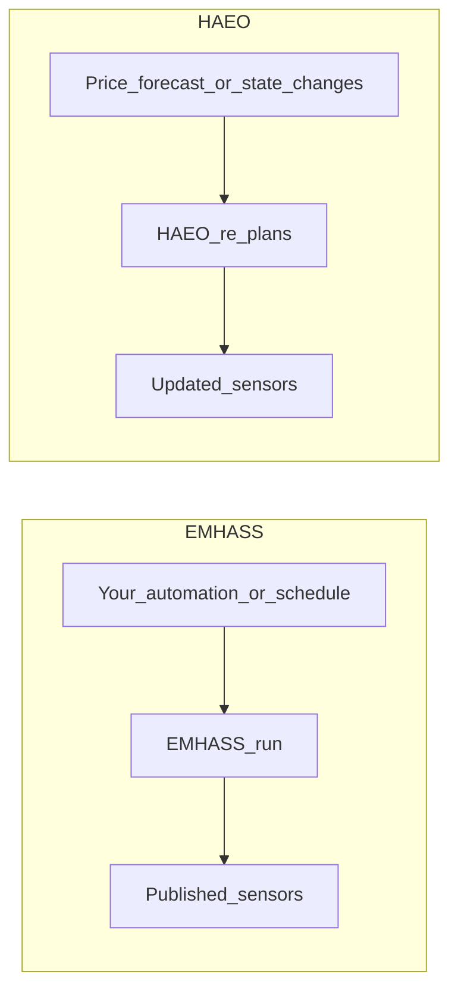

# HAEO vs EMHASS

If you are looking for an energy optimizer for Home Assistant, you will likely come across two actively maintained projects: HAEO and EMHASS.
Both plan when to charge your battery, when to import and export, and when to run flexible loads, so that your energy costs less.
They differ in how you set them up, how often they re-plan, and which parts of a home they cover.

This page compares them from the point of view of someone running one at home, so you can pick the one that fits your system.
It reflects EMHASS v0.18.6 (October 2026).

## At a glance

| What you care about          | HAEO                                                  | EMHASS                                                         |
| ---------------------------- | ----------------------------------------------------- | -------------------------------------------------------------- |
| **Installing**               | HACS integration, any Home Assistant install          | Add-on (HA OS/Supervised), or Docker/standalone                |
| **Setting up**               | Home Assistant UI, one element at a time              | EMHASS web UI and configuration file                           |
| **Re-planning**              | Automatic, whenever an input changes                  | When your automation calls it                                  |
| **Using the plan**           | Sensors with the plan in a `forecast` attribute       | Sensors published by EMHASS, plus a REST API                   |
| **Batteries, solar, grids**  | Any number, wired however your system is wired        | Several batteries and arrays in a fixed layout with one grid   |
| **Flexible appliances**      | Energy by a deadline, scheduled from a calendar       | On/off scheduling, run times, minimum run time, fixed programs |
| **Electric vehicles**        | EV element with trips from a calendar and V2G         | As a flexible appliance or extra battery, plus recipes         |
| **Heat pumps and hot water** | Not yet                                               | Tanks, heating zones, and heat pump efficiency                 |
| **Backup reserve**           | Sized from the loads you want to keep and outage time | Fixed low-charge threshold with a cost                         |
| **Demand charges**           | Not yet                                               | Yes                                                            |
| **Source-dependent prices**  | Yes, with power policies                              | On/off switches such as "no battery export"                    |
| **Forecasts**                | From other integrations, or a calendar                | Built-in solar and machine-learning load forecasts             |

## How each one fits into your day

### EMHASS: you decide when it plans

EMHASS grew out of European homes where tomorrow's prices are known in advance.
Its classic mode plans the next day once, then publishes the setting for the current time slot.
For prices that change during the day, its `naive-mpc-optim` mode re-plans with fresh battery charge, forecasts, and appliance state.
You trigger each run yourself with an automation, `rest_command`, or shell command, and pass the current state in.
The [EMHASS MPC guide](https://emhass.readthedocs.io/en/latest/study_cases/mpc.html) explains the setup.

### HAEO: it re-plans as things change

HAEO was built for prices that move all day, such as [Amber Electric](https://www.home-assistant.io/integrations/amberelectric/) or [AEMO NEM](https://www.home-assistant.io/integrations/aemo/) spot prices.
It re-plans whenever a price, forecast, or sensor it reads changes, and as time moves on, with nothing for you to schedule.
The near future is planned minute by minute and later hours more coarsely, so the decision for right now stays precise while the plan still looks days ahead.
See [how data updates work](data-updates.md).

### What this means for the plan

HAEO plans without any on/off decisions, which keeps each plan a straightforward calculation.
For you, that means:

- Re-planning takes a fraction of a second, so it can happen every time a price moves.
- Each plan is the cheapest one for its inputs, not a close approximation.
- The same inputs always give the same plan, so it does not flip between equally cheap options from one update to the next.

EMHASS makes on/off decisions for appliances, and for every battery it decides in each time slot whether to charge or discharge.
Those decisions make each run much harder to solve, so by default EMHASS accepts a plan within 1% of the cheapest and stops at a time limit.
In exchange, it can schedule appliances that really are either on at full power or off.

## Appliances and EVs

### Flexible appliances

HAEO's [deferrable load](elements/deferrable_load.md) is for devices that need a set amount of energy by a deadline and can run at any power up to their limit, such as a pool pump or an EV charger.
You put each run window in a Home Assistant calendar, with the energy it needs in the event text, such as `8 kWh`.
HAEO fits that energy into the cheapest part of each window.
An optional energy meter lets it plan only what is left when it re-plans partway through a window.
If the energy cannot fit, HAEO plans for the shortfall at a cost you set instead of failing.

EMHASS covers appliances that HAEO does not model yet:

- Loads that are either on at a fixed power or off
- Minimum on and off times, to stop short cycling
- Fixed programs, such as a washing machine cycle, where EMHASS only picks the start time
- Loads that run only when doing so costs less than a limit you set

In EMHASS, each appliance's window and run hours are configuration values or are passed in on each run, rather than read from a calendar.

### Electric vehicles

HAEO's [EV element](elements/ev.md) plans charging around your trips:

- Trips come from a calendar with the distance in each event, and HAEO works out the energy each trip needs.
- A plugged-in sensor and an optional odometer tell it whether the car is home, yet to leave, or back early.
- The car can supply the home (V2G) when your charger supports it.
- A public charging price lets HAEO weigh charging at home against topping up on the road.

The [EV walkthrough](../walkthroughs/adding-an-ev.md) sets one up for a real car.

EMHASS has no EV element.
You model the car as a flexible appliance or as an extra battery, and its cookbook has recipes for pairing it with evcc to control the charger.

## Batteries

Both handle several batteries.
In EMHASS they share the system's one inverter, and some settings, such as the charge target and the no-export switch, apply to all of them at once.
In HAEO each battery is its own element, connected wherever it sits in your system, for example one on a hybrid inverter and one AC-coupled.

### Backup reserve and spare room

HAEO's [buffers](elements/buffer.md) hold back battery charge, or empty space, for a reason you describe:

- **A reserve** keeps enough energy to run the loads you choose through a grid outage of the length you choose, less any solar that keeps running.
- **Headroom** keeps enough empty space for solar you cannot curtail, or keeps a battery off 100% to look after it.

A reserve follows the plan, so it grows when HAEO plans to run a big load and shrinks when it does not.
The [buffers walkthrough](../walkthroughs/buffers.md) shows both kinds.

EMHASS gives each battery a low-charge and a high-charge threshold with a cost for crossing them, which you set by hand.

### Battery options only EMHASS has

- **Charge power that slows as the battery fills**, as most batteries do near full
- **Inverter efficiency that changes with power**, for hybrid inverters
- **A charge target at a set time**, such as 80% by 4 pm
- **Battery self-identification**, which estimates your battery's real capacity and efficiency from its history and suggests them

## Tariffs

### Prices that depend on where the power came from

HAEO's [power policies](../walkthroughs/power-policies.md) price power by where it came from and where it goes.
For example, battery exports can earn a different rate from solar exports, or grid charging can be blocked while solar charging stays free.
Policies appear as their own device, so you can change them from the Home Assistant UI.

EMHASS has on/off switches for common cases, such as "no grid charging" and "no battery export", plus per-kWh costs on charging and discharging.

### Time-of-use prices from a calendar

Any HAEO price or forecast can read a Home Assistant calendar, so a peak period can be a recurring event with `0.30 $/kWh` in it.
See [calendars as forecasts](forecasts-and-sensors.md#calendars-as-forecasts).

### Demand charges

If your tariff charges for your highest grid import over a month or a peak window, EMHASS can plan around it.
It handles demand windows, peaks measured over 15 or 30 minutes, several charges at once, and the peak you have already reached this billing period.
HAEO does not model demand charges yet.

## Heating

EMHASS can plan heat pumps, gas or other fuel heaters, hot water and buffer tanks, and heating zones in your home.
It accounts for outdoor temperature in heat pump efficiency, sunlight through windows, and limits on how often a heat pump starts.
HAEO does not model heating yet.
You can still give HAEO a heat pump's expected consumption as a load forecast.

## Forecasts

HAEO reads forecasts from the integrations you already use, such as Solcast, Open-Meteo Solar Forecast, Amber, or Nordpool, and from calendars.
It recognizes their formats automatically; see [forecasts and sensors](forecasts-and-sensors.md).
For load forecasts built from your history, see [historical load forecast](historical-load-forecast.md).

EMHASS includes its own solar forecasting and a machine-learning load forecaster.
It also has tools that check its forecasts against your own history, and it can plan against a cautious solar forecast (Solcast P10) instead of the most likely one.

## Setup and day-to-day use

| What you care about  | HAEO                                                  | EMHASS                                           |
| -------------------- | ----------------------------------------------------- | ------------------------------------------------ |
| **Install**          | HACS, then add the integration                        | Add-on store, Docker, or standalone              |
| **Where it runs**    | Inside Home Assistant                                 | A separate service, which can be another machine |
| **Configuration**    | Home Assistant UI, with values you can change live    | EMHASS web UI and configuration file             |
| **Driving devices**  | Automations read HAEO's sensors                       | Automations read EMHASS's sensors                |
| **Seeing the plan**  | HAEO forecast and topology dashboard cards            | EMHASS web UI charts                             |
| **Understanding it** | Sensors show what an extra kWh is worth at each point | Plan and cost results                            |
| **Reporting issues** | Diagnostics capture the inputs from a past moment     | Logs and saved results                           |
| **Learning curve**   | Wiring your system together takes some thought        | Many configuration parameters to understand      |
| **Track record**     | Newer, smaller community                              | Mature, large community, extensive documentation |

## What HAEO does not do yet

- **Fixed-power appliances and fixed programs**: A deferrable load can run at any power up to its limit, so appliances that are only on or off, need a minimum run time, or follow a fixed cycle are not modeled.
- **Heating**: There is no heat pump, tank, or heating zone model.
- **Demand charges**: Peak import is not priced.
- **Battery detail**: Charge power does not slow as the battery fills, and efficiency does not change with power.
- **Built-in forecasting**: HAEO relies on other integrations for forecasts.

## Which one should you choose?

Choose **HAEO** if you:

- Have prices that change during the day and want plans that follow them with nothing to schedule
- Want battery export, solar export, and grid charging priced differently
- Have an unusual system, such as several inverters, AC- and DC-coupled batteries, or more than one grid connection
- Want a backup reserve sized for an outage
- Have an EV and want charging planned around your trips
- Run Home Assistant Container or Core, or want everything set up in the Home Assistant UI

Choose **EMHASS** if you:

- Have day-ahead prices and want a full-day schedule
- Need to schedule on/off appliances, minimum run times, or fixed programs
- Have a heat pump or hot water system you want planned
- Pay demand charges
- Want forecasting built in
- Want to run the optimizer on a separate machine
- Prefer a mature project with a large community

## Can you use both?

Yes, and for some homes that is the best split.
Running both on the same battery is redundant, so give each one the parts it does best:

| What                                                        | Tool       |
| ----------------------------------------------------------- | ---------- |
| Heating, fixed-power appliances, machine-learning forecasts | **EMHASS** |
| Battery, solar, grid, EV, flexible loads, power policies    | **HAEO**   |

After EMHASS publishes its plan, point a HAEO [load](elements/load.md) at the EMHASS sensors, such as `sensor.p_deferrable0`.
HAEO recognizes the [EMHASS format](forecasts-and-sensors.md#supported-forecast-formats) and plans the rest of your system around that consumption.

!!! tip "Avoid double control"

    Do not let HAEO and EMHASS both control the same battery or the same appliance.
    Decide which tool owns each device.

## Getting help

### HAEO support

- [GitHub issues](https://github.com/hass-energy/haeo/issues) - Bug reports and feature requests
- [GitHub discussions](https://github.com/hass-energy/haeo/discussions) - Questions and community support
- [Documentation](../index.md) - Guides and walkthroughs

### EMHASS support

- [GitHub repository](https://github.com/davidusb-geek/emhass) - Code and issues
- [Documentation](https://emhass.readthedocs.io/) - Setup and configuration guides
- [Community forum](https://community.home-assistant.io/t/emhass-an-energy-management-for-home-assistant/338126) - Active discussion thread

## Next steps

- :material-download:{ .lg .middle } **Install HAEO**

    ---

    Get started with HAEO by installing it through HACS and setting up your first energy network.

    [:material-arrow-right: Installation guide](installation.md)

- :material-connection:{ .lg .middle } **Understand forecasting**

    ---

    Learn how HAEO uses forecast data from Home Assistant sensors to optimize your energy system.

    [:material-arrow-right: Forecasts and sensors](forecasts-and-sensors.md)

- :material-help-circle:{ .lg .middle } **Troubleshooting**

    ---

    Find solutions to common issues and get help with HAEO configuration.

    [:material-arrow-right: Troubleshooting guide](troubleshooting.md)

- :material-github:{ .lg .middle } **Join the community**

    ---

    Connect with other HAEO users, ask questions, and share your experiences.

    [:material-arrow-right: GitHub discussions](https://github.com/hass-energy/haeo/discussions)

