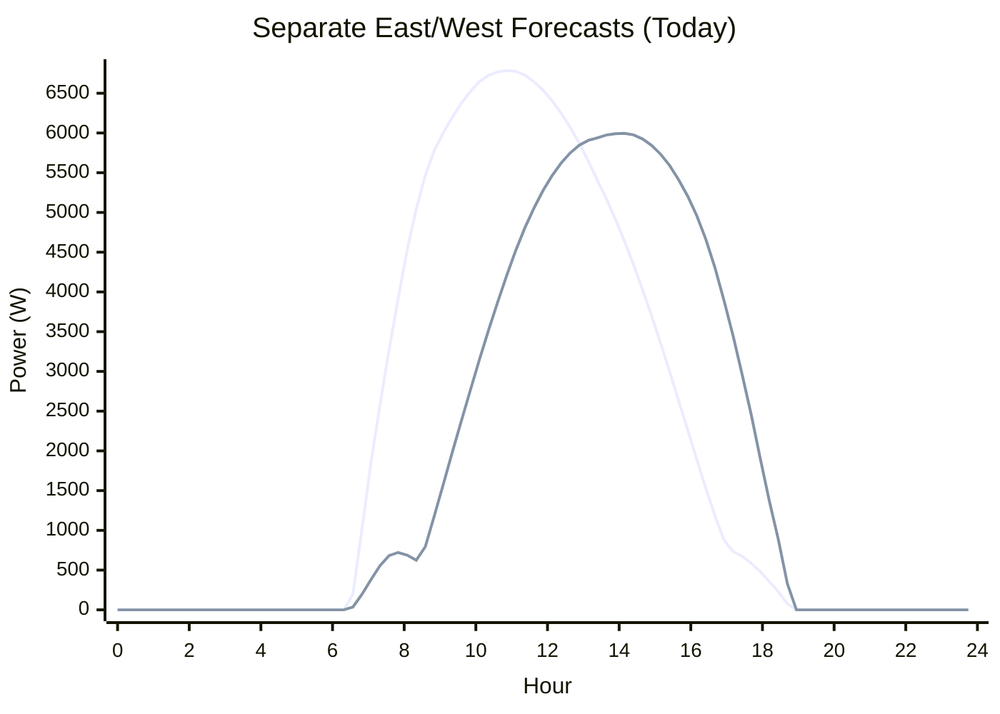
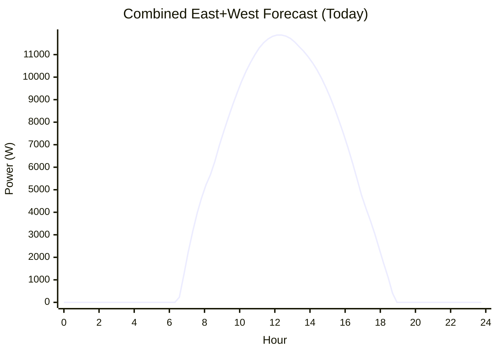
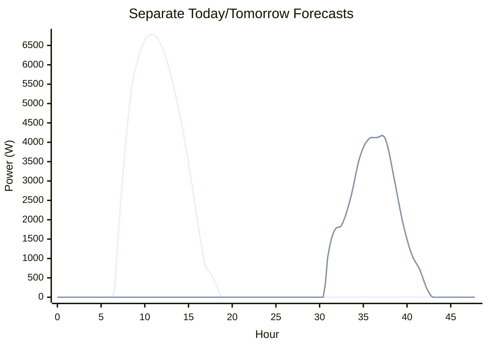
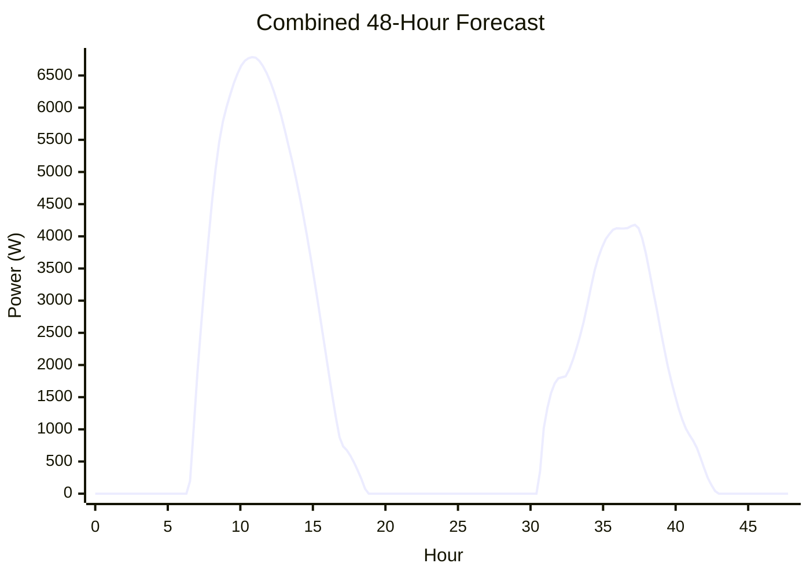
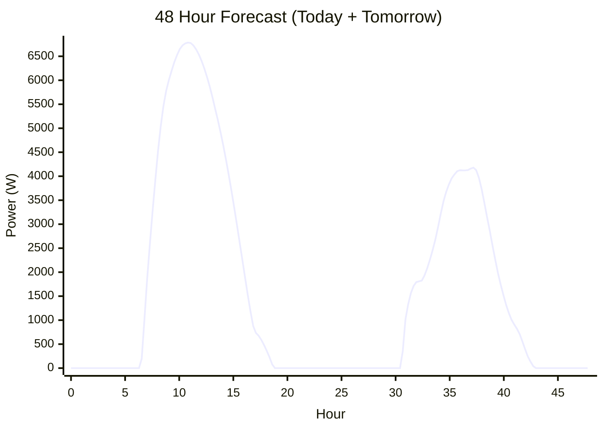
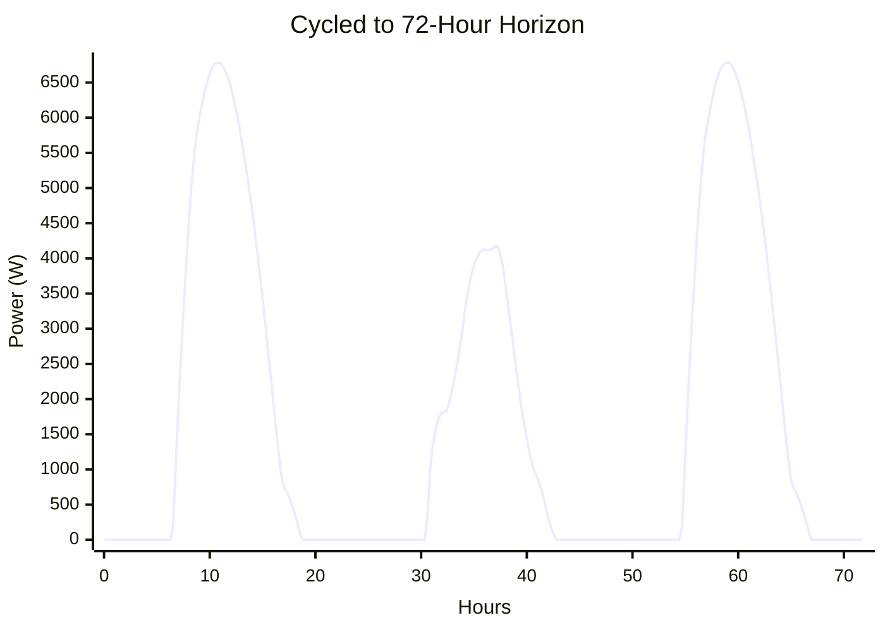

# Forecasts and sensors

This guide explains how HAEO uses Home Assistant sensor data to optimize your energy network.

## Overview

HAEO loads data from Home Assistant sensors to understand:

- **Electricity prices** for import and export
- **Solar generation** forecasts
- **Load consumption** patterns

Each sensor provides either a current value or a forecast series, never both.
HAEO automatically detects what data each sensor exposes and combines everything into a unified time series aligned with your optimization horizon.

## How HAEO uses sensor data

When you configure an element like a grid or solar system, you provide one or more sensor entity IDs.
HAEO reads these sensors and extracts either:

- **Present value**: The current sensor reading at the moment optimization starts (for simple sensors)
- **Forecast series**: A list of future timestamped predictions (for forecast-capable sensors)

These values are then processed to create a complete time series covering your optimization horizon.

## Single sensor values

The simplest case is a sensor that only provides a current value without any forecast data.

**Example**: A sensor showing current grid import price:

```yaml
entity_id: sensor.current_electricity_price
state: 0.25
```

HAEO reads the value (0.25 \$/kWh) and repeats it for every time step in your optimization horizon.
When you configure a sensor that only provides a present value, that value is used for all optimization periods.

### Scalar-only fields

Some configuration fields are scalar-only and do not create forecasts.
For example, the [Current charge percentage field](elements/battery.md#current-charge-percentage) uses the present value at optimization start to set the initial battery SOC.
HAEO reads the current sensor state and does not repeat it across the horizon for these fields, even when the sensor also carries a forecast.

## Forecast sensors

Some sensors provide structured forecast data instead of a simple current value.
HAEO automatically detects and parses forecast attributes from supported integrations.
Custom template sensors that match these formats will also work.

**Supported formats** (see [Supported Forecast Formats](#supported-forecast-formats) for complete details):

- [HAFO](https://hafo.haeo.io)
- [Amber Electric](https://www.home-assistant.io/integrations/amberelectric/) (electricity pricing)
- [AEMO NEM](https://github.com/cabberley/HA_AemoNemData) (Australian electricity pricing)
- [EMHASS](https://github.com/davidusb-geern/emhass) (energy management forecasts)
- [Nordpool](https://github.com/custom-components/nordpool) (electricity pricing)
- [Solcast Solar](https://github.com/BJReplay/ha-solcast-solar) (solar generation)
- [Volcast](https://github.com/volter-labs/volcast-ha-integration) (solar generation)
- [Open-Meteo Solar Forecast](https://github.com/rany2/ha-open-meteo-solar-forecast) (solar generation)
- HAEO sensors (chain HAEO outputs as inputs to other elements)

**Example**: Amber Electric sensor with pricing forecast:

```yaml
entity_id: sensor.amber_general_price
state: 0.28
attributes:
  forecasts:
    - start_time: '2025-11-10T14:00:00+10:00'
      per_kwh: 0.28
    - start_time: '2025-11-10T14:30:00+10:00'
      per_kwh: 0.32
    - start_time: '2025-11-10T15:00:00+10:00'
      per_kwh: 0.29
```

### Interpolation behavior

Forecast values are interpolated using trapezoidal integration to compute interval averages.
This means HAEO calculates the average power or price over each optimization period, not just point samples.

For the optimization horizon:

- **Position 0**: Present value at the horizon start time
- **Position 1+**: Average value over each subsequent time interval

This approach accurately represents energy consumption and costs over time.

### Unit conversion

HAEO automatically converts sensor units to the internal representation used for optimization.
You don't need to create template sensors for unit conversion.

**Power conversions**:

- W (watts) → kW (kilowatts)
- MW (megawatts) → kW (kilowatts)

**Energy conversions**:

- Wh (watt-hours) → kWh (kilowatt-hours)
- MWh (megawatt-hours) → kWh (kilowatt-hours)

**Price conversions**:

- A price per Wh or MWh → the same currency per kWh
- A price in cents or pence (`c/kWh`, `¢/kWh`, `ct/kWh`, or `p/kWh`) → the main currency unit, so 30 c/kWh is 0.30 \$/kWh

HAEO cannot convert between currencies, so every price input should report the same currency.
When price sensors report different currencies, HAEO keeps optimizing but raises a repair issue that lists each currency and its sensors.
A currency code and its symbol, such as EUR and €, count as the same currency.
Pence count as pounds and `ct` as euro cents, while cents written as `c` or `¢` count as cents of whichever currency your other prices use.

**Example**: If your battery sensor reports power in watts (`sensor.battery_power` = 5000 W), HAEO automatically converts this to 5 kW for optimization.

All HAEO output sensors use kilowatts (kW) for power and kilowatt-hours (kWh) for energy, regardless of input sensor units.

## Multiple sensors

You can provide multiple sensors for any field that accepts sensor(s).
HAEO combines them automatically.

**How combining works**:

All of an input's sensors add up on one timeline, each counting only within its own forecast window.
Wherever no sensor has data, the combined forecast repeats by time of day.

- Present values **sum together**
- Forecasts for windows that follow on from each other join, such as [today and tomorrow](#multiple-forecast-windows)
- Forecasts whose windows overlap add up where they overlap
- A forecast counts only within its own window, so a short one beside a long one adds only while it lasts
- With only present values, the summed value repeats across the horizon
- With a forecast, the summed present value is the value for now (the first period) and the summed forecast covers the rest
- If any of the sensors is unavailable, the whole field is unavailable, as it would be for a single unavailable sensor

**Example scenarios**:

**Scenario 1: Two forecast sensors**

```yaml
sensor_1: sensor.solar_rooftop_forecast
# Provides forecast series [...array 1 predictions...]

sensor_2: sensor.solar_ground_forecast
# Provides forecast series [...array 2 predictions...]

# Result: Forecast series (sum of both arrays at each timestamp)
```

**Scenario 2: One forecast sensor, one simple sensor**

```yaml
sensor_1: sensor.solar_array_forecast
# Provides forecast series [...predictions...]

sensor_2: sensor.current_load
# Provides current value: 1.5 kW

# Result: 1.5 kW for the first period, then the forecast series
```

A present value is a reading of now, not a constant to add to every period.
To add a constant across the horizon, give it a forecast, for example a template sensor with a `forecast` attribute.

This makes it easy to model multiple solar arrays, price components, or load sources without manual calculation.

### Visual example: Combining two solar arrays

When you configure two solar arrays for a solar element, HAEO sums their forecasts at each timestamp.
This example uses real data from an east-facing and west-facing array:

<div class="grid grid-cols-2 gap-4">





</div>

**Legend**: First chart shows east array (blue) and west array (orange) separately. East array peaks in the morning, west array peaks in the afternoon. Second chart shows their combined output summed at each timestamp.

The combined output provides more consistent generation throughout the day.

## Multiple forecast windows

Many integrations provide separate forecasts for different time windows (today, tomorrow, day-after-tomorrow).
Combine them using multiple sensors:

| Field     | Value                                                       |
| --------- | ----------------------------------------------------------- |
| **Power** | sensor.solar_forecast_today, sensor.solar_forecast_tomorrow |

The two windows follow on from each other, so they join into one forecast covering both days.
Only the part of each forecast inside the horizon matters:

- With a horizon that ends tonight, only today's forecast falls inside it, so tomorrow's adds nothing
- With a horizon reaching into tomorrow, the plan uses today's forecast and then tomorrow's
- With a horizon longer than both, the joined two days [repeat by time of day](#forecast-coverage-and-cycling) after tomorrow ends

If two windows leave a gap between them, such as today and the day after tomorrow, the gap has no data and is filled the same way.

!!! tip "Cover the horizon for a value that should apply everywhere"

    A short sensor beside a long one counts only within its own window.
    For example, a 24-hour surcharge forecast beside a 7-day price forecast adds to the first day only, because the price forecast has data for the rest of the horizon.
    If the surcharge should apply on every day, give it a forecast that covers the horizon.

### Visual example: Combining today and tomorrow forecasts

When you provide both today's and tomorrow's forecasts, HAEO seamlessly combines them.
This example shows the north array with different weather conditions each day:

<div class="grid grid-cols-2 gap-4">





</div>

**Legend**: First chart shows today's forecast (blue) reaching ~6.8kW peak and tomorrow's forecast (orange) with lower ~4.2kW peak due to cloudier conditions. Second chart shows the seamless combined 48-hour coverage.

Notice how tomorrow's partly cloudy forecast shows lower generation than today's clear-sky conditions.
HAEO uses the actual forecast data for each day rather than assuming identical patterns.

## Forecast coverage and cycling

Forecasts don't always cover your entire optimization horizon.
HAEO handles partial coverage automatically through **forecast cycling**.

### How cycling works

Wherever no sensor has data:

1. **Single sensor values** repeat for the entire horizon (already covered above)
2. **Forecast series** cycle using natural period alignment, after all of the input's forecasts have [combined](#multiple-sensors)

**Natural period alignment** means HAEO identifies the pattern duration in your forecast and repeats it intelligently:

- A 6-hour forecast from 2pm-8pm cycles to show the same 2pm-8pm pattern for subsequent days
- A weekly forecast cycles weekly, preserving your full week pattern
- Daily patterns like electricity pricing maintain realistic time-of-day structure

This ensures optimization always uses plausible data rather than assuming zero values or constant prices.

### What you'll see

If your optimization horizon is 48 hours but you only have a 24-hour forecast:

- Hours 0-24: Actual forecast data (interpolated)
- Hours 24-48: First 24 hours repeated with time-of-day alignment

For multi-day forecasts (like a 7-day solar forecast), the full pattern cycles at its natural period.

### Visual example: 24-hour forecast cycling to 72 hours

When your horizon exceeds forecast coverage, HAEO cycles the pattern with time-of-day alignment.
This example shows a single 48-hour north-facing solar array forecast extended to 72 hours:

<div class="grid grid-cols-2 gap-4">





</div>

**Legend**: First chart shows the combined 48-hour forecast from today and tomorrow. Second chart shows the same 48 hours repeated starting at hour 48 to fill the 72-hour horizon.

Note how the 48-hour pattern repeats starting at hour 48, maintaining realistic time-of-day generation profiles.

## Supported forecast formats

HAEO automatically detects and parses these forecast formats:

| Integration                                                                        | Domain                      | Use Case                        | Format              |
| ---------------------------------------------------------------------------------- | --------------------------- | ------------------------------- | ------------------- |
| [Amber Electric](https://www.home-assistant.io/integrations/amberelectric/)        | `amberelectric`             | Electricity pricing (Australia) | 30-minute intervals |
| [AEMO NEM](https://www.home-assistant.io/integrations/aemo/)                       | `aemo`                      | Wholesale pricing (Australia)   | 30-minute intervals |
| [EMHASS](https://github.com/davidusb-geern/emhass)                                 | `emhass`                    | Energy management forecasts     | Variable intervals  |
| HAEO                                                                               | `haeo`                      | Chain HAEO outputs as inputs    | Variable intervals  |
| [Nordpool](https://github.com/custom-components/nordpool)                          | `nordpool`                  | Electricity pricing (Europe)    | Variable intervals  |
| [HAFO](https://hafo.haeo.io)                                                       | `hafo`                      | Historical load forecasting     | Hourly intervals    |
| [Solcast Solar](https://github.com/BJReplay/ha-solcast-solar)                      | `solcast_pv_forecast`       | Solar generation                | 30-minute intervals |
| [Volcast](https://github.com/volter-labs/volcast-ha-integration)                   | `volcast`                   | Solar generation                | 5-minute intervals  |
| [Open-Meteo Solar Forecast](https://github.com/rany2/ha-open-meteo-solar-forecast) | `open_meteo_solar_forecast` | Solar generation                | Hourly intervals    |

Format detection is automatic—you don't need to specify the integration type.

## Creating custom forecast sensors

You can create custom forecast sensors using Home Assistant templates.
The forecast must be a list of dictionaries with time and value keys.
Times should be either DateTime objects or ISO8601 compatible strings.
Time strings without a timezone are treated as the local time of Home Assistant instance.

**Example**: Custom load forecast sensor:

```yaml
template:
  - sensor:
      - name: Custom Load Forecast
        state: "{{ states('sensor.current_load') }}"
        unit_of_measurement: kW
        device_class: power
        attributes:
          forecast:
            - time: '{{ (now() + timedelta(hours=1)).isoformat() }}'
              value: 2.5
            - time: '{{ (now() + timedelta(hours=2)).isoformat() }}'
              value: 3.0
            - time: '{{ (now() + timedelta(hours=3)).isoformat() }}'
              value: 2.8
```

**Requirements**:

- `state` must be a numeric value (current reading)
- `unit_of_measurement` must match the element's expected unit (kW for power, \$/kWh for prices)
- `device_class` should be set appropriately (`power`, `monetary`)
- `forecast` attribute must contain timestamp/value pairs

HAEO will detect this as a simple forecast format and extract the data.

## Calendars as forecasts

Any forecast field with a unit can read a Home Assistant calendar alongside or instead of a sensor.
HAEO reads the calendar's events over the horizon as a stepped forecast: each event's value while the event runs, and zero outside events.
Events that overlap add together.
A calendar combined with sensors adds to them like any other forecast.
Its zeros between and around events count as data, so a calendar covers the whole horizon: a sensor beside it counts only within its own window and does not repeat.

An event's value is a number followed by its unit, such as `5 kW`, `500 W`, `0.30 $/kWh`, `30c/kWh`, or `120 €/MWh`.
It can sit among other words and numbers, so a summary of `EV 8kWh`, `Charge 8 kWh tonight`, or `Tariff 2 at 0.30 $/kWh` holds its value.
HAEO converts it to the field's unit as it would a sensor reading.

HAEO reads the value by these rules:

- A number must stand as its own word: the `2` in `EV2` or the `1.2` in `v1.2` is not a number.
    Pieces of a larger number are not read on their own either, such as the `500` in `1,500` or the `30` in `10:30`.
    Use a dot for decimals and no thousands separators: write `1.5 kWh` rather than `1,5 kWh`, and `1500 Wh` rather than `1,500 Wh`.
- The unit is the word typed right after the number, with or without a space between them.
- The location, summary, and description are checked in that order, and the first holding any number is the value's field.
    Fields after it are not read, even when its numbers cannot be used, so a mistyped value is reported rather than replaced.
    Keep other numbers, such as a street address, out of the fields before the value.
- The value is the field's one number whose unit converts to the field's unit.
    Other numbers in it, such as a tariff number or a charger's `7 kW` in an energy field, are passed over.
- A range, such as `8-10 kWh` or `8 to 10 kWh`, is never a value, and neither is a field holding several, such as `8 kWh or 10 kWh`.
- An event with no number in any field counts as zero.

An event whose value's field holds no number HAEO can use is never guessed: its numbers have no unit, a unit that does not convert to the field's unit, or are negative for a quantity that cannot be, or the field holds a range or several values.
HAEO ignores that event's value, so one mistyped event does not stop the rest of the calendar from loading, and raises a repair issue listing each such event with the text its value was read from.
The issue clears once every event's value can be used.

**Example**: A demand charge of 0.30 \$/kWh on weekday evenings.
Create a recurring event from 4 pm to 9 pm with `0.30 $/kWh` in its description, then add the calendar to the grid's import price next to the price sensor.
HAEO adds 0.30 \$/kWh to the import price during each event.
Past the end of the price sensor's forecast, the import price is the calendar's alone, so use a price forecast that covers the horizon.

Calendar events are fetched whenever the calendar or the horizon changes.
If a calendar cannot be read, the field is unavailable and optimization pauses until it can, as it would for an unavailable sensor.

## Using constants vs sensors

For values that don't change over time (fixed prices, baseline loads, power limits), you have two options:

### Direct constant entry

During element configuration, select **Constant** for the field and enter your value directly in the form.
This is the simplest approach for truly static values.

| Selection | Value | Use Case                      |
| --------- | ----- | ----------------------------- |
| Constant  | 0.25  | Fixed price (source → target) |
| Constant  | 15    | Static power limit            |
| Constant  | 90    | Fixed SOC percentage          |

### Input number helpers

For values you want to adjust through the Home Assistant UI without reconfiguring HAEO, use [input_number helpers](https://www.home-assistant.io/integrations/input_number/).

**Creating an input_number**:

1. Navigate to **Settings** → **Devices & Services** → **Helpers**
2. Click **Create Helper** button
3. Select **Number**
4. Configure:
    - **Name**: Descriptive name (e.g., "Base Load Power", "Fixed Transfer Price")
    - **Unit of measurement**: Match the element's expected unit (kW, \$/kWh, %, etc.)
    - **Minimum/Maximum**: Set reasonable bounds
    - **Initial value**: Set your desired constant
5. Click **Create**

**Using in HAEO configuration**:

During element configuration, select the input_number entity in the entity selector:

| Field         | Value                             |
| ------------- | --------------------------------- |
| **Price**     | input_number.fixed_transfer_price |
| **Max power** | input_number.transfer_max_power   |

HAEO treats input_number helpers like any other sensor, reading the current value and repeating it across the optimization horizon.

**Benefits of input_number helpers**:

- Adjustable through Home Assistant UI without reconfiguring HAEO
- Can be controlled via automations or scripts
- Value changes take effect on next optimization cycle

**When to use each approach**:

- **Constant**: Values that rarely change (capacity, efficiency) - enter a fixed value directly
- **Entity with input_number**: Values you adjust regularly (target SOC, temporary overrides) - select the input_number helper
- **Entity with forecast sensor**: Values that vary over time (prices, solar generation) - select the forecast sensor

## Troubleshooting

### Sensor not found

**Problem**: Error "Input … has no reading from …", or an input entity shows as unavailable

An input with no reading shows as unavailable, and HAEO does not optimize until it has one, whether at startup or while running.
A repair issue names the element, the input, and the sensors with no reading, and clears itself once they report again.

**Solutions**:

- Verify the sensor entity ID exists in Home Assistant
- Check that the sensor is available (not "unavailable" or "unknown")
- Ensure the sensor has been created by its integration

### No forecast data

**Problem**: Optimization uses repeated current values instead of forecasts

**Possible causes**:

- Sensor doesn't provide forecast attribute
- Forecast attribute is in an unsupported format
- Forecast data is empty or malformed

**Solutions**:

- Check sensor attributes in Developer Tools → States
- Verify the integration is configured correctly
- Review HAEO logs for format detection warnings

### Input cannot be negative

**Problem**: Error message "Input ... cannot be negative, but ... supplied ..."

Power, energy, state of charge, and efficiency inputs cannot be negative.
HAEO treats a sensor or forecast value slightly below zero as zero: within 10 W for power, 10 Wh for energy, or 0.01 percentage points for state of charge and efficiency.
A value further below zero stops optimization, and the error names the element, the input, the source sensors, and the value.

**Solutions**:

- Check the named sensor in Developer Tools → States, including its forecast attribute
- Fix the sign of the source, for example with a template sensor, if the integration reports the value inverted
- Optimization resumes automatically once the sensor reports a valid value

### Incorrect values

**Problem**: Optimized values don't match expectations

**Check**:

- Sensor units match element configuration (kW vs W, \$ vs cents)
- Multiple sensors are summing correctly (intended behavior?)
- Forecast data quality from the source integration
- Optimization horizon covers the relevant time period

## Best practices

### Update frequency

- **Pricing sensors**: Update before each optimization run (typically every 5-30 minutes)
- **Solar forecasts**: Update hourly or when weather changes significantly
- **Load forecasts**: Update based on your usage pattern changes

### Data resolution

Data resolution is less critical than you might expect because HAEO interpolates all data to match your optimization intervals.
However, higher resolution forecasts improve accuracy:

- Use forecasts with resolution matching or finer than your shortest horizon period
- The 1-minute near-term periods of a preset horizon work well with 5-minute or finer forecast data
- Longer periods (30-60 minutes) can use coarser forecast intervals
- Finer forecast data provides more accurate interpolation results

### Data quality

- Validate forecast accuracy periodically against actual outcomes
- Use reputable forecast providers with proven track records
- Consider multiple forecast sources for critical elements

## Next steps

<div class="grid cards" markdown>

- :material-history: **Create a historical load forecast**

    ---

    Build a simple load forecast from past consumption data

    [:material-arrow-right: Historical load forecast](historical-load-forecast.md)

- :material-battery-charging: **Configure your elements**

    ---

    Set up batteries, grids, solar, and loads with sensor references

    [:material-arrow-right: Element configuration](elements/index.md)

- :material-chart-line: **Monitor optimization results**

    ---

    View optimized schedules and actual performance

    [:material-arrow-right: Data updates guide](data-updates.md)

- :material-tools: **Troubleshoot issues**

    ---

    Resolve common problems and error messages

    [:material-arrow-right: Troubleshooting guide](troubleshooting.md)

</div>
