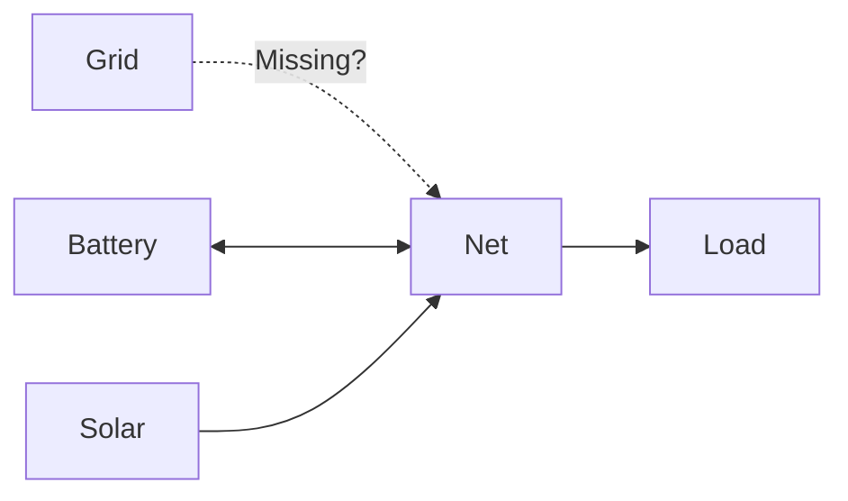
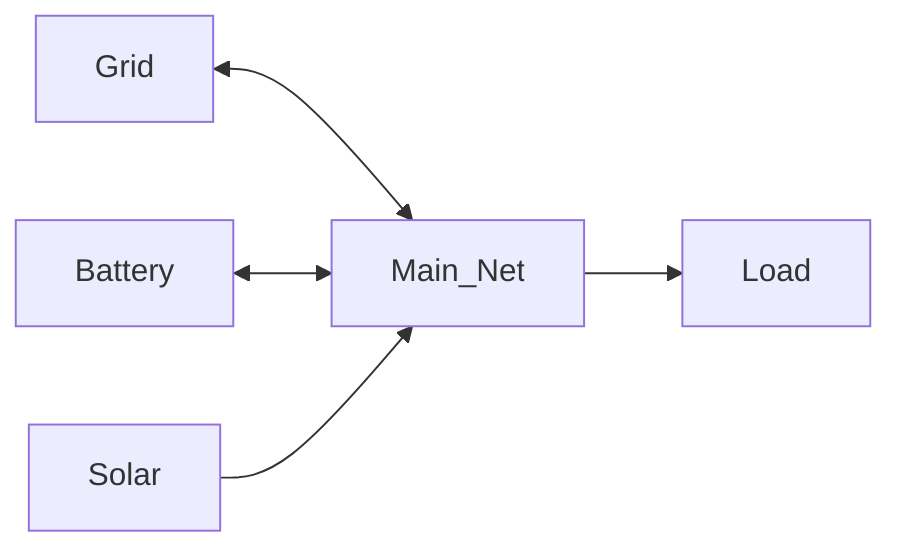

# Troubleshooting

Common issues and their solutions.

## Forecasts are not long enough

### Problem

Optimization fails or warnings about insufficient forecast data.

### Symptoms

- Optimization status shows `failed`
- Logs mention forecast length issues
- Sensors show `unknown` values

### Solutions

#### Check forecast length

Ensure your forecast sensors provide data for the entire optimization horizon.

**Example**: If horizon is 48 hours, forecasts must cover at least 48 hours.
See the [planning horizon](configuration.md#planning-horizon) options before changing the horizon.

#### Verify forecast sensors

Check sensor attributes in Developer Tools:

1. Go to **Developer Tools** → **States**
2. Find your forecast sensor
3. Check `forecast` attribute has enough timestamped values

#### Reduce horizon

If you can't get longer forecasts, reduce the horizon:

1. Open HAEO configuration
2. Choose a shorter preset, or a forecast sensor that ends within your forecast length
3. Save and wait for optimization
    Shorter horizons limit planning depth, so review the [planning horizon](configuration.md#planning-horizon) options when you make this change.

#### Use multiple forecast sensors

Some integrations split forecasts (today/tomorrow):

```yaml
Forecast:
  - sensor.solar_forecast_today  # 0-24 hours
  - sensor.solar_forecast_tomorrow  # 24-48 hours
```

HAEO combines them automatically.

#### Common integrations

| Integration               | Forecast Length |
| ------------------------- | --------------- |
| Open-Meteo Solar Forecast | 7 days          |
| Solcast                   | 7 days          |
| Amber Electric            | 48 hours        |
| Custom Sensors            | Varies          |

## Graph isn't connected properly

### Problem

Optimization fails because the network graph is disconnected.

### Symptoms

- Optimization status shows `failed`
- Some elements never show power flow
- Logs mention disconnected components

### Solutions

#### Visualize your network

Draw your network on paper:



Each element should have at least one connection.

#### Check all elements have connections

In HAEO configuration, verify:

1. **Grid**: Connected to a net or battery
2. **Battery**: Connected to grid or net
3. **Solar**: Connected to net or battery
4. **Loads**: Connected to net or battery

#### Add missing connections

If an element is isolated, add connection entries to link it to the network:

1. Navigate to **Settings** → **Devices & Services**
2. Click **Add Integration** and search for "HAEO"
3. Select **Connection** as the entry type
4. Choose the isolated element as source or target
5. Connect it to another element in your network
6. Submit the connection

#### Use junctions

For complex topologies, use [junctions](elements/junction.md) as connection hubs:



This ensures all elements connect to a common point.

#### Verify connection direction

Some connections are unidirectional:

- Solar can only **produce** (→)
- Loads can only **consume** (→)
- Grid and Battery are **bidirectional** (↔)

Ensure directions match physical capabilities.

## No plan meets every constraint

### Problem

Your forecasts ask for more than your system can do, so no plan can meet them.
A typical cause is a load forecast spike above what the grid import limit and the batteries can supply together, such as an EV charging session carried forward into the forecast.

### Symptoms

- A repair issue titled "No plan meets every constraint"
- Optimization status shows `failed`
- Logs show `Optimization failed with status: Infeasible` followed by the conflicting constraints

### Solutions

#### Read the conflicting constraints

The repair issue names the elements whose constraints cannot all hold together, and how many minutes into the plan they first conflict.
For a load spike, these are usually the load, the grid and batteries that cannot supply it, and the junction they meet at.

#### Check the forecasts and limits

Check the forecasts of the elements named in the issue for values your system cannot meet, and the power limits on the path between them.

#### Resolve the issue

The issue stays until you mark it resolved, even once a later plan is found, so a forecast that only sometimes asks for too much is not missed.
It describes the first plan that could not be found since you last resolved it, and when that plan was made.
Once you have addressed the cause, open the issue and select **Submit** to resolve it; it is raised again if a later plan cannot be found.

#### Report the issue

When the issue is raised, HAEO saves the configuration and inputs of the plan that failed to a diagnostics file in `config/haeo/diagnostics/`, named in the issue.
If you cannot find the cause, [open an issue](https://github.com/hass-energy/haeo/issues) and attach that file, so the plan can be run again exactly as it failed.
The file is deleted when you resolve the issue, or when you remove the hub, so attach it before you resolve the issue.
Only one file is kept for each open issue, so repeated failures do not fill your disk.

#### Relax impossible plans

Turn on **Relax impossible plans** in the hub's advanced settings to keep planning while a forecast asks for more than your system can do.
HAEO then finds the smallest shortfall that makes a plan possible, places it at a power balance where it can, and optimizes the rest of the plan as usual.
Something still went wrong, so a repair issue titled "A plan had to relax constraints it cannot meet" names the elements that conflict, how many minutes into the plan, and where and in how many periods the plan relaxed constraints, such as at the switchboard.
The log lists each relaxed constraint and by how much.

That issue stays until you resolve it in the same way, even once later plans meet every constraint.
It describes the first plan that had to relax constraints since you last resolved it, and saves its diagnostics in the same way.

The relaxed periods cannot happen as planned, so treat that issue as a sign to check the forecast.
The shortfall is placed to be as small as possible rather than as cheap as possible, so the rest of the plan can cost a little more than it would with the shortfall placed by cost.

## An input has no reading

### Problem

A sensor that one of your inputs reads has stopped reporting, and shows as `unavailable` or `unknown`.

### Symptoms

- For a short gap, HAEO keeps planning with the sensor's last reading
- The input's entity then shows `held_source_entity`, naming the sensor, and `held_since`, the time it stopped reporting
- If the gap lasts longer than the hub's **Sensor gap tolerance**, the input shows as unavailable, the optimization status is **Failed**, and the other output sensors are unavailable
- A repair issue titled "… has no reading for …" names the element, the input, and the sensors with no reading

### Solutions

#### Check the sensor

Look up each sensor the repair issue names in **Developer tools → States**.
If it was removed or renamed, reconfigure the element to read one that exists.
HAEO starts planning again as soon as the sensor reports, and the repair issue clears.

#### Allow for short dropouts

If a sensor often drops out for a few seconds or minutes, raise **Sensor gap tolerance** in the hub's [advanced settings](configuration.md#editing-hub-settings), so HAEO keeps planning through those gaps.
A longer tolerance means HAEO may plan with an older value, so keep it no longer than you are happy to plan on a reading that old.
Set it to 0 to stop planning as soon as any sensor has no reading.

#### Act on held values in automations

An automation that follows HAEO's plan can check whether an input is holding a reading, and be more careful while it is:

```yaml
condition:
  - condition: template
    value_template: >-
      {{ state_attr('number.grid_import_price', 'held_source_entity') is none }}
```

## Optimization takes too long

### Problem

Optimization duration exceeds acceptable limits.
HAEO stops a solve that runs for more than 60 seconds and reports the optimization as failed, so a slow solve never holds up the next one.

### Solutions

If optimization takes too long:

1. **Shorten the horizon**: Choose a shorter [planning horizon](configuration.md#planning-horizon) preset, or a forecast sensor with fewer periods
2. **Simplify network**: Remove unnecessary elements

## Battery not charging/discharging

### Problem

Battery remains idle despite price variation.

### Solutions

1. **Check SOC limits**: May be too tight
2. **Verify pricing**: Need import price > export price
3. **Check power limits**: May be too restrictive
4. **Review connections**: Battery must be connected

## Sensors showing unknown

### Problem

Element sensors display `unknown` values.

### Solutions

1. **Wait for optimization**: First run takes time
2. **Check optimization status**: Must be **Succeeded**; when it is **Failed**, its `error` attribute explains why
3. **Verify configuration**: All required fields filled
4. **Review logs**: Check for error messages

## Price forecasts not working

### Problem

HAEO doesn't respond to price changes.

### Solutions

1. **Check forecast format**: Must include `datetime` and `value`
2. **Verify timestamps**: Must be ISO format; times without a timezone are read in Home Assistant's time zone
3. **Ensure forecast length**: Must cover horizon
4. **Check sensor updates**: Must update regularly

## HAEO could not start

### Problem

A "HAEO could not start" repair issue appears, and the integration shows as retrying setup.

### Solutions

HAEO never gives up on starting.
Home Assistant keeps retrying setup in the background, and the issue clears once it succeeds.

1. **Read the error**: The issue shows the error HAEO hit, and the log has the full traceback
2. **Check your sensors**: Every sensor your elements read should be available in **Developer tools → States**
3. **Report it**: If the error persists once your sensors are available, [report a bug](https://github.com/hass-energy/haeo/issues) with the log and your diagnostics

## Elements refer to elements that do not exist

### Problem

A repair issue titled "Elements refer to elements that do not exist" appears, and the integration shows as retrying setup.

### Solutions

An element names another element that has been deleted, so HAEO cannot build your system.
Deleting an element removes only the prices set on its own form, so everything else that named it is kept.
The issue lists each affected element and the names it is missing.

1. **Add the missing element again**: Use exactly the same name, and everything that named it works as before
2. **Or point elsewhere**: Reconfigure each affected element to use another element, or delete it

HAEO starts again once every element names only elements that exist, and the issue clears.

## Getting help

If these solutions don't help:

1. **Check logs**: Settings → System → Logs
2. **GitHub Issues**: [Report a bug](https://github.com/hass-energy/haeo/issues)
3. **Discussions**: [Ask for help](https://github.com/hass-energy/haeo/discussions)

Include:

- Home Assistant version
- HAEO version
- Configuration (sanitized)
- Relevant logs

## Next steps

Try these resources if you still need assistance after working through the troubleshooting steps.

<div class="grid cards" markdown>

- :material-sync:{ .lg .middle } __Review data update behaviour__

    Check how HAEO refreshes data and identify update bottlenecks.

    [:material-arrow-right: Data update guide](data-updates.md)

- :material-robot-outline:{ .lg .middle } __Check automation patterns__

    Ensure follow-up automations react correctly to optimizer outputs.

    [:material-arrow-right: Automation patterns](automations.md)

- :material-forum:{ .lg .middle } __Ask the community for help__

    Share logs and scenarios to get tailored assistance.

    [:material-arrow-right: GitHub discussions](https://github.com/hass-energy/haeo/discussions)

</div>
