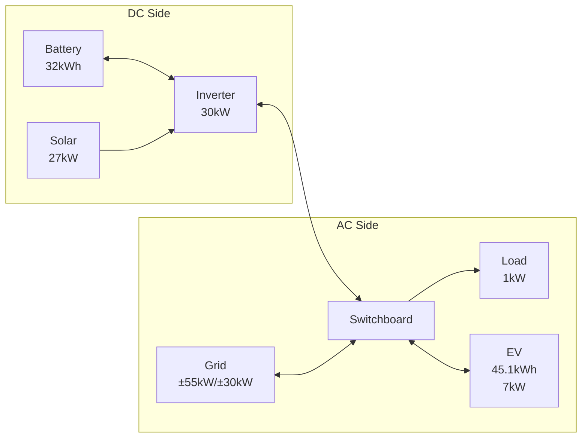

# Adding an EV to your system

This walkthrough adds an electric vehicle (EV) to an existing home energy system.
It covers creating a trip calendar, scheduling trips, and configuring the EV element so HAEO charges the car ahead of departures.
It follows a BYD Atto 2 set up with the [BYD vehicle](https://github.com/jkaberg/hass-byd-vehicle) integration, but any integration with similar sensors works the same way.

## System overview

After completing this walkthrough, your system will include:

- **Base system**: Inverter, battery, solar, grid, and load (from the [Sigenergy System](sigenergy-system.md) guide)
- **EV**: a 45.1 kWh battery, a 7 kW home charger, a 20% minimum charge, and a trip calendar



## Prerequisites

Complete the [Sigenergy System](sigenergy-system.md) walkthrough first.
This guide builds on that configuration and adds a trip calendar and an EV element.

```guide-setup
run_guide("sigenergy-system")
hass.set_state(
    "sensor.byd_atto_2_battery_level",
    "89",
    {"unit_of_measurement": "%", "device_class": "battery", "friendly_name": "Atto 2 Battery level"},
)
hass.set_state(
    "binary_sensor.byd_atto_2_plug",
    "on",
    {"device_class": "plug", "friendly_name": "Atto 2 Plug"},
)
hass.set_state(
    "sensor.byd_atto_2_odometer",
    "8566",
    {
        "unit_of_measurement": "km",
        "device_class": "distance",
        "state_class": "total_increasing",
        "friendly_name": "Atto 2 Odometer",
    },
)
hass.set_state(
    "sensor.byd_atto_2_lifetime_average_ev_consumption",
    "14.6",
    {"unit_of_measurement": "kWh/100km", "friendly_name": "Atto 2 Lifetime average EV consumption"},
)
```

### EV sensors

These come from your car's integration, or from your charger's integration for the plug:

- **Battery level**: the car's state of charge.
- **Plug**: a binary sensor that is on while the car is plugged in at home.
    It is required, since you need one to automate charging anyway.
    A sensor that reports words instead, such as a charger reporting `Charging` or `Idle`, also works: HAEO asks which of its states mean plugged in.
- **Odometer** (optional): tells HAEO how far the car has gone on the current trip, so a car that is back early is not planned as if it had not left.
    It needs a state class of `total_increasing`, which car integrations usually set.
- **Average consumption** (optional): a sensor in `kWh/100km`, `kWh/km`, or `Wh/km`, so trip energy follows how the car is actually driven.
    You can enter a fixed figure instead.

## Step 1: Create a trip calendar

HAEO reads upcoming trips from a Home Assistant calendar.
Create a dedicated [Local Calendar](https://www.home-assistant.io/integrations/local_calendar/) so trip events stay separate from your personal calendars.

```guide
add_local_calendar(page, calendar_name="EV Trips")
```

## Step 2: Schedule a trip

Create an event for each trip.
Its start and end mark when the car is away, and its title says where it goes and how far, such as `Office 105 km`.
The commute happens every day, so set it to repeat daily and each day's trip is planned without adding it again.

```guide
create_calendar_event(
    page,
    title="Office 105 km",
    start_time="08:30",
    end_time="18:30",
    recurrence="Daily",
)
```

!!! tip "Distance format"

    Write the distance as a number followed by its unit, such as `105 km` or `30 mi`, among any other words in the title.
    Keep to one distance per event: a title with two distances, or a number without a unit, is ignored, and HAEO raises a repair issue so you can fix the event.
    An event without a distance still marks the car away for its duration, but asks for no trip energy.

## Step 3: Add the EV element

Navigate to the HAEO integration page and add the EV element.

```guide
page.navigate_to_settings()
page.navigate_to_integrations()
page.navigate_to_integration("HAEO")
```

Configure the EV with its battery, charging, and trip details.
The EV connects to the **Switchboard**, the junction HAEO created with your hub, where the home charger is wired.

```guide
add_ev(
    page,
    name="Atto 2",
    connection="Switchboard",
    capacity=ConstantInput(45.1),
    energy_per_distance=EntityInput("Atto 2 Lifetime average EV consumption", "Atto 2 Lifetime average EV consumption"),
    current_soc=EntityInput("Atto 2 Battery level", "Atto 2 Battery level"),
    min_charge_percentage=ConstantInput(20),
    max_charge_rate=ConstantInput(7),
    connected=EntityInput("Atto 2 Plug", "Atto 2 Plug"),
    trip_calendar=EntityInput("EV Trips", "EV Trips"),
    odometer=EntityInput("Atto 2 Odometer", "Atto 2 Odometer"),
    public_charging_price=ConstantInput(0.60),
)
```

!!! tip "Min charge and public charging"

    The min charge keeps the battery above 20% for an unplanned trip: HAEO never plans to drain past it.
    The public charging price is what a top-up away from home costs; HAEO weighs it against charging at home before each trip.

The 105 km commute at 14.6 kWh/100km needs about 15.3 kWh.
HAEO plans that energy into the car before each departure, choosing the cheapest time to charge, and keeps the battery above 20% throughout.

## Step 4: Verify setup

After completing configuration, verify that all elements were created successfully.

```guide
verify_setup(page)
```

## Verification

Navigate to **Settings → Devices & Services → HAEO** to view the complete system.

### Expected device hierarchy

| Element | Type | Key Sensors                                             |
| ------- | ---- | ------------------------------------------------------- |
| Atto 2  | EV   | Charge power, energy stored, SOC, trip energy delivered |

The EV element adds to the existing base system elements (Inverter, Battery, Solar, Grid, Load).

### Key EV sensors

- `sensor.atto_2_charge_power` — Optimal charging power (kW)
- `sensor.atto_2_discharge_power` — V2G discharge power (kW), which stays at 0 without a max discharge rate
- `sensor.atto_2_energy_stored` — Current energy in the EV battery (kWh)
- `sensor.atto_2_state_of_charge` — EV battery percentage (%)
- `sensor.atto_2_trip_energy_delivered` — Energy used by the current trip, reset at each trip start (kWh)
- `sensor.atto_2_trip_energy_shortfall` — Trip energy expected to be topped up publicly, at each trip's end (kWh)

All sensors include a `forecast` attribute with optimized future values.

### What to expect

With the commute scheduled:

- **Overnight**: HAEO charges the EV during the cheapest electricity periods
- **Before departure**: The EV reaches sufficient charge for the trip distance
- **During the trip**: The EV is away; a trip energy shortfall appears at the trip's end only if home charging could not cover the trip
- **After return**: HAEO resumes home charging based on the remaining schedule

The optimizer balances EV charging against battery storage, solar generation, and grid prices to minimize total system cost.

## Next steps

<div class="grid cards" markdown>

- :material-car-electric:{ .lg .middle } **EV element reference**

    ---

    Detailed configuration options for EV elements.

    [:material-arrow-right: EV configuration](../user-guide/elements/ev.md)

- :material-math-integral:{ .lg .middle } **EV modeling**

    ---

    Mathematical details of how EVs are modeled.

    [:material-arrow-right: EV modeling](../modeling/device-layer/ev.md)

- :material-home-lightning-bolt:{ .lg .middle } **Automation examples**

    ---

    Use optimization results to control your EV charger.

    [:material-arrow-right: Automations](../user-guide/automations.md)

</div>
