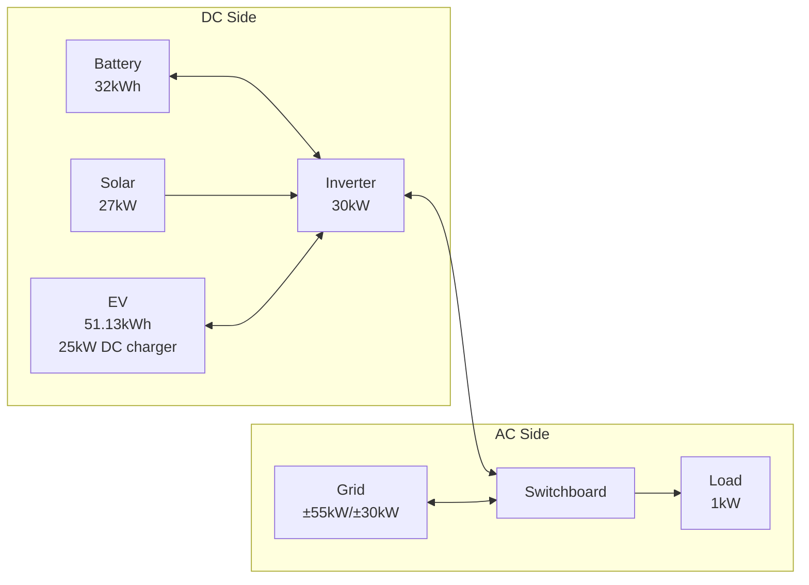

# Adding an EV to your system

This walkthrough adds an electric vehicle (EV) to an existing home energy system.
It covers creating a trip calendar, scheduling trips, and configuring the EV element so HAEO charges the car ahead of departures.
It follows a BYD Atto 2, but any car whose integration provides similar sensors works the same way.

## System overview

After completing this walkthrough, your system will include:

- **Base system**: Inverter, battery, solar, grid, and load (from the [Sigenergy System](sigenergy-system.md) guide)
- **EV**: a 51.13 kWh battery on a 25 kW Sigen DC charger, a 20% minimum charge, and a trip calendar



## Prerequisites

Complete the [Sigenergy System](sigenergy-system.md) walkthrough first.
This guide builds on that configuration and adds a trip calendar and an EV element.

```guide-setup
run_guide("sigenergy-system")
hass.set_state(
    "sensor.byd_atto_2_battery_level",
    "89.0",
    {
        "state_class": "measurement",
        "unit_of_measurement": "%",
        "device_class": "battery",
        "friendly_name": "BYD ATTO 2 Battery level",
    },
)
hass.set_state(
    "sensor.byd_atto_2_odometer",
    "8566",
    {
        "state_class": "total_increasing",
        "unit_of_measurement": "km",
        "device_class": "distance",
        "icon": "mdi:counter",
        "friendly_name": "BYD ATTO 2 Odometer",
    },
)
hass.set_state(
    "sensor.byd_atto_2_lifetime_average_ev_consumption",
    "14.6",
    {
        "state_class": "measurement",
        "unit_of_measurement": "kWh/100km",
        "friendly_name": "BYD ATTO 2 Lifetime average EV consumption",
    },
)
hass.set_state(
    "sensor.sigen_inverter_dc_charger_rated_charging_power",
    "25.0",
    {
        "state_class": "measurement",
        "unit_of_measurement": "kW",
        "device_class": "power",
        "friendly_name": "Sigen Inverter DC Charger Rated Charging Power",
    },
)
hass.set_state(
    "sensor.sigen_inverter_dc_charger_running_state",
    "Idle",
    {"icon": "mdi:ev-station", "friendly_name": "Sigen Inverter DC Charger Running State"},
)
```

### EV sensors

The car's integration provides its battery level, odometer, and consumption, and the Sigenergy integration provides the DC charger's sensors:

- **Battery level**: the car's state of charge.
- **Plugged in**: required, since you need one to automate charging anyway.
    Here it is the charger's **Running State**, which reports words such as `Idle`, `Occupied`, or `Charging` rather than on or off.
    HAEO asks which of its states mean unplugged when you add the EV.
    A binary sensor from the car or the charger works too, without that step.
- **Charge rate**: the charger's **Rated Charging Power**, 25 kW.
- **Odometer** (optional): tells HAEO how far the car has gone on the current trip, so a car that is back early is not planned as if it had not left.
    It needs a state class of `total_increasing`, which car integrations usually set.
- **Average consumption**: turns each trip's distance into the energy it needs, so it is required.
    A sensor in `kWh/100km`, `kWh/km`, or `Wh/km` lets trip energy follow how the car is actually driven; you can enter a fixed figure instead.

## Step 1: Create a trip calendar

HAEO reads upcoming trips from a Home Assistant calendar.
Create a dedicated [Local Calendar](https://www.home-assistant.io/integrations/local_calendar/) so trip events stay separate from your personal calendars.

```guide
add_local_calendar(page, calendar_name="EV trips")
```

## Step 2: Schedule a trip

Create an event for each trip.
Its start and end mark when the car is away, and its title says where it goes and how far, such as `Office 105 km`.
The commute happens every day, so set it to repeat daily and each day's trip is planned without adding it again.

```guide
create_calendar_event(
    page,
    title="Office 105 km",
    start_time="08:30",
    end_time="18:30",
    recurrence="Daily",
)
```

!!! tip "Distance format"

    Write the distance as a number followed by its unit, such as `105 km` or `30 mi`, among any other words in the title.
    Keep to one distance per event: a title with two distances, or a number without a unit, is ignored, and HAEO raises a repair issue so you can fix the event.
    An event without a distance still marks the car away for its duration, but asks for no trip energy.
    An event with an unrelated number, such as `Pick up 2 kids`, raises a repair issue; add `0 km` to its title to say it needs no energy.

## Step 3: Add the EV element

Navigate to the HAEO integration page and add the EV element.

```guide
page.navigate_to_settings()
page.navigate_to_integrations()
page.navigate_to_integration("HAEO")
```

Configure the EV with its battery, charging, and trip details.
A DC charger is part of the inverter, so the EV connects to the **Inverter**.
An AC charger would connect to the **Switchboard** instead.

```guide
add_ev(
    page,
    name="Atto 2",
    connection="Inverter",
    capacity=ConstantInput(51.13),
    energy_per_distance=EntityInput(
        "BYD ATTO 2 Lifetime average EV consumption", "BYD ATTO 2 Lifetime average EV consumption"
    ),
    current_soc=EntityInput("BYD ATTO 2 Battery level", "BYD ATTO 2 Battery level"),
    min_charge_percentage=ConstantInput(20),
    max_charge_rate=EntityInput(
        "Sigen Inverter DC Charger Rated Charging Power", "Sigen Inverter DC Charger Rated Charging Power"
    ),
    connected=EntityInput("Sigen Inverter DC Charger Running State", "Sigen Inverter DC Charger Running State"),
    trip_calendar=EntityInput("EV trips", "EV trips"),
    odometer=EntityInput("BYD ATTO 2 Odometer", "BYD ATTO 2 Odometer"),
    public_charging_price=ConstantInput(0.60),
    charge_efficiency=ConstantInput(93),
    unplugged_states=["Idle"],
)
```

After you submit, HAEO asks which of the Running State's states mean on and off.
Choose `Idle` as the state meaning off: every other state, such as `Occupied` or `Charging`, then counts as plugged in.

!!! tip "Charge only, at 93%"

    The max discharge rate is left empty, so HAEO only ever plans to charge the car, and the charge efficiency is set to this charger's measured 93%.
    [Match HAEO's EV settings](#match-haeos-ev-settings) explains both.

!!! tip "Min charge and public charging"

    The min charge keeps the battery above 20% for an unplanned trip: HAEO never plans to drain past it.
    The public charging price is what a top-up away from home costs; HAEO weighs it against charging at home before each trip.

The 105 km commute at 14.6 kWh/100km needs about 15.3 kWh.
HAEO plans that energy into the car before each departure, choosing the cheapest time to charge, and keeps the battery above 20% throughout.

## Step 4: Verify setup

After completing configuration, verify that all elements were created successfully.

```guide
verify_setup(page)
```

## Verification

Navigate to **Settings → Devices & Services → HAEO** to view the complete system.

### Expected device hierarchy

| Element | Type | Key Sensors                                             |
| ------- | ---- | ------------------------------------------------------- |
| Atto 2  | EV   | Charge power, energy stored, SOC, trip energy delivered |

The EV element adds to the existing base system elements (Inverter, Battery, Solar, Grid, Load).

### Key EV sensors

- `sensor.atto_2_charge_power` — Optimal charging power (kW)
- `sensor.atto_2_discharge_power` — V2G discharge power (kW), which stays at 0 without a max discharge rate
- `sensor.atto_2_energy_stored` — Current energy in the EV battery (kWh)
- `sensor.atto_2_state_of_charge` — EV battery percentage (%)
- `sensor.atto_2_trip_energy_delivered` — Energy used by the current trip, reset at each trip start (kWh)
- `sensor.atto_2_trip_energy_shortfall` — Trip energy expected to be topped up publicly, at each trip's end (kWh)

All sensors include a `forecast` attribute with optimized future values.

### What to expect

With the commute scheduled:

- **Overnight**: HAEO charges the EV during the cheapest electricity periods
- **Before departure**: The EV reaches sufficient charge for the trip distance
- **During the trip**: The EV is away; a trip energy shortfall appears at the trip's end only if home charging could not cover the trip
- **After return**: HAEO resumes home charging based on the remaining schedule

The optimizer balances EV charging against battery storage, solar generation, and grid prices to minimize total system cost.

## Automate the charger

HAEO plans when the car charges, but the Sigen DC charger only charges when something starts it and sets its limit.
This section builds an automation that follows the plan through the charger's controls from the Sigenergy Local Modbus integration.
[Automating your hardware](../user-guide/automations.md#chargers-and-appliances) explains the pattern it follows.

### Set up the charger

In the mySigen app, set the charger's charging mode to **Fast charging**.
In this mode the charger is an independent load that follows its charge limit exactly, whatever mode the plant runs in, so HAEO's plan runs as written.
That includes charging the car from the home battery while the home battery discharges.

Avoid the other modes:

- **Bidirectional (V2X)** makes the car part of the plant's battery.
    The plant's mode then sets one direction for both, so the car charges barely at all in Maximum Self Consumption and can never charge while the home battery discharges.
- **Solar surplus** caps charging at spare solar, which silently overrides any plan to charge from the home battery or the grid.

Also in the app:

- **Turn off any charging schedule**, or the charger starts at its scheduled time regardless of HAEO.
- **Set the battery boost minimum** to the home battery's min charge in HAEO, 10% in the [Sigenergy walkthrough](sigenergy-system.md#step-3-add-battery).
    It is the lowest the home battery may go while feeding the car.
    If the two differ, HAEO plans on energy below that floor and the grid quietly supplies the difference.

### Match HAEO's EV settings

The EV you added in [step 3](#step-3-add-the-ev-element) is already set up for this charger:

- **Max charge rate** is the charger's rated charging power.
- **Plugged in** is the charger's running state, with `Idle` as the only state meaning unplugged.
- **Charge efficiency** is 93%.
    HAEO plans the charge power on the home side of the charger, but the charger's limit caps the power it delivers to the car.
    This charger loses about 7% of its power across its range, so the automation multiplies the plan by the charge efficiency to get the limit.
    With the default 95%, the charger draws more than planned, and at high power the grid supplies the difference at whatever price it is.
- **Max discharge rate** is empty, so HAEO treats the car as charge-only, as Fast charging mode does.

### Add a manual switch

Create a toggle helper so you can stop the automation and control the charger yourself at any time.

1. Go to **Settings** → **Devices & services** → **Helpers**.
2. Select **Create helper** → **Toggle**.
3. Name it "HAEO EV charging control", which gives it the entity ID `input_boolean.haeo_ev_charging_control`.

### Add the charging automation

The automation reads HAEO's `sensor.atto_2_charge_power` and `number.atto_2_charge_efficiency`, whose IDs start with the EV's name.
It reads the charger's running state and drives its charge and discharge limits and its start and stop buttons.
Their IDs start with `sigen_inverter_dc_charger`, which depends on how your plant and inverter are named, so check yours on the charger's device.

Go to **Settings** → **Automations & scenes**, create a new automation, select **Edit in YAML** from its menu, and paste:

```yaml
alias: HAEO EV DC Charging
description: >-
  Start, stop and limit the Sigen DC charger to follow the charge power
  HAEO plans for the Atto 2.
triggers:
  - trigger: state
    entity_id: sensor.atto_2_charge_power
    to:
    for:
      minutes: 1
  - trigger: state
    entity_id: sensor.sigen_inverter_dc_charger_running_state
    to: [Occupied, Scheduled, Charging]
    for:
      seconds: 10
  - trigger: state
    entity_id: input_boolean.haeo_ev_charging_control
  - trigger: time_pattern
    minutes: /5
conditions:
  - "{{ is_state('input_boolean.haeo_ev_charging_control', 'on') }}"
actions:
  - variables:
      charge_limit: number.sigen_inverter_dc_charger_max_charging_power_limit
      discharge_limit: >-
        number.sigen_inverter_dc_charger_max_discharging_power_limit
      plan_kw: "{{ states('sensor.atto_2_charge_power') | float(0) }}"
      charger: "{{ states('sensor.sigen_inverter_dc_charger_running_state') }}"
      efficiency: "{{ states('number.atto_2_charge_efficiency') | float(100) }}"
      min_kw: 1.0
  - if:
      - condition: template
        value_template: '{{ states(discharge_limit) | float(0) != 0 }}'
    then:
      - action: number.set_value
        target: {entity_id: '{{ discharge_limit }}'}
        data: {value: 0}
    alias: Never discharge the car
  - choose:
      - conditions:
          - condition: template
            value_template: >-
              {{ plan_kw >= min_kw
                 and charger in ['Occupied', 'Scheduled', 'Charging'] }}
        sequence:
          - action: number.set_value
            target: {entity_id: '{{ charge_limit }}'}
            data:
              value: '{{ (plan_kw * efficiency / 100) | round(1) }}'
          - if:
              - condition: template
                value_template: "{{ charger != 'Charging' }}"
            then:
              - action: button.press
                target:
                  entity_id: button.sigen_inverter_dc_charger_start_charging
        alias: Charge at the planned power
      - conditions:
          - condition: template
            value_template: "{{ plan_kw < min_kw and charger == 'Charging' }}"
        sequence:
          - action: button.press
            target:
              entity_id: button.sigen_inverter_dc_charger_stop_charging
        alias: Stop when no charge is planned
mode: queued
max: 3
```

If your EV has another name, replace `atto_2` with it.

### How it works

- **Follows the plan.**
    While at least 1 kW is planned, it sets the charger's limit to the planned power times the charge efficiency, and presses **Start** if the car is plugged in and not yet charging.
    A start takes about 45 seconds of handshaking before the charger ramps up.
- **Stops when the plan does.**
    When the plan drops below 1 kW while the car charges, it presses **Stop**.
    Planned charges below 1 kW are skipped.
- **Never discharges the car.**
    It holds the charger's discharge limit at zero.
- **Runs when something changes.**
    It runs once a new planned power has held for a minute, when the car is plugged in or starts charging, when you turn the helper on, and every 5 minutes as a backstop.
    The empty `to:` on the plan trigger ignores the forecast updates of every optimization, so it only runs when the planned power itself changes.
- **Leaves the plant alone.**
    It never changes the plant's mode, which the [plant automation](sigenergy-system.md#automate-the-plant) controls.
    In Fast charging mode the charger does not depend on it.

### Known behavior

- **Restarting without replugging is unreliable.**
    After a stop, a start often resumes charging, but sometimes the charger instead ends the session and raises a "Charging fault" alarm on the plant and inverter.
    Unplugging and replugging the car clears it.
- **Changing the charging mode mid-session** in the app may end the session.

## Next steps

<div class="grid cards" markdown>

- :material-car-electric:{ .lg .middle } **EV element reference**

    ---

    Detailed configuration options for EV elements.

    [:material-arrow-right: EV configuration](../user-guide/elements/ev.md)

- :material-math-integral:{ .lg .middle } **EV modeling**

    ---

    Mathematical details of how EVs are modeled.

    [:material-arrow-right: EV modeling](../modeling/device-layer/ev.md)

- :material-home-lightning-bolt:{ .lg .middle } **Automation examples**

    ---

    Adapt the charger automation to other chargers and appliances.

    [:material-arrow-right: Automating your hardware](../user-guide/automations.md#chargers-and-appliances)

</div>
