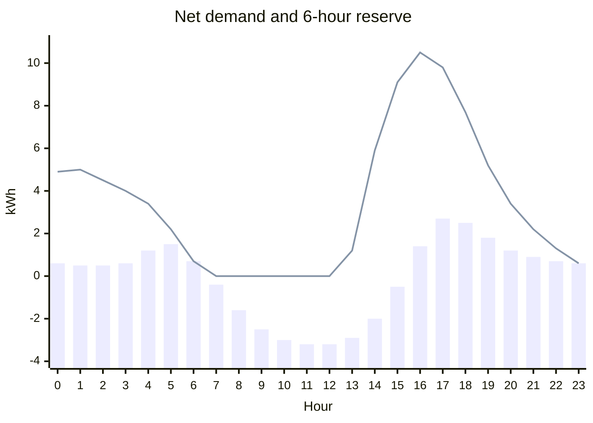

# Backup reserve

This guide sets up a backup reserve: energy HAEO keeps in your batteries so your home can ride through a grid outage.
It explains what a reserve is for, walks through adding one, and shows what to expect from the plan and the forecast card afterwards.

## What is a reserve for?

Without a reserve, HAEO uses your battery purely for savings.
If exporting at a high price or covering an expensive evening is worth it, HAEO will happily plan to run the battery down to its minimum charge.
That is the cheapest plan while the grid is up, but it leaves nothing in the battery if the grid goes down at the wrong moment.

A reserve tells HAEO how long an outage you want to be able to ride through, and which loads you need to keep running.
At every point in the forecast, HAEO works out how much energy those loads would need, less any solar that keeps producing, if the grid went down then.
It then plans to keep at least that much in your batteries.

Use a reserve when:

- **You have backup wiring**: your inverter can run some or all of your home off grid.
- **Outages are likely**: storm season, an unreliable grid, or a known planned outage.
- **Some loads matter more than others**: a fridge, medical equipment, or a sump pump you never want to lose.

Because the reserve follows your forecasts, it changes through the day.
It rises in the evening when the house uses the most and solar has stopped, and falls around midday when solar alone covers the house.

## How the reserve is worked out

For each point in the forecast, HAEO imagines an outage starting then and lasting your chosen length.
It adds up what your loads use and what your solar produces through that outage, hour by hour.
The reserve is the largest amount the battery would need to supply at any time during it.

The chart below shows a day with a 6-hour outage window.
The bars are the net demand each hour (loads less solar), and the line is the reserve the battery should hold at the start of each hour.



A few things stand out:

- **Midday needs nothing**: solar covers the house for the next six hours, so an outage then costs the battery nothing.
- **Early afternoon looks ahead**: at 1 pm the outage would run into the evening peak, so HAEO starts asking for a reserve while solar is still producing.
    Solar after 1 pm offsets some of the evening demand, so the reserve is smaller than the evening's total use.
- **The evening peaks**: at 4 pm the next six hours are the most expensive part of the day for the battery, so the reserve is highest.

## Prerequisites

This guide builds on the [Sigenergy System walkthrough](sigenergy-system.md).
Complete that walkthrough first — the steps here assume your system is already configured.

```guide-setup
run_guide("sigenergy-system")
```

## Adding a reserve

### Step 1: Choose what the reserve covers

Click **Reserve** to add one, then pick its participants:

- **Loads**: the loads to keep running through an outage.
    This guide keeps the whole house running.
- **Generation**: the generation that keeps producing during an outage.
    Only include solar if your inverter keeps running it when the grid is down.
- **Batteries**: the batteries that hold the reserve.
    With more than one battery, they hold it together.

Then set the requirement and the cost of falling short:

- **Outage length**: 12 hours covers an outage overnight.
- **Extra reserve**: 2 kWh on top of what the loads need, as a buffer against the forecast being wrong.
- **Shortfall cost**: \$0.05 per kWh short, for every hour the shortfall lasts.

```guide
add_reserve(
    page,
    name="Backup",
    loads=["Constant Load"],
    generation=["Solar"],
    storage=["Battery"],
    window=ConstantInput(12.0),
    minimum=ConstantInput(2.0),
    shortfall_cost=ConstantInput(0.05),
)
```

!!! tip "Driving the extra reserve from a sensor"

    The extra reserve accepts a sensor as well as a constant.
    Point it at a helper or template sensor to raise the reserve ahead of a storm warning and drop it back to zero afterwards.

### Step 2: Verify the reserve

Check the reserve was saved with the loads, generation, and battery you picked.

```guide
validate_reserve(
    hass,
    name="Backup",
    participants={"loads": ["Constant Load"], "generation": ["Solar"], "storage": ["Battery"]},
)
```

```guide
verify_setup(page)
```

## What to expect

### A new device

The reserve appears as its own device with these sensors:

| Sensor                  | What it shows                                                      |
| ----------------------- | ------------------------------------------------------------------ |
| Required energy         | Energy the batteries should hold at each point (kWh)               |
| Available energy        | Energy the batteries can deliver at each point, after losses (kWh) |
| Energy shortfall        | How far the batteries fall short of the required energy (kWh)      |
| Reserve state of charge | The combined state of charge the batteries should stay above (%)   |

It also has input entities for the outage length, extra reserve, and shortfall cost, so you can change them from a dashboard without reconfiguring.

### A line on the forecast card

The [forecast card](../user-guide/lovelace-card.md) draws the reserve state of charge as a red dotted line alongside your batteries' state of charge.
In normal use your battery's state of charge should stay on or above that line.
The line moves through the day as the reserve does, so the battery may run low around midday and then refill ahead of the evening.

The line is a combined state of charge: with several batteries, their total charge should stay above it, while any one battery may sit below it.

### Changes to the plan

With a reserve, the plan changes in a few ways:

- **Less export before the evening**: HAEO keeps enough charge for the evening instead of selling it during an afternoon price spike.
- **Earlier or extra charging**: if solar will not fill the battery in time, HAEO charges from the grid to reach the reserve.
- **Dips when they pay**: the reserve is not a hard limit.
    HAEO dips below it when the energy is worth more than the shortfall cost for as long as the dip lasts.
    A short dip during a big price spike can be worth it; a dip that lasts all evening rarely is.

### The last hours of the forecast

HAEO cannot see past the end of the forecast, so an outage starting near the end is cut short.
The reserve tapers off over the last outage length of the forecast, and the battery may be planned to run lower there.
Each time the forecast moves forward, the reserve is recomputed, so this only affects the far end of the plan.

## Tuning the reserve

### Outage length

Longer outages need bigger reserves.
If the reserve state of charge sits at 100% for long stretches, the battery cannot hold a reserve that long.
Shorten the outage length, drop loads you would turn off in an outage, or accept that the shortfall will be priced.

### Shortfall cost

The shortfall cost decides how firmly HAEO holds the reserve.
It works like the [battery undercharge cost](../user-guide/elements/battery.md#undercharge-cost): it is charged per kWh short, for every hour the shortfall lasts.

| Shortfall cost | Behavior                                                            |
| -------------- | ------------------------------------------------------------------- |
| 0.005 \$/kWh/h | A soft preference — the reserve gives way to most price differences |
| 0.05 \$/kWh/h  | Held unless a price spike is well worth it                          |
| 1 \$/kWh/h     | Treated as nearly untouchable                                       |

### More than one reserve

You can add several reserves.
For example, one covering only essential loads over a 24-hour outage, and another covering the whole house over 4 hours.
Each reserve is priced on its own, so the batteries hold enough for whichever needs more at each point.

## Troubleshooting

### The battery always sits below the line

The reserve may be larger than the battery can hold, or charging it may cost more than the shortfall.
Check the **Required energy** sensor against your battery's capacity, and raise the shortfall cost if you want HAEO to try harder to hold it.

### The reserve is zero all day

Check that the reserve includes your loads, and that your solar forecast is not much larger than your loads.
A reserve with no loads only holds the extra reserve.

## Next steps

<div class="grid cards" markdown>

- :material-shield-check:{ .lg .middle } **Reserve reference**

    ---

    Every reserve field in detail.

    [:material-arrow-right: Reserve configuration](../user-guide/elements/reserve.md)

- :material-calculator:{ .lg .middle } **How the reserve is modeled**

    ---

    The formulation behind the reserve.

    [:material-arrow-right: Reserve modeling](../modeling/device-layer/reserve.md)

- :material-chart-line:{ .lg .middle } **Forecast card**

    ---

    Read the reserve line alongside your battery's plan.

    [:material-arrow-right: Lovelace forecast card](../user-guide/lovelace-card.md)

</div>
