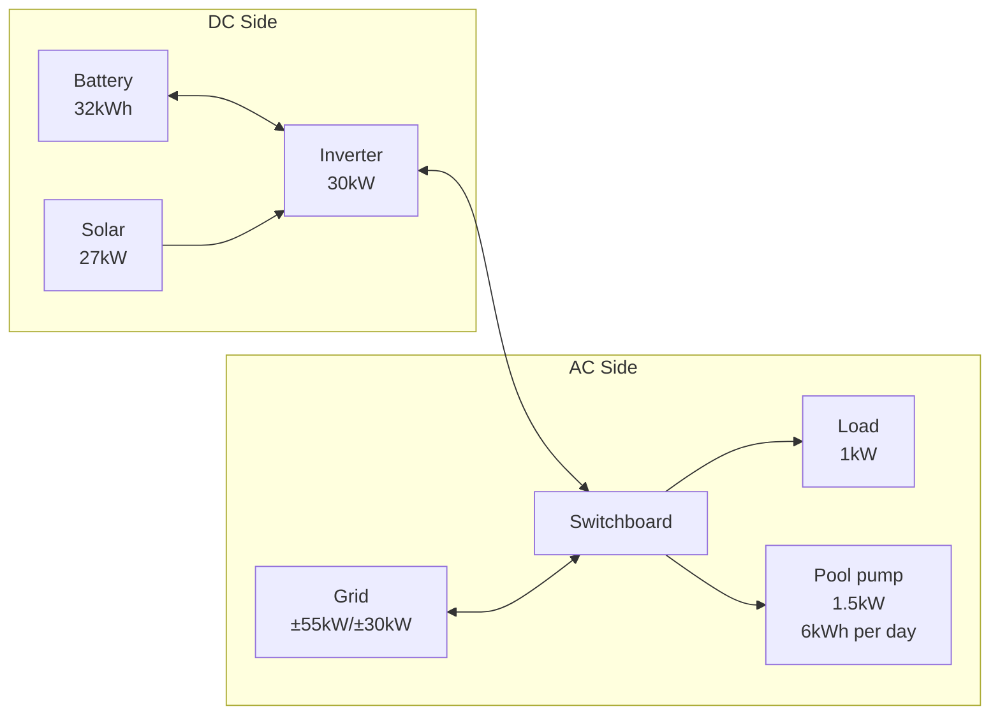

# Adding a deferrable load

This walkthrough adds a pool pump to an existing home energy system as a deferrable load.
The pump needs a set amount of energy each day, but it does not matter when it runs.
HAEO picks the cheapest times to run it, such as when solar would otherwise be exported for little or nothing.

## Why a deferrable load?

A plain [load](../user-guide/elements/load.md) tells HAEO when power will be used.
HAEO plans around it, but cannot move it.

A deferrable load tells HAEO how much energy an appliance needs and when it is allowed to run.
HAEO then decides when inside that time to run it, alongside your battery, solar, and grid.
Use one for an appliance that has a job to finish but no fixed start time:

- **A pool pump** that needs a few hours of filtering each day.
- **A hot water system** that needs to heat a tank before the evening.
- **Irrigation** that can run any time overnight.

## System overview

After completing this walkthrough, your system will include:

- **Base system**: Inverter, battery, solar, grid, and load (from the [Sigenergy System](sigenergy-system.md) guide)
- **Pool pump**: a 1.5 kW pump that needs 6 kWh every day, with a smart plug measuring its energy



## Prerequisites

Complete the [Sigenergy System](sigenergy-system.md) walkthrough first.
This guide builds on that configuration and adds a run window calendar and a deferrable load element.

```guide-setup
run_guide("sigenergy-system")
hass.set_state(
    "sensor.pool_pump_plug_energy",
    "412.3",
    {
        "state_class": "total_increasing",
        "unit_of_measurement": "kWh",
        "device_class": "energy",
        "friendly_name": "Pool pump plug Energy",
    },
)
```

### Pool pump sensor

The pump is plugged into a smart plug whose integration provides an **Energy** sensor.
It counts the total energy the pump has used, and HAEO reads how much it has risen since the pump's run window opened.
The sensor is optional, but without it HAEO cannot tell how much of today's energy the pump has already had.
Any energy sensor with a state class of `total_increasing` or `total` works, including one that resets each day.

## Step 1: Create a run window calendar

HAEO reads when the pump may run, and how much energy it needs, from a Home Assistant calendar.
Create a dedicated [Local Calendar](https://www.home-assistant.io/integrations/local_calendar/) so these events stay separate from your personal calendars.

```guide
add_local_calendar(page, calendar_name="Pool pump schedule")
```

## Step 2: Schedule the run window

Each event is one run window.
Its start and end mark when the pump may run, and its title holds the energy the pump needs inside it, such as `Pool pump 6 kWh`.
This pump may run from 10 AM until midnight, so the event starts at 10:00 and ends at 23:59.
It needs the same energy every day, so set it to repeat daily.

```guide
create_calendar_event(
    page,
    title="Pool pump 6 kWh",
    start_time="10:00",
    end_time="23:59",
    recurrence="Daily",
)
```

!!! tip "Energy format"

    Write the energy as a number followed by its unit, such as `6 kWh` or `500 Wh`, among any other words.
    HAEO reads it from the event's location, title, or description, whichever of them comes first with a number in it.
    Keep other numbers, such as an address, out of the fields before it.
    Keep to one energy per event: an energy without a unit, or two energies in one field, is ignored, and HAEO raises a repair issue so you can fix the event.
    An event without a number is still a run window, but needs no energy.

!!! tip "Choosing the hours"

    HAEO only runs the pump inside the event.
    A longer window gives HAEO more cheap periods to choose from, and turning on **All day** lets it run at any time.
    A shorter one keeps the pump to the hours you choose, such as when it is less likely to disturb anyone.

## Step 3: Add the deferrable load

Navigate to the HAEO integration page and add the deferrable load.

```guide
page.navigate_to_settings()
page.navigate_to_integrations()
page.navigate_to_integration("HAEO")
```

Configure the pool pump with its calendar, energy meter, prices, and power.
The pump is wired to the house, so it connects to the **Switchboard**.

- **Run window calendar**: the calendar from step 1.
- **Energy meter**: the smart plug's energy sensor.
- **Shortfall price**: \$10 per kWh the pump misses in a window, the default.
- **Overage price**: \$0.05 per kWh the pump runs past its 6 kWh.
- **Max power**: 1.5 kW, the power the pump draws while it runs.
    It is under **Power**, which starts collapsed.

```guide
add_deferrable_load(
    page,
    name="Pool pump",
    connection="Switchboard",
    window_calendar=EntityInput("Pool pump schedule", "Pool pump schedule"),
    energy_meter=EntityInput("Pool pump plug Energy", "Pool pump plug Energy"),
    deficit_price=ConstantInput(10),
    overage_price=ConstantInput(0.05),
    max_power=ConstantInput(1.5),
)
```

### Choosing the prices

The prices tell HAEO how much it matters that the pump gets exactly its energy.

- **Shortfall price** is what each kWh the pump misses in a window costs you.
    The default of \$10 per kWh is more than electricity ever costs, so HAEO runs the pump for its full 6 kWh whenever it can.
    Lower it if missing some filtering is acceptable when power is expensive.
    At \$0.30 per kWh, HAEO leaves energy short whenever running the pump would cost more than that.
- **Overage price** is what each kWh past the window's energy costs you.
    At the default of zero, HAEO runs the pump longer only when that saves money, such as when you are paid to use energy.
    Running a pump longer than needed wears it, so this guide sets a small price of \$0.05 per kWh.
    HAEO then only runs the pump extra when the energy pays more than that.

!!! tip "Max power"

    The max power is optional, but set it for any appliance with a fixed power.
    Without it, HAEO could plan the whole 6 kWh into a few minutes.

## Step 4: See the plan

HAEO optimizes as soon as the pool pump is added.
The [forecast card](../user-guide/lovelace-card.md) shows the plan for the next two days.
The green bars below the line are the pool pump, and the orange bars above it are the solar HAEO plans to use.
The lines on the price axis are the grid's import and export prices.

The pump runs at its 1.5 kW for four hours to get each day's 6 kWh.
Each day's run lands while the solar is up and exporting would earn little or nothing, and never in the price peak.

```guide
show_forecast_card(
    page,
    hass,
    step="Plan with the pool pump",
    elements=["Pool pump", "Solar"],
    inputs=["Grid"],
    horizon="2d",
)
```

## Step 5: Credit the energy already used

HAEO plans again regularly, and each plan starts from the present.
Partway through a day, the pump has already had some of its energy.
The energy meter tells HAEO how much, so it plans only the rest.

Here the smart plug's meter has risen by 4 kWh since today's window opened.
HAEO now plans only the remaining 2 kWh for today, and tomorrow's 6 kWh is unchanged.

```guide
hass.set_state(
    "sensor.pool_pump_plug_energy",
    "416.3",
    {
        "state_class": "total_increasing",
        "unit_of_measurement": "kWh",
        "device_class": "energy",
        "friendly_name": "Pool pump plug Energy",
    },
)
show_forecast_card(
    page,
    hass,
    step="Plan after the pump has used 4 kWh today",
    elements=["Pool pump", "Solar"],
    inputs=["Grid"],
    horizon="2d",
)
```

The pool pump's **Energy since window started** input entity shows the energy HAEO is crediting to the open window.
Without a meter, HAEO would plan the full 6 kWh again, and the pump would run longer than it needs to.

## Verification

Navigate to **Settings → Devices & Services → HAEO** to view the complete system.
The pool pump appears as its own device alongside the base system elements.

### Key pool pump sensors

- `sensor.pool_pump_power`: the power HAEO plans for the pump (kW)
- `sensor.pool_pump_energy_delivered`: energy the pump has received in the current window, reset at each window start (kWh)
- `sensor.pool_pump_energy_shortfall`: energy HAEO expects a window to miss, at the window's end (kWh)
- `sensor.pool_pump_energy_overage`: energy HAEO plans past a window's requirement (kWh)

All sensors include a `forecast` attribute with optimized future values.

### What to expect

- **Inside each window**: the pump runs in the cheapest periods, usually during solar surplus or cheap grid prices.
- **Outside the windows**: the pump does not run.
- **A shortfall** appears when the window is too short to fit the energy at the max power, or when running costs more than the shortfall price.
    A window cut off by the end of the forecast also shows a shortfall, which shrinks as the forecast moves forward.

## Control the pump

HAEO plans when the pump runs, but something has to switch it on and off.
An automation that turns the smart plug on when `sensor.pool_pump_power` rises above a threshold, and off when it drops below, follows the plan.
Set the threshold below the pump's 1.5 kW, such as half of it, so a period planned at slightly less than full power still runs.
A period planned below the threshold is skipped, and the energy meter then has HAEO plan that energy into a later period.
[Automating your hardware](../user-guide/automations.md#chargers-and-appliances) explains the pattern.

## Next steps

<div class="grid cards" markdown>

- :material-timer-outline:{ .lg .middle } **Deferrable load reference**

    ---

    Every deferrable load field in detail.

    [:material-arrow-right: Deferrable load configuration](../user-guide/elements/deferrable_load.md)

- :material-math-integral:{ .lg .middle } **Deferrable load modeling**

    ---

    How deferrable loads are modeled.

    [:material-arrow-right: Deferrable load modeling](../modeling/device-layer/deferrable_load.md)

- :material-home-lightning-bolt:{ .lg .middle } **Automation examples**

    ---

    Switch appliances to follow HAEO's plan.

    [:material-arrow-right: Automating your hardware](../user-guide/automations.md#chargers-and-appliances)

</div>
