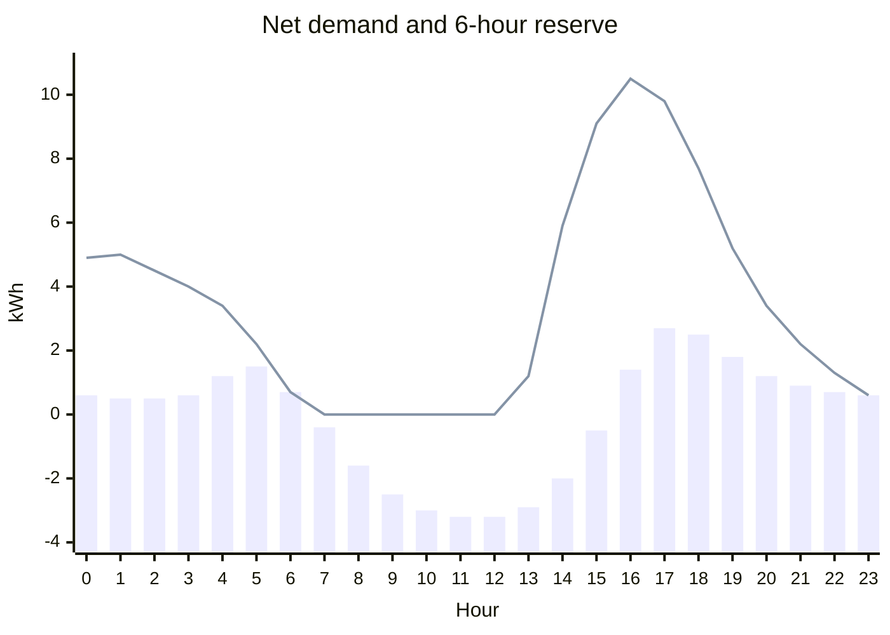

# Reserve and headroom

This guide sets up a reserve and a headroom, the two ways to tell HAEO how much your batteries should hold.
It explains what each is for, walks through adding them, and shows the plan changing on the forecast card at every step.

## What are they for?

Without either, HAEO uses your battery purely for savings.
It happily plans to run the battery down to its minimum charge for an expensive evening, or fill it to the top on cheap power overnight.
That is the cheapest plan, but it is not always the plan you want.

A **reserve** keeps energy in your batteries.
You choose how long an outage to ride through and which loads to keep running, and HAEO keeps enough charge to cover them, less any solar that keeps producing.
Use a reserve when:

- **You have backup wiring**: your inverter can run some or all of your home off grid.
- **Outages are likely**: storm season, an unreliable grid, or a known planned outage.
- **Some loads matter more than others**: a fridge, medical equipment, or a sump pump you never want to lose.

**Headroom** is the mirror image: it keeps empty space in your batteries.
You choose your generation and how far ahead to look, and HAEO keeps enough room to absorb what is coming, less what your loads use.
Use headroom when:

- **Your solar cannot be curtailed**: once the house is covered and exports are at their limit, the battery is the only place left for the surplus.
    Headroom with your solar as its generation keeps enough room for what is forecast to come.
- **You want to look after the battery**: many batteries last longer when they spend less time near 100%.
    A fixed amount of headroom keeps the battery below full, and lets it go higher only when the energy is worth more than the holding cost.
- **You take part in a grid support program**: some demand response and grid stability programs ask you to keep capacity free to absorb power when the grid needs it.
    A fixed amount of headroom keeps that capacity free, and a sensor can raise it during the hours the program covers.

Both follow your forecasts, so they change through the day, and both are soft: HAEO can go past them when that is worth more than the shortfall cost you set.

## How they are worked out

For each point in the forecast, HAEO looks at the window that follows it: the outage length for a reserve, or how far ahead to look for headroom.
It adds up what your loads use and what your generation produces through that window, hour by hour.

- **A reserve** is the largest amount the batteries would need to supply at any time in the window.
- **Headroom** is the largest amount the batteries would need to absorb at any time in the window.

Loads count by the power HAEO plans for them, and generation by what it is forecast to produce.
A surplus earlier in the window offsets demand that comes after it, and the other way round.

The chart below shows a day with a 6-hour window.
The bars are the net demand each hour (loads less solar), and the line is the reserve the battery should hold at the start of each hour.



- **Midday needs no reserve**: solar covers the house for the next six hours, so an outage then costs the battery nothing.
    This is when headroom matters most, since the battery needs room for the surplus.
- **Early afternoon looks ahead**: at 1 pm the window runs into the evening peak, so HAEO starts asking for a reserve while solar is still producing.
- **The evening peaks**: at 4 pm the next six hours are the most expensive part of the day for the battery, so the reserve is highest.

## Prerequisites

This guide builds on the [Sigenergy System walkthrough](sigenergy-system.md).
Complete that walkthrough first — the steps here assume your system is already configured.

```guide-setup
run_guide("sigenergy-system")
```

## The plan without a reserve

Before adding anything, here is what HAEO plans over the next two days.
The green dashed line is the battery's state of charge, and the bars are its charging and discharging alongside the house and solar.
The pale orange is what the solar could produce, and the darker orange what HAEO plans to use.

The battery runs down to its minimum each evening, so an outage then would leave nothing to run the house.
And it charges all the way to full most days, which wears it faster than it needs to.

```guide
show_forecast_card(
    page,
    hass,
    step="Plan without a reserve or headroom",
    elements=["Battery", "Constant Load", "Solar"],
    inputs=["Solar"],
    horizon="2d",
)
```

## Adding a reserve

Click **Reserve** to add one, then pick its participants:

- **Loads**: the loads to keep running through an outage.
    This guide keeps the whole house running.
- **Generation**: the generation that keeps producing during an outage.
    Only include solar if your inverter keeps running it when the grid is down.
- **Batteries**: the batteries that hold the reserve.
    With more than one battery, they hold it together.

Then set the requirement and the cost of falling short:

- **Outage length**: 12 hours covers an outage overnight.
- **Extra reserve**: 2 kWh on top of what the loads need, as a buffer against the forecast being wrong.
- **Shortfall cost**: \$0.05 per kWh short, for every hour the shortfall lasts.

```guide
add_reserve(
    page,
    name="Backup",
    loads=["Constant Load"],
    generation=["Solar"],
    storage=["Battery"],
    window=ConstantInput(12.0),
    minimum=ConstantInput(2.0),
    shortfall_cost=ConstantInput(0.05),
)
validate_requirement(
    hass,
    name="Backup",
    participants={"loads": ["Constant Load"], "generation": ["Solar"], "storage": ["Battery"]},
)
```

!!! tip "Driving the extra reserve from a sensor"

    The extra reserve accepts a sensor as well as a constant.
    Point it at a helper or template sensor to raise the reserve ahead of a storm warning and drop it back to zero afterwards.

## Adding headroom

This headroom keeps the top 10% of the battery free, so it spends less time full.
It covers no loads or generation, so it holds just its extra amount: 3.2 kWh, 10% of this system's 32 kWh battery.
A low shortfall cost lets HAEO fill the top of the battery when the energy is worth it, such as when it will soon be needed.

Click **Headroom** to add one, pick the battery, and set:

- **Look-ahead**: 1 hour.
    With no loads or generation it does not change what the headroom holds.
- **Extra headroom**: 3.2 kWh.
- **Shortfall cost**: \$0.02 per kWh past the headroom, for every hour it lasts.

```guide
add_headroom(
    page,
    name="Battery care",
    storage=["Battery"],
    window=ConstantInput(1.0),
    minimum=ConstantInput(3.2),
    shortfall_cost=ConstantInput(0.02),
)
validate_requirement(hass, name="Battery care", participants={"storage": ["Battery"]})
```

## Comparing the plans

Use the arrows to flick between the plans with neither, each one, and both.

- **The reserve** appears as a red dotted line, which the battery's state of charge should stay on or above.
    The battery now follows the line down through the evening, holding enough for an outage at every point instead of running down to its minimum.
- **A shorter outage** lowers the line, and HAEO plans to use more of the battery.
- **The headroom** appears as a purple dotted line, which the battery's state of charge should stay on or below.
    The battery now stops short of full unless the extra energy pays for its holding cost.
- **With both**, the plan keeps the battery between the two lines.

The reserve and headroom have input entities for their outage length or look-ahead, extra amount, and shortfall cost, so you can change them from a dashboard as these plans do.

```guide
everything = ["Battery", "Constant Load", "Solar"]

set_input(hass, element="Backup", field="shortfall_cost", value=0.0)
set_input(hass, element="Battery care", field="shortfall_cost", value=0.0)
show_forecast_card(
    page, hass, step="Without a reserve or headroom", elements=everything, inputs=["Solar"], horizon="2d"
)

set_input(hass, element="Backup", field="shortfall_cost", value=0.05)
show_forecast_card(
    page, hass, step="With a 12 hour reserve", elements=[*everything, "Backup"], inputs=["Solar"], horizon="2d"
)

set_input(hass, element="Backup", field="window", value=4.0)
show_forecast_card(
    page, hass, step="With a 4 hour reserve", elements=[*everything, "Backup"], inputs=["Solar"], horizon="2d"
)

set_input(hass, element="Backup", field="shortfall_cost", value=0.0)
set_input(hass, element="Battery care", field="shortfall_cost", value=0.02)
show_forecast_card(
    page,
    hass,
    step="Keeping the top 10% free",
    elements=[*everything, "Battery care"],
    inputs=["Solar"],
    horizon="2d",
)

set_input(hass, element="Backup", field="shortfall_cost", value=0.05)
show_forecast_card(
    page,
    hass,
    step="With a 4 hour reserve and the top 10% free",
    elements=[*everything, "Backup", "Battery care"],
    inputs=["Solar"],
    horizon="2d",
)
```

## Seeing them in the network

The topology card marks the batteries holding a reserve with 🛡 and those keeping headroom with ⤒.
Hover over an element to see which reserves and headroom it holds or is counted in.

```guide
show_topology_card(page, hass, step="Network with a reserve and headroom")
```

## What to expect

### New devices

Each reserve and headroom appears as its own device with these sensors:

| Sensor                             | What it shows                                                         |
| ---------------------------------- | --------------------------------------------------------------------- |
| Required energy / Required space   | What the batteries should hold or keep free at each point (kWh)       |
| Available energy / Available space | What the batteries can deliver or absorb at each point, after losses  |
| Energy shortfall / Space shortfall | How far the batteries fall short (kWh)                                |
| Reserve / Headroom state of charge | The combined state of charge the batteries should stay above or below |

They also have input entities for the window, extra amount, and shortfall cost.

### Changes to the plan

- **A reserve exports less before the evening** and may charge from the grid ahead of it.
- **Headroom stops short of full**, and with generation included, discharges ahead of it to leave room.
- **Both give way when it pays**: HAEO goes past a line when the energy is worth more than the shortfall cost for as long as it lasts.
    When a reserve and a headroom ask for more than the battery can do at once, the shortfall costs decide which gives way.

The lines are a combined state of charge: with several batteries, their total charge should stay on the right side of the line, while any one battery may cross it.

### The last hours of the forecast

HAEO cannot see past the end of the forecast, so a window starting near the end is cut short.
Both requirements taper off over the last window of the forecast.
Each time the forecast moves forward they are recomputed, so this only affects the far end of the plan.

## Tuning

### Window

A longer outage needs a bigger reserve, and a longer look-ahead needs more headroom.
If a line sits at 0% or 100% for long stretches, the battery cannot meet it.
Shorten the window, change which loads and generation it covers, or accept that the shortfall will be priced.

### Shortfall cost

The shortfall cost decides how firmly HAEO holds the line.
It is charged per kWh short, for every hour the shortfall lasts.

| Shortfall cost | Behavior                                                |
| -------------- | ------------------------------------------------------- |
| 0.005 \$/kWh/h | A soft preference — gives way to most price differences |
| 0.05 \$/kWh/h  | Held unless a price spike is well worth it              |
| 1 \$/kWh/h     | Treated as nearly untouchable                           |

### A fixed amount

A reserve or headroom with no loads or generation holds just its extra amount.
A fixed reserve keeps the battery above a level unless dipping lower is worth the cost, and a fixed headroom keeps it below full the same way.

- **To look after the battery**, set the extra headroom to the top slice you want to avoid, such as 10% of the capacity, with a low shortfall cost.
    HAEO then fills the top slice only when the energy is worth more than the holding cost for as long as it stays there.
- **For a grid support program**, set the extra headroom to the capacity you have committed, with a high shortfall cost.
    If the commitment only covers some hours, drive the extra headroom from a sensor that is zero outside them.

### More than one

You can add several of each.
For example, a reserve covering only essential loads over a 24-hour outage, and another covering the whole house over 4 hours.
Each is priced on its own, so the batteries hold enough for whichever needs more at each point.

## Troubleshooting

### The battery always sits on the wrong side of a line

The requirement may be more than the battery can hold, or meeting it may cost more than the shortfall.
Check the required energy or space sensor against your battery's capacity, and raise the shortfall cost if you want HAEO to try harder.

### A line is at zero all day

Check that the reserve or headroom includes your loads and generation.
A reserve with much more solar than load, or headroom with much more load than solar, needs nothing.

## Next steps

<div class="grid cards" markdown>

- :material-shield-check:{ .lg .middle } **Reserve reference**

    ---

    Every reserve field in detail.

    [:material-arrow-right: Reserve configuration](../user-guide/elements/reserve.md)

- :material-format-vertical-align-top:{ .lg .middle } **Headroom reference**

    ---

    Every headroom field in detail.

    [:material-arrow-right: Headroom configuration](../user-guide/elements/headroom.md)

- :material-calculator:{ .lg .middle } **How they are modeled**

    ---

    The formulation behind reserves and headroom.

    [:material-arrow-right: Reserve and headroom modeling](../modeling/device-layer/reserve.md)

</div>
