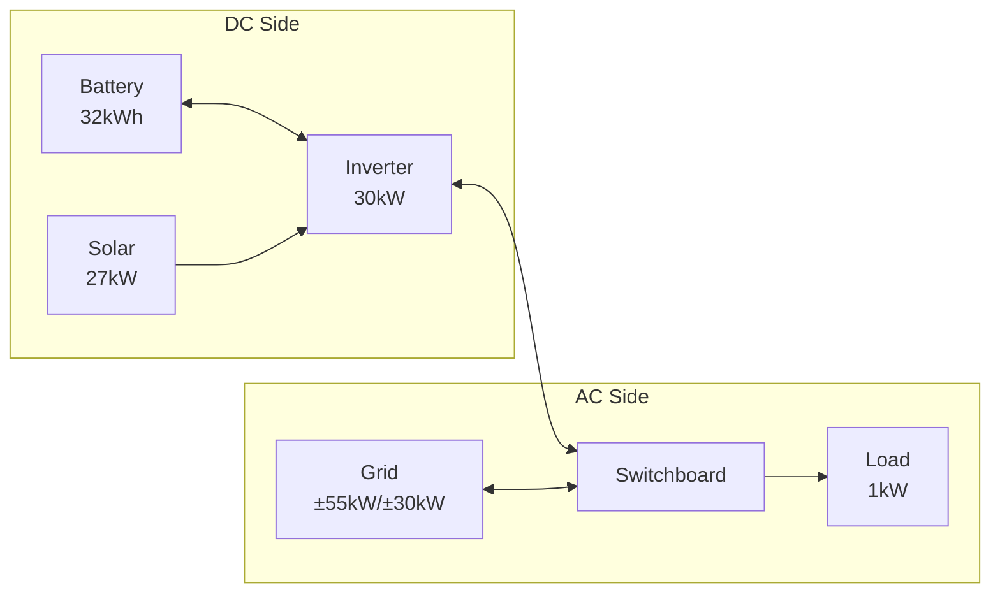

# Complete example: Sigenergy system with hybrid inverter

This guide demonstrates configuring a Sigenergy system with hybrid inverter architecture, multiple solar arrays, and grid connection.

## System overview

This example uses the test system configuration:

- **Battery**: 32 kWh (Sigenergy SigenStor), 99% efficiency
- **Solar**: 27 kW peak (four orientations: East, North, South, West)
- **Inverter**: 30 kW hybrid inverter (DC/AC coupling)
- **Grid**: 55 kW import limit, 30 kW export limit
- **Load**: 1 kW constant base load



## Prerequisites

Before starting this configuration, ensure you have:

### Required integrations

- **HAEO**: Installed via HACS (see [Installation guide](../user-guide/installation.md))
- **Sigenergy**: Provides battery capacity and SOC sensors
- **Solar Forecast**: [Open-Meteo Solar Forecast](https://www.home-assistant.io/integrations/open_meteo_solar_forecast/) integration
- **Electricity Pricing**: Any integration providing import/export price forecasts

### Configuration requirements

- Multiple solar array orientations configured in forecast integration
- Battery SOC sensor available from Sigenergy integration
- Baseline house load determined (see [Load configuration](../user-guide/elements/load.md#determining-your-baseline))

## Configuration steps

### Step 1: Log in and add HAEO

Log in to your Home Assistant instance, navigate to **Settings → Devices & services**, and add the HAEO integration.
Enter a name for your energy network — this example uses "Sigenergy System".

```guide
login(page)

add_integration(
    page,
    network_name="Sigenergy System",
)
```

After submitting, you should see a Switchboard junction already exists.
This is the AC power balance point where grid and loads connect.

### Step 2: Add inverter

The Inverter element models your hybrid inverter with its built-in DC bus.
Battery and solar will connect to this element.

```guide
add_inverter(
    page,
    name="Inverter",
    connection="Switchboard",
    max_power_source_target=EntityInput("max active power", "Sigen Plant Max Active Power"),
    max_power_target_source=EntityInput("max active power", "Sigen Plant Max Active Power"),
)
```

!!! tip "Selecting Sensors"

    In the entity picker, search for "max active power" to find the sensor.
    HAEO entity pickers search by **friendly name**, not entity ID.

### Step 3: Add battery

Configure the Sigenergy battery, connecting to the Inverter's DC side.

```guide
add_battery(
    page,
    name="Battery",
    connection="Inverter",
    capacity=EntityInput("rated energy", "Rated Energy Capacity"),
    initial_charge_percentage=EntityInput("state of charge", "Battery State of Charge"),
    max_power_target_source=EntityInput("rated charging", "Rated Charging Power"),
    max_power_source_target=EntityInput("rated discharging", "Rated Discharging Power"),
    min_charge_percentage=ConstantInput(10),
    max_charge_percentage=ConstantInput(100),
)
```

!!! tip "Searching for Battery Sensors"

    Use these search terms in entity pickers:

    - "rated energy capacity" for battery capacity
    - "state of charge" for current SOC
    - "charging" for max charge power
    - "discharging" for max discharge power

### Step 4: Add solar

Configure solar arrays with forecast sensors for each orientation, connecting to the Inverter's DC side.

```guide
add_solar(
    page,
    name="Solar",
    connection="Inverter",
    forecast=[
        EntityInput("east solar today", "East solar production forecast"),
        EntityInput("north solar today", "North solar production forecast"),
        EntityInput("south solar today", "South solar prediction forecast"),
        EntityInput("west solar today", "West solar production forecast"),
    ],
)
```

!!! tip "Multi-Select Entity Pickers"

    For fields that accept multiple sensors, an "Add entity" button appears after selecting the first sensor.
    Click it to add additional sensors one at a time.

### Step 5: Add grid connection

Configure grid with pricing and limits, connecting to the Switchboard.

```guide
add_grid(
    page,
    name="Grid",
    connection="Switchboard",
    price_source_target=[
        EntityInput("general price", "Home - General Price"),
        EntityInput("general forecast", "Home - General Forecast"),
    ],
    price_target_source=[
        EntityInput("feed in price", "Home - Feed In Price"),
        EntityInput("feed in forecast", "Home - Feed In Forecast"),
    ],
    max_power_source_target=ConstantInput(55),
    max_power_target_source=ConstantInput(30),
)
```

!!! tip "Finding Price Sensors"

    Search for "General Price" for import pricing and "Feed In" for export pricing.
    Your integration may use different naming.
    Look for sensors with price forecast attributes.

### Step 6: Add load

Configure the house's consumption, connecting to the Switchboard.
This guide uses a steady 1 kW, but a load forecast sensor lets HAEO plan around when you actually use power.

```guide
add_load(
    page,
    name="House load",
    connection="Switchboard",
    forecast=ConstantInput(1),
)
```

!!! tip "Load Sensors"

    If you don't have a load forecast, create an `input_number` helper for a steady baseline load:

    1. Settings → Devices & Services → Helpers
    2. Create Helper → Number
    3. Name: "House Load Power", Unit: kW, Value: 1.0

### Step 7: Verify setup

After completing configuration, verify that all elements were created successfully.

```guide
verify_setup(page)
```

### Step 8: See the plan

HAEO optimizes as soon as the network is complete.
The [forecast card](../user-guide/lovelace-card.md) shows the plan for the next two days:
the battery charging from cheap power and solar, discharging through the expensive evening, and the grid making up the difference.

```guide
show_forecast_card(
    page,
    hass,
    step="Planned power flows",
    elements=["Battery", "House load", "Solar", "Grid"],
    inputs=["Solar"],
    horizon="2d",
)
```

The topology card shows the network you built, with the battery and solar on the inverter's DC side and the grid and house on the Switchboard.

```guide
show_topology_card(page, hass, step="Network topology")
```

## Verification

Navigate to **Settings → Devices & Services → HAEO** and open the "Sigenergy System" hub to view its devices.

### Expected device hierarchy

In the HAEO integration page, you should see:

| Element     | Type     | Entities |
| ----------- | -------- | -------- |
| Optimizer   | Network  | Varies   |
| Switchboard | Junction | Varies   |
| Inverter    | Inverter | Varies   |
| Battery     | Battery  | Varies   |
| Solar       | Solar    | Varies   |
| Grid        | Grid     | Varies   |
| House load  | Load     | Varies   |

### Key sensors to monitor

**Optimizer**:

- `sensor.optimizer_cost` - Total forecasted cost (\$)
- `sensor.optimizer_status` - Should show "success"
- `sensor.optimizer_duration` - Solve time (seconds)

**Battery**:

- `sensor.battery_charge_power` - Charging power (kW)
- `sensor.battery_discharge_power` - Discharging power (kW)
- `sensor.battery_active_power` - Net power, positive while discharging (kW)
- `sensor.battery_energy_stored` - Current energy level (kWh)
- `sensor.battery_state_of_charge` - SOC percentage (%)

**Solar**:

- `sensor.solar_power` - Optimal generation (kW)
- `sensor.solar_forecast_limit_shadow_price` - Value of additional generation capacity (\$/kWh)

**Grid**:

- `sensor.grid_import_power` - Import from grid (kW)
- `sensor.grid_export_power` - Export to grid (kW)
- `sensor.grid_active_power` - Net power, positive while importing (kW)
- `sensor.grid_import_cost` - Import cost (\$)
- `sensor.grid_export_revenue` - Export revenue (\$)

**Load**:

- `sensor.house_load_power` - Load consumption (kW)

**Inverter**:

- `sensor.inverter_dc_to_ac_power` - DC→AC power flow (kW)
- `sensor.inverter_ac_to_dc_power` - AC→DC power flow (kW)
- `sensor.inverter_active_power` - Net AC power (kW)

All sensors include a `forecast` attribute with future optimized values.

!!! tip "Inspecting Device Details"

    Click on any device in the HAEO integration page to see:

    - All sensors created by that element
    - Current sensor values and states
    - Forecast attributes (click on sensor → attributes tab)
    - Entity IDs for use in automations

    This is helpful for understanding what data each element provides and troubleshooting configuration issues.

## Automate the plant

HAEO plans the battery, but the Sigenergy plant keeps running on its own until something tells it what to do.
This section builds the automations that follow the plan through the plant's remote EMS control.
[Automating your hardware](../user-guide/automations.md) explains the rules they use and why each one exists.

The mode automation reads HAEO's plan for the current period:

- `sensor.battery_active_power`: positive while the battery discharges, negative while it charges.
- `sensor.grid_active_power`: positive while the house imports, negative while it exports.
- `number.grid_export_limit`: the export limit you gave the grid in [step 5](#step-5-add-grid-connection).
- The `last_run` attribute of `sensor.optimizer_status`, to tell whether the plan is still being updated.

It drives three entities that the Sigenergy integration provides:

- `select.sigen_plant_remote_ems_control_mode`, the plant's operating mode.
- `number.sigen_plant_ess_max_charging_limit` and `number.sigen_plant_ess_max_discharging_limit`, the battery's charge and discharge limits in kW.

Enable remote EMS control in the Sigenergy integration first, so the plant accepts these commands.
The integration disables the two limit entities by default, so enable them on the plant's device too.
If your entity IDs or mode names differ, check them under **Developer tools** → **States**.

### Add a manual switch

Create a toggle helper so you can stop the automation and control the plant yourself at any time.
Turning it off returns the plant to Maximum Self Consumption with full limits, then leaves it alone until you turn it back on.

1. Go to **Settings** → **Devices & services** → **Helpers**.
2. Select **Create helper** → **Toggle**.
3. Name it "HAEO battery control", which gives it the entity ID `input_boolean.haeo_battery_control`.

### Add the mode automation

Go to **Settings** → **Automations & scenes**, create a new automation, select **Edit in YAML** from its menu, and paste:

```yaml
alias: HAEO Sigenergy battery control
description: Follow HAEO's plan with the Sigenergy plant's remote EMS modes.
triggers:
  # Changes to the plan, but not the forecast updates of every optimization.
  - trigger: state
    entity_id:
      - sensor.battery_active_power
      - sensor.grid_active_power
    to:
  - trigger: state
    entity_id: input_boolean.haeo_battery_control
    id: switch
  # Catch up when the plant reconnects, including a hand-back it missed.
  - trigger: state
    entity_id:
      - select.sigen_plant_remote_ems_control_mode
      - number.sigen_plant_ess_max_charging_limit
      - number.sigen_plant_ess_max_discharging_limit
    from:
      - unavailable
      - unknown
    id: switch
  # Notice a plan that has stopped updating.
  - trigger: time_pattern
    minutes: /5
  - trigger: homeassistant
    event: start
conditions:
  # Follow the plan while the helper is on, and hand back while it is off.
  - >-
    {{ is_state('input_boolean.haeo_battery_control', 'on')
       or trigger.id == 'switch' }}
  # Only write to the plant while it is reachable.
  - "{{ has_value('select.sigen_plant_remote_ems_control_mode') }}"
  - >-
    {{ state_attr('number.sigen_plant_ess_max_charging_limit', 'max') is number
       and state_attr('number.sigen_plant_ess_max_discharging_limit', 'max') is number
    }}
actions:
  - variables:
      mode_select: select.sigen_plant_remote_ems_control_mode
      charge_limit: number.sigen_plant_ess_max_charging_limit
      discharge_limit: number.sigen_plant_ess_max_discharging_limit
      # Planned flows smaller than this, in kW, count as zero.
      deadband_kw: 0.1
      # A plan older than this, in minutes, counts as unavailable.
      stale_minutes: 15
      control_on: "{{ is_state('input_boolean.haeo_battery_control', 'on') }}"
      plan_available: >-
        
        {{ has_value('sensor.battery_active_power')
           and has_value('sensor.grid_active_power')
           and last_run is not none
           and now() - as_datetime(last_run) < timedelta(minutes=stale_minutes) }}
      # HAEO's plan for the current period, in kW.
      # Battery: positive discharges, negative charges.
      # Grid: positive imports, negative exports.
      battery_kw: "{{ states('sensor.battery_active_power') | float(0) }}"
      grid_kw: "{{ states('sensor.grid_active_power') | float(0) }}"
      # The grid export limit in HAEO, or none if it has no limit.
      export_limit_kw: "{{ states('number.grid_export_limit') | float(none) }}"
      charging: '{{ battery_kw < -deadband_kw }}'
      discharging: '{{ battery_kw > deadband_kw }}'
      importing: '{{ grid_kw > deadband_kw }}'
      exporting: '{{ grid_kw < -deadband_kw }}'
      at_export_limit: >-
        {{ export_limit_kw is number
           and grid_kw <= -(export_limit_kw - deadband_kw) }}
      # The battery's full rates are the highest values its limits accept.
      full_charge_kw: "{{ state_attr(charge_limit, 'max') }}"
      full_discharge_kw: "{{ state_attr(discharge_limit, 'max') }}"
      planned_charge_kw: >-
        {{ ([-battery_kw, 0] | max, full_charge_kw) | min | round(2) }}
      planned_discharge_kw: >-
        {{ ([battery_kw, 0] | max, full_discharge_kw) | min | round(2) }}
      # Choose the mode and both limits from the first rule that matches.
      rule: >-
        free
        grid_charge
        solar_charge
        free
        export
        discharge
        hold
        
      ems_mode: >-
        {{ {'free': 'Maximum Self Consumption',
            'grid_charge': 'Command Charging (PV First)',
            'solar_charge': 'Maximum Self Consumption',
            'export': 'Command Discharging (PV First)',
            'discharge': 'Maximum Self Consumption',
            'hold': 'Standby'}[rule] }}
      charge_kw: >-
        {{ planned_charge_kw if rule in ['grid_charge', 'solar_charge']
           else full_charge_kw }}
      # Discharging at the export limit, the limit decides the power, so leave the battery free.
      discharge_kw: >-
        {{ full_discharge_kw if rule == 'export' and discharging and at_export_limit
           else planned_discharge_kw if rule in ['export', 'discharge']
           else full_discharge_kw }}
  # Write only the settings that differ from the plant's.
  - if: '{{ states(mode_select) != ems_mode }}'
    then:
      - action: select.select_option
        target:
          entity_id: '{{ mode_select }}'
        data:
          option: '{{ ems_mode }}'
  - if: '{{ states(charge_limit) | float(none) != charge_kw }}'
    then:
      - action: number.set_value
        target:
          entity_id: '{{ charge_limit }}'
        data:
          value: '{{ charge_kw }}'
  - if: '{{ states(discharge_limit) | float(none) != discharge_kw }}'
    then:
      - action: number.set_value
        target:
          entity_id: '{{ discharge_limit }}'
        data:
          value: '{{ discharge_kw }}'
mode: queued
```

Give the plant the same export limit as the grid in HAEO, since the export rule relies on the plant stopping exports there.
The automation checks these rules in order, and the first that matches sets the mode and both limits:

| Plan for the current period                  | `rule`         | Plant mode                     | Limits                                                                      |
| -------------------------------------------- | -------------- | ------------------------------ | --------------------------------------------------------------------------- |
| No plan available, stale plan, or helper off | `free`         | Maximum Self Consumption       | Both at full rate                                                           |
| Battery charging, grid importing             | `grid_charge`  | Command Charging (PV First)    | Charge at the planned rate                                                  |
| Battery charging otherwise                   | `solar_charge` | Maximum Self Consumption       | Charge at the planned rate                                                  |
| Grid near zero                               | `free`         | Maximum Self Consumption       | Both at full rate                                                           |
| Grid exporting                               | `export`       | Command Discharging (PV First) | Discharge at the planned rate, or full when discharging at the export limit |
| Battery discharging, grid importing          | `discharge`    | Maximum Self Consumption       | Discharge at the planned rate                                               |
| Battery idle, grid importing                 | `hold`         | Standby                        | Both at full rate                                                           |

Any limit the table does not name is set to full rate, so a limit from an earlier period never holds the battery back.
The forced modes run only while the battery trades energy with the grid.
When the plan charges from surplus solar, the automation uses self-consumption with a charge limit rather than Command Charging.
If solar then comes in below forecast, the battery charges less instead of importing to make up the planned rate.
When the plan exports only solar, the discharge limit is zero, so a dip in solar never drains the battery into the grid.

The automation runs when the plan changes and every 5 minutes, and only writes the settings that differ from the plant's.
It falls back to self-consumption when HAEO's plan is unavailable, or when the latest plan is more than 15 minutes old, such as while **Auto optimize** is off.
If your planning horizon's first period is longer than 15 minutes, raise `stale_minutes` above it.
It only writes while the plant's mode and limits are available, so it never writes a limit it cannot read the range of.
If the plant was unreachable when you turned the helper off, it hands back as soon as the plant reconnects.
To also fall back to self-consumption when your internet connection is down, so the plant stops following a plan built on stale prices, add your connectivity sensor to the first line of `rule`.
For example, `free`.

### Add the price guards

Two more automations react to negative prices directly, whatever the plan says.
They read the current prices from HAEO's `number.grid_export_price` and `number.grid_import_price` [input entities](../user-guide/elements/grid.md#input-entities), and leave the limits alone while a price is unavailable.
The export guard restores the plant's export limit from `number.grid_export_limit`, so it always matches HAEO.

They drive two more of the plant's limits, which the Sigenergy integration disables by default.
Enable them on the plant's device under **Settings** → **Devices & services** first:

- `number.sigen_plant_grid_export_limitation` (**Grid Export Limitation**), the plant's export limit in kW.
- `number.sigen_plant_pv_max_power_limit` (**PV Max Power Limit**), the plant's solar limit in kW.

Replace the `30` in the import price guard with your plant's PV rating.

Add each as its own automation, the same way as the mode automation:

```yaml
alias: HAEO Sigenergy export price guard
description: Stop exporting while the export price is negative.
triggers:
  - trigger: state
    entity_id:
      - number.grid_export_price
      - number.grid_export_limit
    to:
  - trigger: homeassistant
    event: start
conditions:
  - >-
    {{ has_value('number.grid_export_price')
       and has_value('number.grid_export_limit') }}
actions:
  - action: number.set_value
    target:
      entity_id: number.sigen_plant_grid_export_limitation
    data:
      # kW: 0 while exporting costs money, otherwise the grid's export limit in HAEO
      value: >-
        {{ 0 if states('number.grid_export_price') | float < 0
           else states('number.grid_export_limit') | float }}
mode: queued
```

```yaml
alias: HAEO Sigenergy import price guard
description: Stop solar generating while the import price is negative.
triggers:
  - trigger: state
    entity_id: number.grid_import_price
    to:
  - trigger: homeassistant
    event: start
conditions:
  - "{{ has_value('number.grid_import_price') }}"
actions:
  - action: number.set_value
    target:
      entity_id: number.sigen_plant_pv_max_power_limit
    data:
      # kW: 0 while importing pays, otherwise the 30 kW inverter rating
      value: "{{ 0 if states('number.grid_import_price') | float < 0 else 30 }}"
mode: queued
```

### Check it

Turn on **HAEO battery control**, then open the mode automation's trace after its next run.
Its variables show the `rule` it chose and the values it read.
Compare the plant's mode with the plan on the [forecast card](../user-guide/lovelace-card.md) at the same time.

## Architecture notes

This hybrid inverter configuration uses the Inverter element which provides:

- **Built-in DC bus** for battery and solar connections
- **Bidirectional AC/DC conversion** with power limits
- **AC connection** to the Switchboard where grid and loads connect

The Inverter element simplifies configuration compared to manual DC/AC nets with connection elements, while accurately modeling:

- DC→AC export cannot exceed inverter rating
- AC→DC charging cannot exceed inverter rating
- Battery and solar share the DC bus capacity

See [Junction](../user-guide/elements/junction.md#hybrid-inverter-example) for more on hybrid inverter modeling.

## Next steps

<div class="grid cards" markdown>

- :material-battery-charging:{ .lg .middle } **Battery configuration**

    ---

    Review battery settings and operating limits.

    [:material-arrow-right: Battery guide](../user-guide/elements/battery.md)

- :material-flash:{ .lg .middle } **Inverter configuration**

    ---

    Tune DC/AC power limits and efficiencies.

    [:material-arrow-right: Inverter guide](../user-guide/elements/inverter.md)

- :material-chart-line:{ .lg .middle } **Forecasts and sensors**

    ---

    Ensure pricing and solar forecasts cover your horizon.

    [:material-arrow-right: Forecasts guide](../user-guide/forecasts-and-sensors.md)

- :material-graph:{ .lg .middle } **Optimization results**

    ---

    Interpret costs, power flows, and shadow prices.

    [:material-arrow-right: Optimization guide](../user-guide/optimization.md)

- :material-robot-outline:{ .lg .middle } **Automating your hardware**

    ---

    Understand the rules behind the plant automation and adapt them to other inverters.

    [:material-arrow-right: Automating your hardware](../user-guide/automations.md)

</div>
